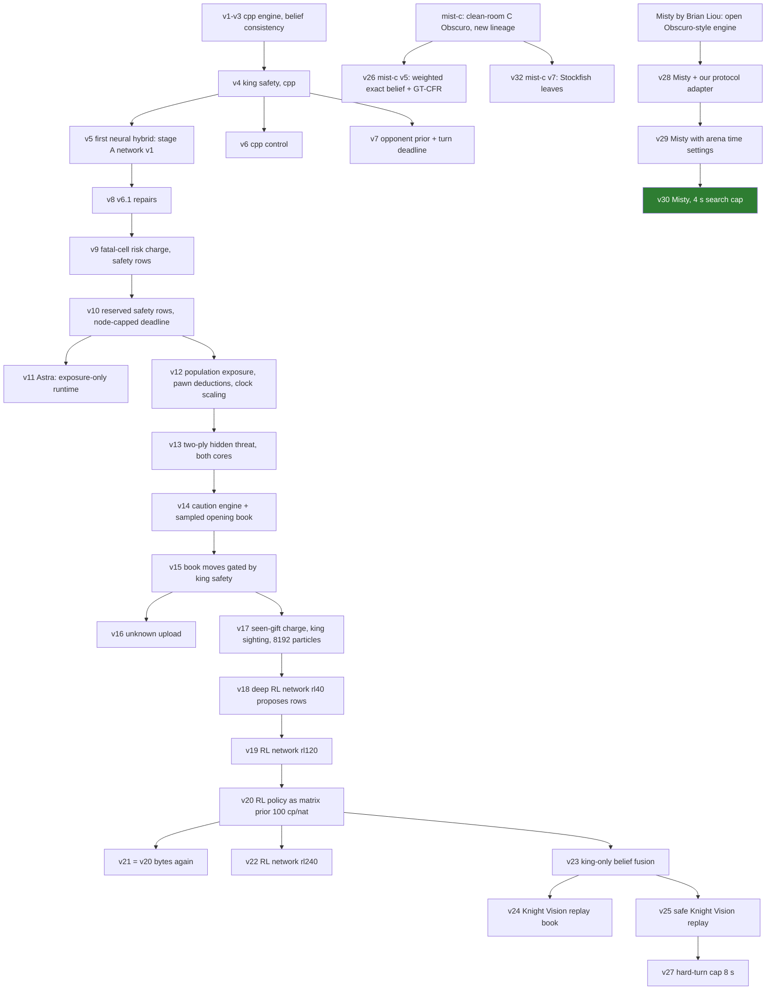

# IAmAVirus — mutation registry

> Like a virus: we mutate, we learn from what kills us, and the mutations that win survive.

Each **mutation** is one heritable change (a *gene*): an engine option, a network, a book, or an exploit. Each variant gets the same record:

- its parent and the gene that changed;
- where it lives (branch or commit, archive and its sha256 prefix);
- the local evidence and the arena record;
- its **fate**:
  - **alive**: active in the arena;
  - **dormant**: packaged, could be uploaded;
  - **shelved**: tested, no gain;
  - **extinct**: replaced.

Arena records are computed from our replays (`data/raw`), last updated 2026-10-10 00:25 UTC. Classes: **TA** = TA Baselines P/A/S, **top six** = Greek Gift, Knight Vision, Decent Chess Bot, Strongly Invisible, duck, Instructors, **rest** = everyone else (Apricot, baseline.py, Mist, ...). Scores are points per game. The upload-by-upload detail stays in [`fable-submissions/README.md`](fable-submissions/README.md); the design notes are in [`versions/`](versions/).

## Lineage

## Arena variants

| v | parent | gene that changed | archive (sha256) | games | W-D-L | score | TA | top six | rest | fate |
| --- | --- | --- | --- | --- | --- | --- | --- | --- | --- | --- |
| 2 | v1 | C++ engine | pre-session | 4 | 4-0-0 | 1.00 | 1.00/1 | — | 1.00/3 | extinct |
| 3 | v2 | belief consistency | pre-session (`351ca0b`) | 10 | 10-0-0 | 1.00 | 1.00/4 | — | 1.00/6 | extinct |
| 4 | v3 | king safety (cpp) | pre-session (`5e0ef63`) | 262 | 103-6-153 | 0.405 | 0.31/121 | 0.01/71 | 0.96/70 | extinct |
| 5 | v4 | **first neural hybrid**: stage A imitation network v1 (1.87M) | `iamavirus-v6-hybrid.zip` (`662a989aa56c`) | 36 | 26-2-8 | 0.750 | 0.67/18 | 0.00/2 | 0.94/16 | extinct |
| 6 | v4 | cpp control of v5 | `iamavirus-v6-cpp.zip` (`6b6b1f338501`) | 8 | 2-0-6 | 0.250 | 0.00/2 | 0.00/4 | 1.00/2 | extinct |
| 7 | v4 | opponent prior + turn deadline (cpp) | `iamavirus-cpp.zip` (`eb994e3d89e4`) | 12 | 2-0-10 | 0.167 | 0.17/12 | — | — | extinct |
| 8 | v5 | v6.1 repairs | `iamavirus-v6.1-hybrid.zip` (`0e4db2bf507b`) | 24 | 9-0-15 | 0.375 | 0.44/16 | 0.00/6 | 1.00/2 | extinct |
| 9 | v8 | fatal-cell risk charge, safety rows, harmless deadline | `iamavirus-v9-hybrid.zip` (`3076b45fb01d`) | 10 | 7-0-3 | 0.700 | 0.75/4 | 0.00/2 | 1.00/4 | extinct |
| 10 | v9 | safety rows reserved in the union, node-capped deadline fallback | `iamavirus-v10-hybrid.zip` (`6f57a44ec814`) | 170 | 81-3-86 | 0.485 | 0.48/74 | 0.08/52 | 0.98/44 | extinct |
| 11 | v10 | Astra: exposure-only runtime | `astra-submissions/iamavirus-v12-hybrid.zip` (`a5f806d0039f`) | 2 | 0-0-2 | 0.000 | — | 0.00/2 | — | extinct |
| 12 | v10 | population-wide exposure, pawn visibility deductions, clock scaling, underpromotion rule | `iamavirus-v12-hybrid.zip` (`68a89006f6c2`) | 16 | 7-1-8 | 0.469 | 0.38/4 | 0.00/6 | 1.00/6 | extinct |
| 13 | v12 | two-ply hidden-threat term, clock defaults, matrix cells on both cores | `iamavirus-v13-hybrid.zip` (`39fb4480e0b7`) | 154 | 68-10-76 | 0.474 | 0.42/64 | 0.08/48 | 1.00/42 | extinct |
| 14 | v13 | caution engine (two-ply king threat 0.6, repetition charge, 10 s reserve) + frequency-sampled opening book | `iamavirus-v14-hybrid.zip` (`2ae7ee3c6cce`) | 56 | 26-1-29 | 0.473 | 0.45/28 | 0.07/14 | 0.93/14 | extinct |
| 15 | v14 | booked moves gated by the king-safety filter (closes the 6-ply Qa4 trap) | `iamavirus-v15-hybrid.zip` (`381451613375`) | 574 | 241-15-318 | 0.433 | 0.45/264 | 0.04/184 | 0.98/126 | extinct |
| 16 | ? | unknown upload | — | 24 | 8-1-15 | 0.354 | 0.45/10 | 0.00/10 | 1.00/4 | extinct |
| 17 | v15 | seen-gift charge x3, king sighting 300, 8,192 particles, 16 hypotheses x 16 rows | `iamavirus-v17-hybrid.zip` (`721cc7e9727f`) | 42 | 19-2-21 | 0.476 | 0.44/18 | 0.14/14 | 1.00/10 | extinct |
| 18 | v17 | **deep RL network** (regularised PPO, 40 iterations) proposes rows *(inferred from upload timing)* | `iamavirus-v18-hybrid.zip` (`7cafb58b0cc2`) | 84 | 32-4-48 | 0.405 | 0.49/42 | 0.11/32 | 1.00/10 | extinct |
| 19 | v17 | RL network after 120 iterations | `iamavirus-v19-hybrid.zip` (`852a902a2f2e`) | 4 | 4-0-0 | 1.00 | 1.00/2 | — | 1.00/2 | extinct |
| 20 | v19 | **RL policy as the matrix-game prior**, 100 cp per nat | `iamavirus-v20-hybrid.zip` (`fb7449edded5`) | 140 | 61-10-69 | 0.471 | 0.57/60 | 0.13/56 | 1.00/24 | extinct |
| 21 | v20 | the same bytes, uploaded again | `iamavirus-v20-hybrid.zip` (`fb7449edded5`) | 222 | 85-21-116 | 0.430 | 0.60/102 | 0.08/82 | 0.74/38 | extinct |
| 22 | v20 | RL network after 240 iterations | `iamavirus-v22-hybrid.zip` (`522f1d99d0f5`) | 24 | 16-5-3 | 0.771 | 0.75/12 | 0.50/2 | 0.85/10 | extinct (dormant bytes) |
| **23** | v20 | **king-only belief fusion** (network belief reweights the enemy-king squares of the particles) | `iamavirus-v23-hybrid.zip` (`384d51dd0730`) | 27 | 11-2-14 | 0.444 | 0.70/10 | 0.23/11 | 0.42/6 | extinct (replaced by v24 at 00:25 UTC) |
| **24** | v23 | **Knight Vision replay book**: the winners' moves of KV v29's recorded losses, played while our view matches (KV v29 is a pure strategy: 1,336 of 1,336 repeated histories answered identically) | `iamavirus-v24-hybrid.zip` (`36d793297602`) | 0 | 44 | 9-2-33 | 0.227 | 0.28/9 | KV 8/8; top five 0.15/13 | Mist 0.04/12 | extinct: its Black replay line hijacked our opening against everyone (0/17 as Black without KV); the v23 control is back, the fix is arena v25 |
| **25** | v23 | **safe Knight Vision replay** (v24b): the book forces only our own main first moves (1.d4 / 1...d5); 22-ply White and 35-ply Black KV lines | `iamavirus-v25-hybrid.zip` (`491a65b4e986`) | 68 | 32-5-31 | 0.507 | 0.77/28 | KV 2/2; top five 0.18/22 | Mist 0.36/14; rest 2/2 | **alive** (best record so far, 04:30 UTC) |
| **26** | mist-c (new lineage) | **the mist version**: our clean-room C Obscuro ([mist-c](https://github.com/htansetiawan/mist-c) `b697c75`): exact belief weighted by an opponent move model, GT-CFR over 128–256 sampled worlds, legality guard, no third repetition when ahead, belief updates paid from the clock. No network, no IAmAVirus code | `iamavirus-v26-mist-c-v5.zip` (`082fb4f2b791`) | 0 | — | — | — | — | — | extinct: 4–1–15 over 20 (0/8 against the top six, every loss to a piece it could not see); replaced by v27 at 22:02 UTC. Bench: 0.60–0.75 vs v25, 0.85 vs TA-P, 0.1–0.3 vs Misty |
| **27** | v25 | **hard-turn cap**: a turn the engine marks hard may take at most 8 s (was 12); v25 burned its clock on such turns against the top five | `iamavirus-v27-hybrid.zip` (`11d1c878e994`) | 0 | — | — | — | — | — | extinct: 2–0–6 over 8 (1–0–5 at the switch back; the cap was not the cause, see the map); v25 re| **28** | Misty (not our engine) | **Brian Liou's Misty** behind our protocol adapter, uploaded at the user's request to measure an Obscuro-style engine on the arena | `iamavirus-v28-misty.zip` (`2717d78f4cfc`) | 0 | — | — | — | — | — | extinct: 11–0–6 over 17 (0.65) with 2 time forfeits (10-18 s a move on the arena); replaced by v29 at 00:51 UTC. Local: 2–2 vs v25 |
| **29** | v28 | **arena time settings**: a 3 s search cap, Misty's commit guards on 200 belief boards (was 1,000), |P| capped at 500,000, and crash recovery in our adapter | `iamavirus-v29-misty.zip` (`158c37d0a6c4`) | 0 | — | — | — | — | — | cancelled by the user before it played, for a 4 s search cap (v30). Replays of v28's lost-on-time games: the slowest move fell from 7.2 s to 3.6 s |
| **30** | v29 | **4 s search cap** (v29 had 3 s), the user's choice; the same guards (200 boards), |P| cap and crash recovery | `iamavirus-v30-misty-4s.zip` (`20a2e433ca31`) | 0 | — | — | — | — | — | extinct: 29.0/60 (0.48), +0.12 a game over v25 against the same opponents (significant), no time forfeits; replaced by v32 at 04:26 UTC |
| **32** | mist-c (v26's lineage) | **mist-c v7: Stockfish 19 scores the search's leaves** (one depth-1 MultiPV call per expanded node) on top of v6 (weighted belief, 128-256 worlds, clock-paid belief, king-trap caution) | `iamavirus-v32-mist-c-v7.zip` (`114b56e3937c`) | 0 | — | — | — | — | — | shelved: 9.0/23 on the arena, top six 2/14 (Misty 0.28); v30 reactivated 05:20 UTC. Bench: 18-2-1 vs v25, 11/20 vs Misty, 14-0-7 vs v6 |
| *(v33 candidate)* | mist-c v7 | **mist-c v9: 32 worlds with Stockfish** (was 128–256; v8) **+ king guard** (root moves more than 2 points above the least king risk on all of P are left out) | `iamavirus-v33-candidate-mist-c-v9.zip` (`9b5915ff5b73`) | not yet uploaded. Bench: v9 15-2-3 vs Misty, 11-0-9 vs v7, 10-0-10 vs v8; v8 16-0-4 vs Misty, 9-0-11 vs v7 (three 9–12-ply losses to hidden queen checks) |
activated 00:05 UTC. Bench: 0.533 vs v25 over 30, 0.50 vs Misty over 21 (v25 0.33) |

Notes on the table:

- **v22 vs v23 cannot be compared yet.** v22 met mostly TA baselines and the rest. v23's first 12 games were 8 against the top six and 2 against Mist; then it went 6–0 against the TA baselines (0.70 over 10 in all). On the shared opponents v23 is level with v22 against Instructors (2-0-2 vs 1-0-1), and ahead of v20/v21 there (0.50 vs 0.23).
- **v23 shows its gene at work.** Against the top six, its attacks on the enemy king from unseen squares run at 1.32 per 100 moves, against v20/v21's 0.50.

## Candidate mutations (local only)

Local gates are colour-swapped pairs on the course referee, 180+2, two cores per bot. Replicas are networks imitating a team. The **duck replica is not faithful**: v20 scored 0.77 against it but 0.23 against the real duck.

| mutation | gene (option) | parent | archive / branch | local evidence | fate |
| --- | --- | --- | --- | --- | --- |
| **Knight Vision replay book** | `replay.txt` + `FOW_REPLAY`, `FOW_REPLAY_RISK` (0.5) | v23 | branch `v24-replay` (`f127d8c`) | KV v29 answered 1,336 of 1,336 repeated histories identically. Book: 7,338 views from KV v29's 275 recorded losses; shortest lines 11 plies (as Black) and 22 (as White). Packaged test on the course referee against a KV v29 stand-in: **2 of 2 won** on the recorded lines | **became arena v24** |
| king fusion + deception | `FOW_BELIEF_FUSION` 1.0, mask 32, `FOW_BAIT_P` 0.3 | v20 | `iamavirus-v22-candidate-kingfusion-deception-hybrid.zip` (`3bc21e465ca6`); branch `v22-kfd` | vs real Misty 2-1-5 (v20: 1-2-5) | dormant |
| deception (hidden-cover bait) | `FOW_BAIT_P` 0.3 | v20 | branch `deception` | vs Mist replica 10-0-0; vs v20 1-5-3; vs TA-P replica 9-1-0 | shelved (only pays against Mist-like play, and the bot cannot tell who it faces) |
| queen fog charge | `FOW_FOG_QUEEN` 1.0 | v20 | `iamavirus-v22-candidate-queenfog-hybrid.zip` (`7f96c024fc7a`); branch `v22-candidate` | vs v20 11-11-8 (0.55 over 30); queen given away 48% → 39% on the fatal corpus; duck replica 15-5-4 vs v20's 16-5-3 | shelved |
| king fog floor | `FOW_FOG_KING` 1.0 | v20 | branch `v22-fog` | fatal king corpus 65% → 69% king lost: at those moves every alternative was already risky | shelved; note 030 says the fix is upstream |
| prior 200 | `FOW_POLICY_PRIOR` 200 | v20 | `iamavirus-v22-candidate-prior200-hybrid.zip` (`b68b3449e507`) | vs v20 6-17-5 (0.52 over 28); duck replica 19-4-1; TA-P replica 11-4-1 | dormant |
| 20.4M imitation network | network `releases/v6-l` + prior 100 | v20 | `iamavirus-v22-candidate-l-imitation-prior100-hybrid.zip` (`1861f802e72c`, 75 MB, not committed) | vs v20 4-2-2; duck replica 5-2-1; TA-P replica 6-1-2 | dormant |
| RL on the 20.4M network | network rl-L | v20 | `iamavirus-rlL-hybrid.zip` | vs v20 2-3-1; TA-P replica 4-0-0; duck replica 4-0-0; Mist replica 1-3-0 | gating |
| RL-L + king fusion + deception | rl-L + `v22-kfd` options | v22kfd | `data/candidates/iamavirus-v23-candidate-rlL-kfd-hybrid.zip` (`be9c84f64cdb`, 75 MB) | vs v22kfd 2-0-2 | gating |
| pawn storm | `FOW_STORM` | v20 | branch `storm` | vs Mist replica 3-0-3 | shelved |
| RL 240 iterations | network rl-v20-it240 | v20 | became arena v22 | **locally 1-4-5 vs v20, then 16-5-3 in the arena** | the warning: local gates against our own bytes mislead |
| RL control | network v4 (imitation) on the v17 engine | v17 | `iamavirus-v18-control-v4-hybrid.zip` (`4596f62d7aaf`) | the control for v18 | extinct |

## Gene catalogue

All genes are environment overrides of `EngineOptions` (`engine.cc`, `Override(...)`), so one archive can express many variants. The value given is the default in the named version.

| gene | what it does | first expressed | default in v23 |
| --- | --- | --- | --- |
| `FOW_MODE` | `cpp`, `neural` or `hybrid` (network rows + matrix game) | v5 | hybrid |
| `FOW_POLICY_PRIOR` | network policy as a prior on matrix rows, cp per nat | v20 | 100 |
| `FOW_BELIEF_FUSION`, `FOW_BELIEF_FUSION_MASK` | reweight particles by the network's belief head; the mask picks piece classes (32 = enemy king) | v23 | 1.0, 32 |
| `FOW_BAIT_P` | deception: hidden-cover bait, blended in win-probability space | branch `deception` | 0 |
| `FOW_FOG_KING`, `FOW_FOG_QUEEN` | floor and charge from the arena loss rates for king and queen moves into open fog lines | branch `v22-fog` | absent |
| `FOW_STORM` | pawn-storm bonus toward the enemy king | branch `storm` | absent |
| `FOW_BOOK`, `FOW_BOOK_PLIES` | the frequency-sampled opening book of the six strongest teams, gated by king safety | v14 / v15 | `book.txt`, 10 |
| `FOW_REPLAY`, `FOW_REPLAY_RISK` | the replay book against deterministic opponents | v24 candidate | (v24) `replay.txt`, 0.5 |
| network | stage A v1 (1.87M imitation) → RL rl40 / rl120 / rl240 (regularised PPO + magnet to imitation, true-board critic, league) → v6-L (20.4M imitation) → rl-L | v5 → v18 → v20 → candidates | rl-v18-it120 |

## What selection has taught us

1. **RL pays only through the prior.** Given its own rows, the RL network changed nothing (v18, v19). As a prior on the matrix game, it lifted TA play from 0.45 to 0.60 (v15 → v20/21).
2. **Local gates against our own bytes mislead.** The rl240 network lost 1-4-5 to v20 locally, then went 16-5-3 in the arena. Gates against faithful replicas (TA-P) predict better; gates against unfaithful ones (duck) do not.
3. **Offence genes work; defence is the open wound.** King fusion more than doubled hidden attacks on the enemy king. But every one of v23's 8 losses was our own king taken by a piece we could not see, 7 of them on our own king move (note 030).
4. **Pure strategies are exploitable.** Knight Vision v29 answers every history identically, so a recorded loss replays as a forced win. Every other top team randomises. That is the course's lesson on mixed strategies, turned into a weapon. **Confirmed in the arena:** v24's first two games against KV v29 were won move for move on the recorded lines (`12j9j4qe`, 11 plies; `da7pinqq`, 22 plies).

5. **A view-keyed book is played against everyone until the view separates opponents.** v24's Knight Vision line as Black (1...e6 2...c5) fired in every game, because Black sees none of White's quiet first moves: 0 of 17 as Black against everyone else. The fix (v24b, arena v25) only forces moves our own book plays anyway.

Maintenance: add a row when a variant is built or uploaded, and update the arena columns from `data/raw` (the numbers above came from the listings). Every archive name and sha also lives in `fable-submissions/README.md`.
