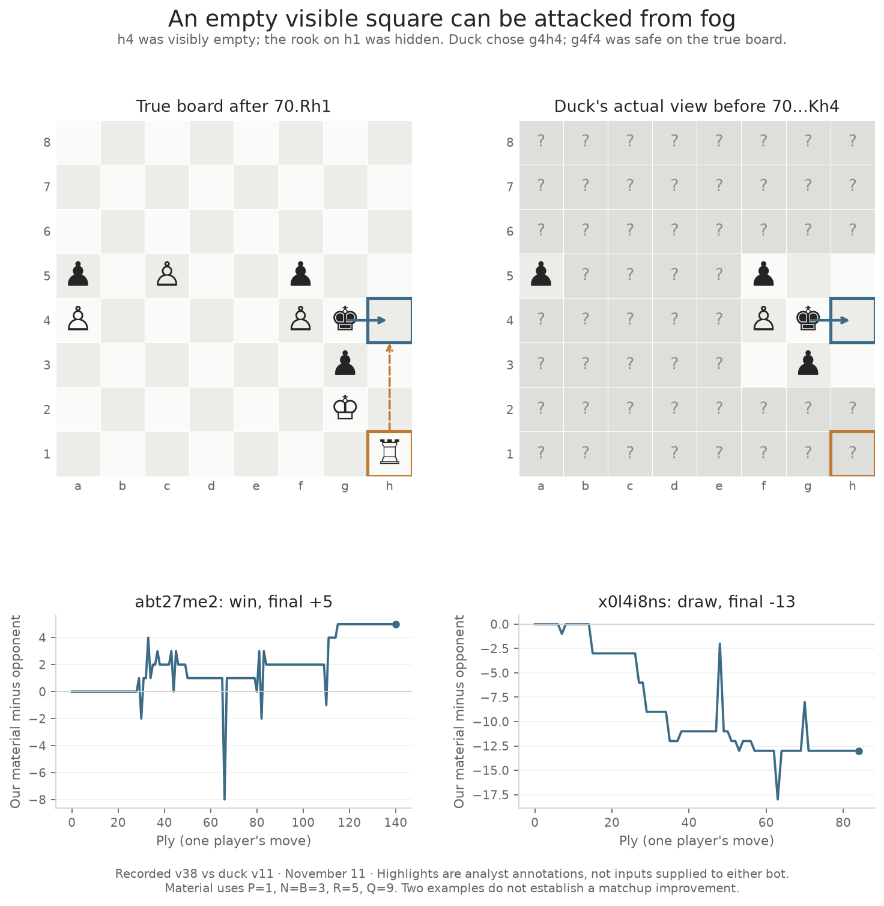

# v38 checkpoint: 1959 Elo, rank 8

Public snapshot: **November 11, 2026, 12:45 p.m. Boston time**
(17:45 UTC). Active arena version remains 38. The API reports **412 wins,
29 draws and 299 losses in 740 games**, a **57.6% score** including draws.
The morning snapshot was 1935.70 Elo, rank 9; this one is 1959.19, rank 8.
These are dated observations of the same submitted version.

## The new games and opponent mix

Since the 5:05 a.m. Boston snapshot, 68 games completed: **43W–1D–24L**,
64.0% score. The page reaches earlier than the cutoff, and its counts reconcile
exactly with both leaderboard records and the API's v38 search summary.

One win, [rdbx11vy](https://www.mit.edu/~6.7980/fow/?tab=arena&game=rdbx11vy),
came from Magnus Monte Carlsen's Black process exiting. Public diagnostics
identify Black as the failing side. Excluding that win leaves **42W–1D–24L
in 67 board results**, 63.4% score. All 24 new losses ended with our king
capturable; no new technical loss by our bot was recorded in this window.

For 64 new games, the older data contains the exact opponent ID, played
version and our color. We weight those older stratum means by the new game
counts: the historical reference is **48.7%**, versus **63.3%** in the new
matched games. Four games lack a matching historical cell: two against
In Pawn Sight v14 and two against Magnus Monte Carlsen v2.

This describes a strong stretch in an unchanged version. Historical cells
can be small; there is no significance test, randomized comparison or causal
Elo estimate here. It neither proves a lasting gain nor revises the earlier
v38 local/arena gates. The 672-game historical reference deduplicates the 31
known journal duplicates before counting.

| Opponent and played version | New W–D–L | All v38 W–D–L through this checkpoint | Cumulative score |
| --- | --- | --- | --- |
| duck v11 | 1–1–0 | 6–6–20 | 28.1% |
| Instructors v4 | 1–0–1 | 17–1–16 | 51.5% |
| TA Baseline S v3 | 1–0–1 | 15–0–5 | 75.0% |
| TA Baseline A v5 | no new games | 6–0–0 | 100%, six games |
| TA Baseline P v5 | no new games | 14–0–0 | 100%, fourteen games |
| HYPOTHERMIA v10 | 6–0–0 | 13–0–5 | 72.2% |
| HYPOTHERMIA v4 | no new games | 15–0–11 | 57.7% |
| Farsight v29 | 0–0–4 | 1–0–7 | 12.5%, eight games |
| Decent Chess Bot v7 | 1–0–5 | 8–3–21 | 29.7% |

The latest leaderboard lists HYPOTHERMIA v4 as active, while the six new
completed matches used v10. Played versions and current versions are separate
fields. No Greek Gift game appears in these 68 results. The cumulative duck,
Farsight and Decent Chess Bot records remain concerns despite the Elo rise.

## Two duck games: positive controls for the presentation

Both duck games in the new window are included. The existing pinned native
validator accepts their 226 recorded positions; this is a replay/rules check,
with no replay of either engine's internal decision process.



In [abt27me2](https://www.mit.edu/~6.7980/fow/?tab=arena&game=abt27me2),
we win as White at ply 140. After **70.Rh1**, duck sees h4 as empty, but h1
is hidden in its delivered view. Its king is safe on g4 before moving.
**70...Kh4** places it on the rook's file. On the true board, **Kxf4** is
the sole immediate king-safe reply; Rh1–h4 would capture the king afterward.
This is a concrete concealed-file attack. The replay does not tell us why
duck chose Kh4, what its belief contained, or whether our engine intended a
trap. Highlights in the figure are analyst annotations.

In [x0l4i8ns](https://www.mit.edu/~6.7980/fow/?tab=arena&game=x0l4i8ns),
we draw as Black at ply 84 while thirteen material points behind. The final
position repeats at plies **76, 80 and 84**, including the native repetition
state. This demonstrates a saved draw from a material deficit, not that the
position was game-theoretically lost or that the engine deliberately chose
an optimal repetition policy.

Material uses P=1, N=B=3, R=5, Q=9. Brief dips can be unfinished exchanges;
neither an instantaneous deficit nor these two outcomes is a reliable
automatic action-quality label. Existing negative guard/prior experiments
remain closed. The transferable examples are concealed line attacks and
repetition resources, not a player-name rule or a new measured strategy.

## Sources and operational checks

Five paced public GET requests captured the leaderboard, our completed-game
page, the technical result's diagnostics and the two duck replays. Completed
replay bytes are cached under
`data/astra-spool/arena-checkpoint-20261111T1743Z/`. Source checksums and
request receipts are retained in [result.json](result.json) and
[receipts.json](receipts.json); [case details](duck-positive-controls.json)
record the exact terminal move, visibility and true-safe alternatives.

The archive initially appeared read-only **inside the sandbox**. A check
outside it confirms the host exFAT mount is writable, and the latest daily
service finished successfully. No host storage failure is established and
no mount, repair or service change was made. The reference journal was read
through its existing shared lock, without modifying canonical data.

Figure source: [plot_duck_checkpoint.py](../../tools/plot_duck_checkpoint.py).
It ran with the existing user Python/Matplotlib installation:

```sh
MPLCONFIGDIR=/tmp/iamavirus-plot-cache python astra-submissions/tools/plot_duck_checkpoint.py \
  --spool data/astra-spool/arena-checkpoint-20261111T1743Z \
  --out NEW_FIGURE_DIRECTORY
```

The [SVG](assets/duck-positive-controls.svg) is also available. Source review
does not publish the website. This checkpoint made no model, arena package,
release-number, training or GPU change.
