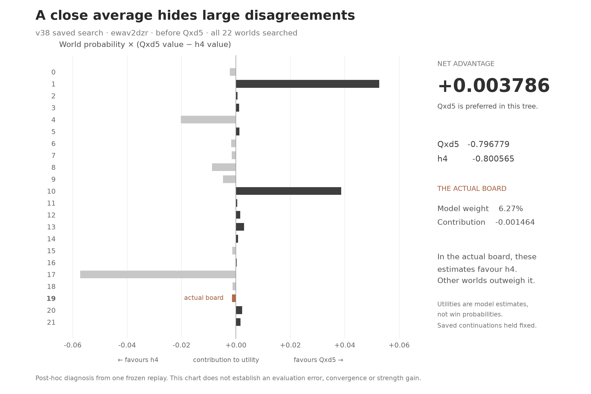

# Why regret minimization can still choose a losing move

*Presentation example from the saved 417 reconstruction, not a new engine run
or a strength experiment. The arena's historical RNG and timing are unknown.*

**The solver preferred Qxd5 under its model, even though it saw the losing
reply in the actual board.** This example separates three questions: whether
the guard computes its intended risk correctly; whether search optimizes the
game it constructed; and whether that game accurately predicts future play.

[Exportable SVG](decision-tradeoff.svg) · [numerical data](result.json).

## One move must work across possible boards

Before White's move in `ewav2dzr`, v38 retains 22 consistent worlds and searches
all 22. This is the small-belief path: the configured 32 draws do not discard
any world. The true board is present with 6.27% sharpened weight. In it,
...Qxd5 is expanded and has opponent probability 1. Missing that attacker is
not the explanation in this reconstruction.

Let `p_i` be a world's normalized weight and `q_i(a)` its continuation value
for action `a`, under the **same saved continuation strategies**. The bot
compares `Q(a) = sum_i p_i q_i(a)`. These are values extracted from one coupled
imperfect-information search, not independently optimized policies for every
board. The player cannot select a different root action for a world it cannot
identify.

| Root action | Saved aggregate utility | Final root probability |
|---|---:|---:|
| Qxd5 | −0.796779 | 1 |
| h4, highest-valued alternative | −0.800565 | 0 |

The difference is **+0.003786** in favour of Qxd5. Twelve worlds favour it and
ten favour h4, but counting worlds is insufficient: their weights and value
differences matter. The actual world's difference favours h4 by 0.023374;
after multiplying by its weight, its contribution is −0.001464. Other worlds
outweigh that. The chart shows the large opposing contributions behind the
small net lead.

Qxd5 also creates a king threat: the queen attacks Black's king in 20 worlds
(91.59% weight), and is hidden in Black's current view in six of them
(21.23% weight). In the actual world it is visible. The
[geometry check](threat-geometry.json) agrees with an independent queen-line
scan and the already exported native reply destinations. A hidden attacker
can still be inferred from history; current visibility does not establish
opponent ignorance, a response probability or a causal offensive benefit.

## What “regret” does and does not establish here

At this root, the instantaneous advantage of action `a` is
`Q(a) − sum_b x(b) Q(b)`, where `x` is the current move mixture. For the final
pure Qxd5 policy this is 0 for Qxd5 and −0.003786 for h4. The reconstructed
**root-only deviation gap is zero**: changing just this decision, while keeping
all continuation strategies fixed, offers no higher estimated value.

That is not the accumulated clipped regret stored by PCFR+, a best response
that changes later decisions, a whole-tree Nash gap, or a convergence proof.
The saved root/reply export does not contain the complete graph needed for
those broader claims. Existing 054/213 already establish these distinctions;
their settling and mixing results remain unchanged.

The [Obscuro paper, §3.2 and Appendix C.5](https://arxiv.org/html/2506.01242v2)
combines PCFR+ with an expanding tree and Stockfish-based frontier estimates.
It distinguishes the average-strategy convergence guarantee from its empirical
use of the last iterate. That framework does not certify the accuracy of our
particular finite tree. Our values are model utilities, **not calibrated win
probabilities or Elo**.

## A small lead with substantial unresolved continuation

Conditioned on taking Qxd5, none of the first two plies' chance × saved
continuation-strategy mass ends at an exported frontier. Conditioned on h4,
**20.75%** does; one world's entire opponent-response node is still a leaf.
This excludes the current root-action probability, which is zero for h4.
It measures only the first two plies, without making Qxd5 fully solved,
proving h4 is undervalued, or establishing that equal expansion improves play.

Two mathematical checks show how little certainty the ranking alone provides:

- With saved values fixed, transferring **0.10897 percentage points** of
  probability from world 10 to world 17 makes the actions tie. This is the
  minimum total-variation perturbation on the existing support. The bound
  follows from `change <= TV × (max d_i − min d_i)`, where
  `d_i = q_i(Qxd5) − q_i(h4)`; the feasible two-world transfer attains it.
- Opposed errors of **0.001893** in the two aggregate value estimates would
  also erase the lead. This is an arithmetic threshold, not a measured error
  bar or evidence that such errors occurred.

An independent linear program reproduces the minimum perturbation. The
one-world sound-trade control cannot change ranking through reweighting its
existing support, as expected. No weights, leaf values or policies were changed
in an engine. Re-solving after an actual change could alter all continuations.

## What this changes in our assessment

417 repairs the guard's definition of recapture protection; 418 finds limited
true-history reach. The guard can exclude Qxd5 even when it has the highest
estimated utility. Whether that risk preference improves complete play remains
unproven. This case is not evidence that randomization, another temperature,
more particles, or a new value head will fix the bot.

For future learning proposals, require action-quality evidence alongside belief
quality, and distinguish approximate continuation values from exact tactical
labels. The earlier learned-value/student failures (237/238/249), prior-playing
failure (357), and mixing pilot (203) stay closed. This presentation diagnosis
does not launch a successor experiment.

The [producer](../../experiments/decision-tradeoff-20261111/analyze.py) checks
all 29/30 root values in the loss/control and restores native float32 weights.
The [independent NumPy/LP review](numeric-review.json) uses the same immutable
exports. Its first run failed because the one-world weight `[1]` became an
integer array; the original source/error are retained, then an explicit float
dtype corrected the check. No actor was rerun. The chart's initially clipped
label was corrected and the final PNG visually inspected; SVG XML parses.

[Reviewer](../../experiments/decision-tradeoff-20261111/review.py) ·
[geometry source](../../experiments/decision-tradeoff-20261111/geometry.py) ·
[plot source](../../experiments/decision-tradeoff-20261111/plot.py) ·
[figure receipt](figure.json) · [scope/source review](method-review.json).
No model fit, GPU, game, ZIP/version, production source/default/service or
website deployment occurred.
