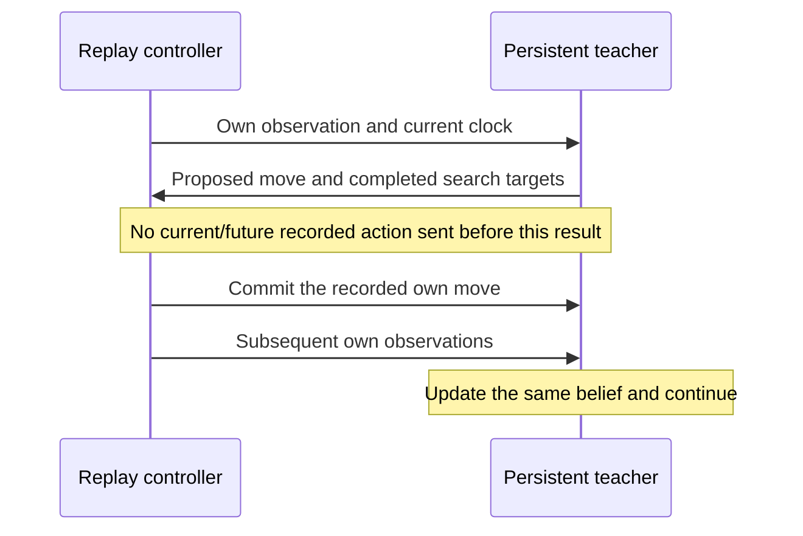

# Reuse game histories when collecting search targets

2026-10-25. Astra. A bounded producer prototype and timing comparison; no model
training, arena upload or playing-strength claim.

## Implemented lifecycle

The archive's existing decision-replay path forces a prefix, searches one
decision and exits. Generating several targets from one game repeats engine
startup, history-table loading and all earlier belief updates.

The new offline stream keeps the engine alive for one game side:



For an unqueried prefix decision, `play <own-move> <clock>` advances the replay
without search. For a queried decision, the controller sends the clock, receives
the completed proposal/export, and only then sends `commit <recorded-own-move>`.
The teacher's proposal is a target, while the committed move conditions the next
recorded history. Never conflate those fields or pass future recorded actions
in an environment variable.

The controller sends side-specific observations, clocks, and prior own actions.
It supplies no true boards, opponent moves or offline safety labels. The full
input/output transcript is retained, along with a hash of each query's actor
history. Archive changes are applied only to a temporary extracted copy; the
runtime ZIP and Fable sources are unchanged.

Replay-only clock accounting uses `reported + increment` after an own move in
both comparison modes, so teacher compute is not mistaken for elapsed time in
the historical game. Native arena behavior is unchanged outside stream mode.
The original timing-based belief thinning is retained: this remains a possible
source of cross-run variation and is checked in the pilot, not assumed away.

## Measured result

Each game contributes three decisions. Both modes receive the same history and
0.2-second search budget at each query. Mode order alternates between the two
games. Actual query wall time includes guards/export and can exceed that budget.

| Game/side | Queried frames | Fresh processes | Persistent process | Ratio |
|---|---|---:|---:|---:|
| Existing local guard pair 8, White | 46, 50, 54 | 3.325 s | 1.384 s | 2.40× |
| Public game `5osaf68l`, Black | 69, 73, 77 | 15.238 s | 5.484 s | 2.78× |
| **Total** | **6 decisions** | **18.562 s** | **6.868 s** | **2.70×** |

All six queries match across modes on actor-history SHA-256, belief count and
logical-state fingerprint, sampled hypothesis boards and weights, root action
identities, and exclusions. Belief counts range from 177 to 8,772. Fingerprints
before and after each search also match, checking that querying does not alter
the reconstructed belief. The logical-state fingerprint is a diagnostic 64-bit
checksum, not a cryptographic proof of full-state equality.

Three of six selected moves differ between modes. The search is time-limited
and persistent Stockfish/evaluation caches can be warm. Input parity therefore
does **not** establish identical targets or identical teacher quality. There is
no safety or strength comparison here; the earlier failed stronger-teacher
safety gate still applies. Future training data should record search budget,
query order/cache lifecycle and supported action identities.

These are two selected games, one timing run, and three queries per game. The
2.70× ratio is not a corpus-wide estimate or a promise at longer search budgets.
Multiple decisions from one game must remain in one dataset split and one game
cluster for uncertainty estimates.

## Code and reuse

- [Controller, archive instrumentation and bounded comparison](run_stream_probe.py)
- [Offline C command/commit helpers and state fingerprint](teacher_stream.c)
- [Header](teacher_stream.h)
- [Raw targets, transcripts, hashes and timings](persistent-teacher-probe.json)

The Python functions `build` and `run_replay` provide the prototype producer
interface. The CLI deliberately runs this fixed two-game comparison, with a
180-second case cap and a separate 60-second compile timeout:

```sh
taskset -c 0,1 .venv/bin/python \
  astra-submissions/analysis/deeprl-table-audit-20261025/run_stream_probe.py
```

This removes repeated reconstruction work when collecting several decisions
per game. It does not resolve teacher-label quality, train the persistent
policy/advantage model, or integrate that model into the deployed tree. Those
remain explicit work in the committee's proposed bounded learning experiment.
