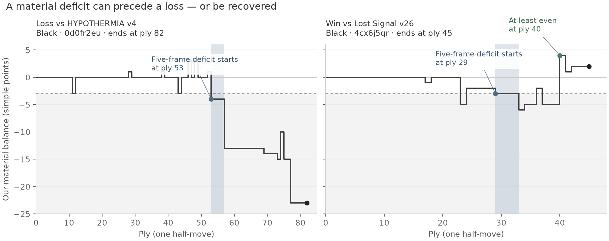

# When the material deficit starts — including wins and draws

Retrospective curation of **all 345 v38 games** in the reviewed field window,
not a new bot experiment. The 184 wins, 17 draws and 144 losses contain
30,945 frames and 343 distinct complete trajectories. These are exposed,
overlapping data, with two extra game IDs sharing full sequences; no untouched test set
or strength-change claim is made. Everything remains local.

## A material dip is not automatically a mistake

The earlier 337 definition is unchanged: the first frame at which our true
material balance is at most −3 for **five consecutive recorded frames**.
Simple piece values are pawn 1, knight/bishop 3, rook 5, queen 9, king 0.
Five frames are five positions, not five of our turns. This is a diagnostic
horizon, not a proven tactical or strategic boundary.

| Outcome | Games | Ever at least 3 down | Meets five-frame definition | Later even or better, among those | Five-frame recovery above −3 |
| --- | ---: | ---: | ---: | ---: | ---: |
| Win | 184 | 134 | 18 | 15 | 12 |
| Draw | 17 | 16 | 3 | 0 | 0 |
| Loss | 144 | 137 | 121 | 26 | 10 |

Ordinary exchanges can briefly put us behind before recapture. A raw
three-point crossing appears even in **134 wins**. The five-frame criterion
is more selective, but the 18 wins show it is still not an automatic error
label. Three of those wins never return to nonnegative material afterward:
the terminal objective is king capture, not material balance.

The loss onsets occur at median **ply 51**, with a median **29 further plies
before the game ends**. Twelve begin by ply 20. This gives a more useful
failure timeline than examining only the last king move. It does not prove
that the first threshold crossing was the first bad move or caused the loss.

The observation horizon also misses some deficits. Sixteen losses cross
−3 without meeting the five-frame rule; seven of those end with a deficit
tail shorter than five frames. Thus “no onset” does not mean safe play or
no material problem. A temporary return to even is also different from a
five-frame recovery, explaining why those columns differ.

## The common capture patterns

Of 121 loss onsets, **116 follow captures** and five follow quiet promotions.
In **111** capture cases the opponent's source square was hidden in our
observation before the preceding own choice. That is decision-time visibility,
not the view after we moved and not a measurement of the bot's beliefs.

| Hidden capturer | Loss onsets |
| --- | ---: |
| Rook | 50 |
| Knight | 15 |
| Bishop | 14 |
| Queen | 13 |
| Pawn | 13 |
| King | 6 |
| Total | 111 |

The victims are 39 rooks, 29 knights, 20 queens, 12 bishops and 11 pawns.
In **83/111**, the victim occupies our preceding UCI move's destination.
That definition omits a castling rook's secondary movement. In **53** cases,
the hidden origin, a slider, its source in the opponent's home half and the
previous-destination victim all coincide. Source half and move distance are
separate facets: these 53 are not automatically long-range captures.

These are composable piece/move/visibility patterns. Player names are report
metadata, not pattern definitions. They do not prove the opponent set a
deliberate trap, that we forgot a previously seen piece, or that a safe
alternative was available.

| Opponent/version | Our losses | Five-frame onsets | Hidden-capture onsets |
| --- | ---: | ---: | ---: |
| duck v11 | 12 | 9 | 9 |
| Greek Gift v25 | 11 | 10 | 9 |
| Instructors v4 | 7 | 6 | 6 |
| HYPOTHERMIA v4 | 6 | 6 | 6 |
| HYPOTHERMIA v10 | 3 | 3 | 2 |

These small matchup cells are not causal comparisons. Twelve game IDs
overlap the earlier [337 Duck study](../../../chatroom/337-astra-duck-v11-material-loss-onset.md);
their onset, material and visibility fields agree exactly. This is an
extension of that diagnostic, not independent confirmation on fresh data.

## Two selected teaching histories

The blue band marks the first five-frame deficit; gray marks material at or
below −3. Both panels use the same scale. These are selected illustrations,
not paired experimental games. The right marker denotes the first return
to **at least** even material; in this history the balance jumps to +4.

In [0d0fr2eu](https://www.mit.edu/~6.7980/fow/?tab=arena&game=0d0fr2eu),
our Black rook captures from e8 to e5. HYPOTHERMIA v4's previously hidden
rook on d5 replies Rxe5 at ply 53: our balance changes from +1 to −4.
The game ends at ply 82, 29 plies later. This is not proof that Rxe5 was
foreseeable under our actual belief or that another move would win.

In [4cx6j5qr](https://www.mit.edu/~6.7980/fow/?tab=arena&game=4cx6j5qr),
we play Black against Lost Signal v26. The first five-frame deficit begins
at ply 29. We reach nonnegative material at ply 40 and win at ply 45.
The threshold crossing alone therefore cannot be labelled a losing choice.

The loss minimizes distance to the two reported loss medians; the win is
the shortest qualifying history that later reaches even or better. Game-ID
ties are lexical. The [selection receipt](figure-selection.json) records
these rules and both source hashes. A [vector figure](assets/material-timelines.svg)
is available for presentation export. Its wording-only first draft is retained
privately; cases, trajectories and axes did not change.

## What this contributes to learning

This local case index contains **142 onset events** and **203 games without
an onset**. It gives us recorded choices, private observations and later
piece/visibility/material outcomes. It does not identify counterfactual
safe moves, prove bad actions, measure posterior calibration or directly
update any deployed coefficient, empirical history count or guard threshold.

The v2 event view explicitly separates:

- The recorded observation before the choice.
- The recorded candidate action. It may condition an action-value/risk model,
  or be an imitation target; it is not known state for a policy choosing it.
- Hindsight labels, including the opponent reply, hidden source, future
  material, later tags and outcome.
- Player/version metadata used only for reporting here.

The original scan's hidden-origin facet was named for a capturer even on
three quiet-promotion records. The normalized v2 view uses **source hidden**
for both captures and promotions and preserves the original scan and metrics.
The 203 non-onset games are game-level controls, not matched negative
decisions. Neither this export nor its oracle facets have been added to the
older actor-only retriever or a training loader.

A rook-loss count is not a reason to revive the failed material guards.
Future action-quality claims need the decision's available information and
the alternatives, with complete-game evidence. This review does not select
a new model, guard, threshold or candidate.

## Verification

The original scan completed once in **1.26 seconds**, within its 60-second
bound. Streaming onsets match the old five-frame expression on every game;
capture/promotion material changes match the raw transitions. The independent
review rederives all trajectories from symbol counts, checks every replay and
sequence hash, verifies all event observations/actions/source visibility,
and reconciles outcome counts, recoveries and medians.

[Frozen plan](plan.json) · [Result](result.json) · [Independent review](review.json)
· [Scan source](../../tools/field_material_onsets.py)
· [Review/schema source](../../tools/review_field_material_onsets.py).

Rich rows and the normalized event view remain under
`data/astra-spool/field-material-onsets-20261111/`. No bot replay/search,
safe-reply enumeration, new game, model fitting, GPU job, train/test split,
shared-report replacement, ZIP, commit, push or deployment occurred.
