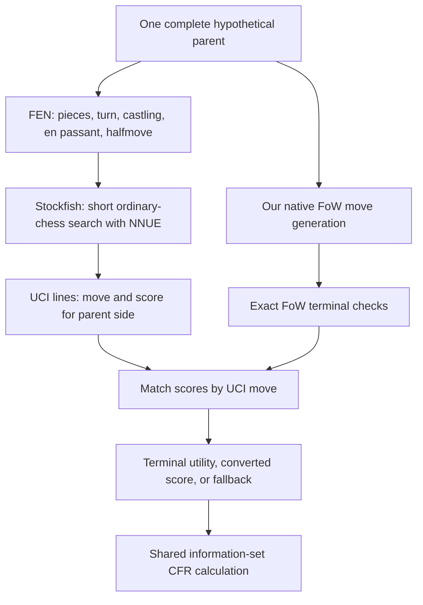

# From an imagined board to a CFR utility

Source review of the immutable v38 ZIP, November 11 UTC. This inspects
20 bundled source/notice files and 41 source conditions. It does not run a
neural model, bot match, benchmark or training job. Everything stays local.

## Two different learned components

| Component | What it predicts | What it receives | Where its learning happened |
| --- | --- | --- | --- |
| Our full/cheap 28-feature move model | Relative likelihood of an opponent move | One hypothetical complete parent and candidate move | Our offline conditional-logit fit on arena replays |
| Borrowed Stockfish NNUE | Ordinary-chess position evaluation used inside search | Structured features from one complete hypothetical board | Upstream pretrained network; we do not fine-tune it in v38 |

The empirical history table supplies another frozen action-frequency prior.
Neither component consumes daily taxonomy percentages. No deployed neural
FoW policy/value learner updates from our arena rewards during play.

## The life of a scoring request



1. We submit a **parent position**, not one request for each child. Its FEN
   contains both sides' imagined pieces. There is no `?`, private-view mask,
   observation history or belief distribution in that request.
2. Two Stockfish worker processes each use one thread and a 16 MiB hash
   setting. The controller requests `MultiPV=256` and `go depth 1`.
3. Stockfish returns scores with a PV's first move. Our controller matches
   those moves against the native FoW move list. Its `bestmove` line marks
   completion; it does not tell the arena which move our bot must play.
4. Native FoW terminal handling overrides a heuristic: own-king exposure
   is a loss, and an immediately fatal own root move has the configured
   extra loss penalty. A nonterminal child begins as an evaluated frontier
   node and can be expanded later. A true terminal cannot.
5. The resulting values enter the local game tree. CFR combines them across
   represented worlds and shared decisions. Final root selection belongs
   to our engine, not to the Stockfish worker.

“Depth 1” describes each Stockfish request. Stockfish can perform tactical
continuation work, and our outer FoW tree can also grow beyond one ply.
The number of requests is not fixed at 32: it depends on tree expansion.

V38's launcher enables the modified full-window root pass. That mode applies
only with depth 1, one thread, full legal-root MultiPV coverage, no active
strength limitation and no root tablebase result. It is an approximation;
the scores need not equal unmodified MultiPV. The upstream deeper machinery
is retained. This is the measured scorer contribution, not a new FoW network.

## Score direction and missing scores

UCI scores describe the **parent side to move**. We convert them to our
agent's utility, keeping that sign convention even though a child has the
opposite side to move:

```text
v = tanh(UCI_centipawns / 400)
utility_for_us = v if parent mover is us, otherwise −v
```

| Parent side | Our side | UCI score | Our utility |
| --- | --- | ---: | ---: |
| White | White | +100 | +0.245 |
| White | Black | +100 | −0.245 |
| Black | Black | +400 | +0.762 |
| Black | White | +400 | −0.762 |

Stockfish's internal NNUE scalar is not the UCI centipawn number: its
evaluation and UCI layers apply additional scaling. Our bounded utility is
also not a calibrated FoW win probability. The controller additionally maps
UCI mate scores to large signed centipawn surrogates before this conversion;
exact FoW terminal handling remains separate.

**Correction to the earlier implementation summary:** missing scores do
not always receive the worst scored sibling's value. The exact branch is:

| Source condition | Nonterminal child value |
| --- | --- |
| Returned matching score exists | Convert that score to our utility |
| No matching score, but matched-score count is at least requested MultiPV | Convert the worst returned matching sibling score |
| Otherwise | Our handwritten `evaluate(child, us)` |

For example, with default requested MultiPV 256, **35 matched scored moves do not
activate the floor**. An unscored child then takes the native fallback.
The request count is not automatically reduced to the parent's available
move count in this C-side condition. No fallback frequency was measured.

The fallback uses material, placement, shelter and a best-capture term;
its optional fog-line/knight coefficients default to zero in this ZIP.
The shipped `build_children_scored` path does not add an extra learned
hazard correction after Stockfish. Experimental code in a moving checkout
must not be described as part of this immutable release.

Stockfish also has ordinary-chess input constraints. The adapter refuses
positions with missing/multiple kings, back-rank pawns, or a side to move
already attacking the other king, and then uses the native fallback path.
Our move generation and terminal rules remain responsible for FoW legality.

## What neural representation actually runs

The bundled source declares default network `nn-1a298aa575a0.nnue`.
The release notice identifies it as the unmodified embedded upstream NNUE.
Its declared network hash is retained in the audit JSON; this source review
does not independently export and hash the embedded weights.

The network uses structured sparse features, not a raw board image:

| Feature family | Possible feature indices |
| --- | ---: |
| King-relative piece-square features, `HalfKAv2_hm` | 22,528 |
| Attack/threat relationships, `FullThreats` | 59,808 |
| Pawn-pair relationships, `PP_3Wide` | 4,560 |
| Total index space | 86,896 |

This is an index-space count, not 86,896 simultaneously active features or
the number of parameters. Feature accumulators have width 1,024 per side.
The transform contributes 512 values from each perspective, producing a
1,024-element input to the small affine network.

There are eight small heads sharing that transformer, selected by piece
count. Each uses a 1,024→32 affine layer, concatenated clipped/squared
activations giving 64 inputs to a 64→32 layer, and a combined 128→1 final
layer. A skip from the first layer and a separate learned PSQT contribution
also affect the scalar. Calling it simply “1024→32→32→1” hides those paths.

The arithmetic already uses mixed integer precision:

| Part | Stored type in bundled source |
| --- | --- |
| Piece-square transformer weights/biases | Signed 16-bit |
| Threat and pawn-pair transformer weights | Signed 8-bit |
| Transformed activations | Unsigned 8-bit |
| Affine weights | Signed 8-bit |
| Affine outputs/biases and PSQT weights | Signed 32-bit |

Thus “we could use quantized inference” needs context: Stockfish already
does so. That is different from quantizing one of our own trained FoW models.
This is not a VQ-VAE, autoencoder or learned codebook of strategies.

NNUE updates changed feature contributions efficiently inside Stockfish's
own search rather than rebuilding a dense representation for every move.
Its model and worker caches are not our retained FoW belief or CFR regrets.
The workers persist between requests; the C adapter sends no `ucinewgame`
reset per query. Discarding the outer FoW tree therefore does not mean every
internal Stockfish cache is also discarded, nor does retaining those caches
provide a carried FoW reference strategy.

## What this establishes—and what it leaves open

The audit establishes the shipped source path, defaults, type declarations
and score semantics. It does not measure fallback incidence, actual NNUE
latency, memory use, quality on hidden-information decisions or a cause of
any particular arena loss. Nothing here qualifies a successor release.

[Source audit](../../tools/audit_v38_frontier.py) · [Hashes and line evidence](result.json)
· [Main architecture review](../../../docs/presentation-20261203.md)
· [Worked CFR example](../presentation-pcfr-20261111/README.md).
