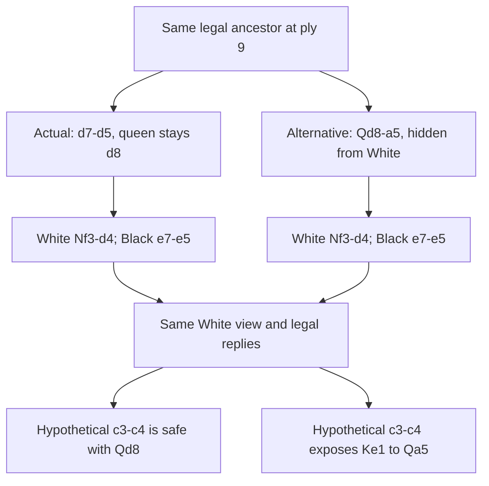

# Private-history alternatives: 224 legal reply-safety witnesses

The final oracle feasibility screen passes its limited design gate: **224
independently verified witnesses across all eight development games**, against
a minimum of 12 individually escapable witnesses in four games. This earns
implementation of a producer using the bot's private inputs. It does not earn
a search candidate, another match batch or an arena release.

The miner used the true completed-game ancestor and the recorded hidden
opponent reply. These are explicit **offline oracle inputs**, unavailable to
the live bot. A witness changes our previous private action while preserving
both intervening opponent observations and its same own reply. Its current
children then give the opponent the same view and legal reply row, but
different royal-safe reply vectors. Counterfactual reach weights are null.

| Measure | Result |
|---|---:|
| Reused development contexts / games | 32 / 8 |
| Legal past-own-action alternatives | 267 |
| Raw current children / canonical consequence signatures | 8,953 / 3,599 |
| Indexed comparisons / nominal raw Cartesian pairs | 2,748 / 251,829 |
| Verified witnesses / individually escapable witnesses | 224 / 224 |
| Different current UCI actions | 137 |
| Opponent currently in check, either world | 0 |
| Pairs with no common royal-safe reply | 0 |
| Canonical actual-current-move hits | 1 |

All real examples involve latent danger: moving a screening piece or walking
the king changes reply safety. Post-hoc classification finds 452 nonking
screen-release and 108 king-walk differing-reply instances; those overlap
witnesses and are not independent games. King-capture bait is verified only
in the synthetic fixture. Every real pair has a common safe reply: no forced
win, opponent mistake or positive equilibrium value has been demonstrated.

## Concrete example: a pawn screens a hidden queen

In game `3il5bvij`, Black is choosing at ply 11. From the shared ancestor,
Black's actual earlier move was `d7d5`; the alternative is `d8a5`. White's
intervening `f3d4` gives the same White observations in both histories.
Black then plays `e7e5` in both, again leaving White's view unchanged.

The alternative queen attacks along **a5–b4–c3–d2–e1** after the c3 pawn
moves. Neither current position has White in check. The recorded White
reply was `d4c6`, safe in both worlds; White did **not** fall for this
hypothetical line. The Qa5 motif is already known to this project. The new
artifact is a fully witnessed private-history construction, not discovery
of a new chess tactic.

## What changed, and what remains unimplemented

The [first screen](../past-alias-20261110/README.md) required the same
current action and different check status; it found zero witnesses. The
[second screen](../private-action-join-20261110/README.md) allowed different
private current actions but still required different check status; it also
found zero. Both remain closed negative results. The final operator compares
the whole reply-safety vector without the extra check-status condition.
The reused 32 contexts remain development data, not fresh confirmation.

Synthetic Qe1/Qf1 followed by Bf7+ produces 492 canonical witnesses, including
Kxf7 safe in only one world. ASan/UBSan agrees. Synthetic counts are not real
corpus successes. Signature deduplication retains canonical representatives
of immediate royal consequences; it is not a justified search-state merge.
Its observed 2.49× representation compression and fewer comparisons are
descriptive counts, not a whole-engine speed benchmark.

The old M4 implementation already carries off-information-set branches and
has negative match evidence. Its fresh samples get distinct scopes/groups.
See the [source comparison](../past-alias-20261110/prior-work.md). A native
producer must retain actual hypothesis ancestry, generate alternatives
without oracle inputs, and keep their own private histories separate.
Reach probabilities, reference continuation values and a valid integration
with M4 or the current GT-CFR remain unspecified.

The [next implementation design](../../next-private-ancestry-design-20261110.md)
uses a shared ancestor pool and an 8-byte origin per current world. It changes
no playing decision initially. Its gate requires private-input isolation,
baseline parity, independent legality/history checks and measured cost.
No further oracle screen or full-game run follows automatically.

## Execution and reproducibility

Source and plan were published to both mirrors at
`1003b3f35efd57f62984bec6b0f762a57a333e4a` before collection. The original
miner exited 0 at 04:19:43 UTC on November 10 in 0.0677 seconds. The
independent auditor exited 0, checking 284 source-prefix frames, every
alternative path and all reply-safety labels in 0.564 seconds. There was
no yielded process handle to resume. Host cleanup confirms no surviving
owned miners/auditors; Fable's existing arena watcher remains untouched.

- [Plan and pinned inputs](plan.json), [preflight](preflight.json),
  [miner completion](completion.json), [independent audit](audit.json).
- [Full corpus manifest](corpus-manifest.json),
  [all 224 verified records, compressed](validated-witnesses.jsonl.gz),
  [12 hash-selected examples](examples.json).
- [Operation counts](operation-counts.json),
  [descriptive reply taxonomy](descriptive-reply-taxonomy.json),
  [host cleanup](cleanup.json).

Raw output remains on the authorized Seagate at
`iamavirus/astra/private-reply-join-20261110/raw.jsonl`, SHA-256
`0053a85f6557ee0f88e6dc482ed150332360c1bdcd8cf5c24e76a231ac302a0e`.
Uncompressed audited records have SHA-256
`93f0b01097c7f6adeefc0432f901817ce189432092856fd639f68f95c7ff6936`.
The manifest records compressed bytes and hash. No GPU, model fit, playing
change, ZIP, release-number reservation or arena action occurred.
