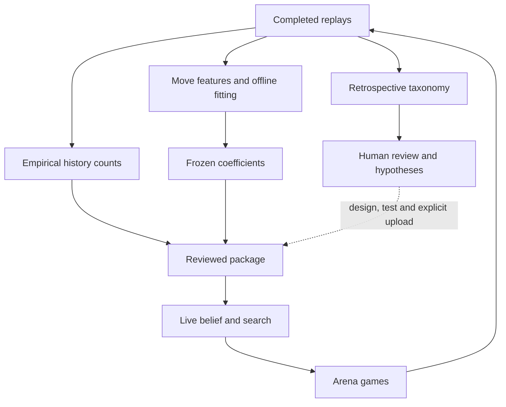

# What the taxonomy does—and what it does not update

Local presentation review, November 11. No website deployment, source push,
model fitting, engine change or new game accompanies this audit.

## Its actual role

`learning/move_taxonomy.py` labels completed replays and aggregates behavior.
It has **19 core report metrics**. The daily report selects **11** columns.
The labeler also defines `quiet` and `king_capture` outside the core 19.
These are overlapping tags, not 19 exclusive strategy classes; their rates
per 100 moves need not add up to 100%.

The taxonomy helps humans identify habits, curate cases and choose hypotheses.
The deployed v38 executable does not load its report. Its model coefficients,
history counts and guard thresholds remain frozen until a different package
is uploaded. Live belief updates use observations and the fixed likelihood
model; they do not read daily taxonomy percentages.

The daily script can separately export raw moves and learning datasets when
storage is available. Exporting does not itself fit new coefficients, rebuild
the shipped table, tune guards or deploy a policy. The shared external archive
is currently unavailable; the separate 6,000-game collector is not a repair
of that shared automation.

## Which information the labels use

| Label family | Information used | Consequence |
| --- | --- | --- |
| King move, castle, queen raid | Own piece and chosen move | Usually available from the actor's information |
| Vision gain/loss | Own views before and after the move | Measurable afterward; actual future view is not a pre-move input |
| Capturer unseen, fog route | Opponent's private views and move history | Oracle diagnostic; generally unavailable directly to the actor |
| Hidden king threat or piece exposure | True hidden positions and attack geometry | Can be labelled after the game; a live bot needs inference |
| Sacrifice, king-hunt sacrifice, capture chain | Subsequent plies/material/termination | Hindsight labels; not proof of deliberate intent or a forced sequence |
| Bare back rank | Broad geometry and opposing heavy-piece presence | Describes a configuration, not a proved attack or loss |

This distinction matters if the data later trains a model: a future outcome
can be a target, while the model's decision-time input must respect its
information boundary.

## Two concrete limits, using existing audited fixtures

**Reporting defect:** in local game `mass-p3-black`, ply 119 is White's
en-passant capture **e5xf6**, taking the black pawn on f5. The course rules
confirm the capture and resulting board. The v0 labeler reports `quiet`
because it checks only whether the destination square was occupied.
This affects report labels; the native engine's legal-move handling is a
separate implementation and was not changed.

**Vocabulary limit:** in real arena win `c8ozqj0m`, White's Rxg7 has tags
including `capture`, `king_threat`, `sacrifice` and `king_hunt_sacrifice`.
It does not get `king_threat_unseen`: the checking rook is visible. The
decisive support is the hidden queen on g4. There is no explicit
`hidden_support_bait` tag. Thus counting unseen checks alone misses this
composable pattern; the existing tactical audit and illustration supply
additional evidence.

The source also calls a consecutive observed capture sequence a
`forcing_chain`; it does not prove that alternatives were unavailable.
Similarly, `king_threat_unseen` requires any hidden attacker, not that all
attackers are hidden. These definitions should accompany presentation claims.

Historical labeler outputs remain unchanged. An en-passant repair should
version its source and regenerate clearly dated reports, rather than silently
changing the meaning of earlier comparisons. Reconstructing each frame with
`fen()` drops en-passant rights, so simply calling `is_en_passant()` on those
standalone frame boards would not be a sufficient repair.

[Exact audit receipt](result.json) · [Read-only audit source](../../tools/audit_taxonomy_semantics.py)
· [Illustrated cases](../../../docs/presentation-cases.md).
