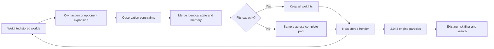

# Weighted belief frontier experiment

This default-off candidate keeps a weighted population of joint hidden states
between observations, separately from the equal-weight particles supplied to
the existing engine. It targets the loss of rare correlated possibilities when
an informative view leaves only a few surviving engine particles. This is a
research candidate, not an arena release or a demonstrated strength gain.

The motivating queen-capture audit found 53 of 86 low-support cases without any
complete belief collapse. Recovery after an empty population cannot repair
possibilities already lost during a near-collapse. See
[the diagnostic report](../../analysis/queen-belief/README.md).

## Update path

1. Store complete positions, normalized weights, last opponent-move destination
   and capture status. Equality also includes castling, en-passant, halfmove
   and side-to-move fields. Hash collisions use full equality.
2. Apply our observed action to every stored state and discard states in which
   the action is unavailable. Condition on the next observation.
3. Enumerate every opponent move from every retained state. Normalize its prior
   over that parent's entire move list before applying observation constraints.
4. Sum masses of identical child states. If they fit the capacity, retain all
   of them with their weights. A small weight is not rounded to a particle count.
5. If distinct children exceed capacity, reduce across the complete enumerated
   pool using hierarchical systematic sampling. Compact parent/move records
   bound memory without storing a full board for every transition. Traversal
   order does not truncate the accepted pool.
6. Independently sample the engine's ordinary equal-weight particle population.
   Its RNG and samples do not change the stored frontier or the RNG used to
   reduce the frontier. A world absent from a particular engine sample can
   therefore survive until a later informative observation.

`FOW_FRONTIER_CAPACITY=0` preserves the control path. The first experiment uses
8,192 stored states and 2,048 engine particles; the hard configurable maximum
is 32,768. Expansions cost O(states × generated moves), with expected constant
time hash lookup per accepted state. There is no claim of sublinear exhaustive
expansion. A timed-game gate is required even if memory and isolated updates fit.

“Keep all weights” means exact propagation from the **currently retained**
states under the selected move prior and consistency rule. It does not recover
states discarded by earlier reductions, correct a wrong prior, or guarantee a
true Bayesian posterior over all legal histories. The first comparison uses
the same legacy observation constraints as its control (`history_mode=0`).
History mode 1 additionally enforces full observation and continuation
constraints. The history-recovery mode 2 combination is disabled. A complete
collapse still uses the existing recovery method and is reported explicitly.

## Validation and promotion

Build with `tools/build_current_history_runtime.py --source` pointing to this
directory and a fresh `--output` directory. The builder pins the root revision,
copies only Astra overlays, records source and binary hashes, and creates no ZIP.

The first build passed 5,508 checks: 514 frontier checks, 541 existing belief
checks, 3,831 history/grouped-prediction checks, and 622 engine checks. The new
tests cover an exhaustive Bayesian oracle, a rare world absent from engine
samples, whole-pool reduction, independence from engine sampling, castling
rights, opponent-move memory and en-passant capture accounting. The engine
tests use the opening-book fixture from the pinned revision.

The predeclared validation starts with a pilot over the first 24 unchanged queen-capture targets,
cap 0 versus 8,192 in the same diagnostic binary, then the full 240 targets
if the runtime is acceptable. Both use prior 1, history 0, grouped prediction 1,
2,048 engine particles and seed 1. Preserve all 12 captures that actually won
the game for us; separately report the 228 surviving-opponent captures.

Track exact-capturer support, zero-support events, full-board support,
collapses, capacity reductions, effective frontier size and elapsed time.
Support on selected queen captures is not calibration or playing strength.
Any promising result must pass the actual king/queen move-selection gates,
another seed, and complete games at 180+2 before release. More stored worlds
are a hypothesis: an earlier experiment doubling ordinary particles worsened
the king-decision benchmark.

The first pilot and complete 240-target support comparison have now finished.
Zero-support capturer cases fell 34→17 and complete collapses 142→69; mean
capturer mass remains inconclusive. The actual hybrid action gate is running.
See the [result and provenance](../../analysis/weighted-frontier/README.md).
