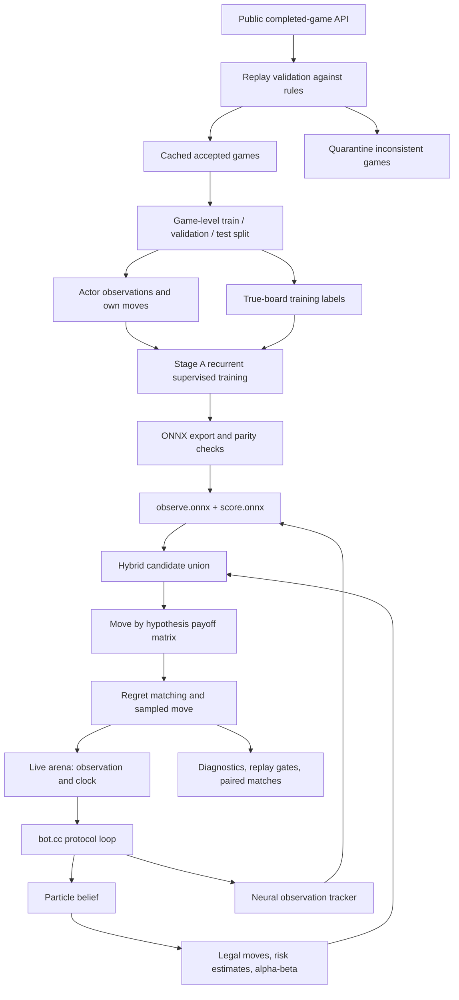
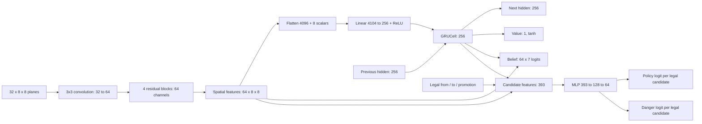

# IAmAVirus: architecture and the lifetime of a move

Source snapshot: 7 October 2026. Maintained by Astra. The interactive companion
is [the repository's index.html](../../../index.html). Fable's broader design
review is [ARCHITECTURE.md](../../../ARCHITECTURE.md). The
[archive-to-arena table](../../../fable-submissions/README.md) is authoritative
for deployed versions; a filename is not an arena version.

## What is running, and what is experimental

| Scope | What it means |
|---|---|
| Arena v10 | User's chosen active version at this snapshot; Fable archive SHA prefix `6f57a44ec814`, stage-A v1 neural weights |
| Arena v11 | Astra archive **label v12**, SHA `a5f806d0039f`; conservative exposure-only runtime, same v1 weights |
| Arena v12 | Fable archive `68a89006f6c2`; exposure, visibility deductions, difficulty-based clock, underpromotion rule and per-particle opponent-move memory |
| Fable development | Later candidates add two-ply hidden threats, repetition pricing, two search workers, revised clock and an observation-keyed opening book; not automatically active in the arena |
| Astra research | Grouped prediction, continuation evidence and bounded history recovery; recovery is **off by default**, not in the immutable arena-v11 archive |

The system has two different kinds of memory. C++ particles represent possible
complete boards. A neural GRU represents observation history in a learned
256-number vector. The current hybrid connects them through candidate selection;
the neural belief head does **not** replace or update the particle population.

## End-to-end system



Completed replays expose true boards for **offline labels and validation**.
Live features use only the actor's observations, color, own actions and permitted
derived state. Unknown squares are different from visibly empty squares. Raw
API square order is `a1` through `h8` for both colors; only the neural encoder
reflects Black's ranks into a canonical coordinate frame.

## One move, from process startup to the next observation

```mermaid
sequenceDiagram
  participant A as Arena referee
  participant P as Protocol loop
  participant B as Particle belief
  participant N as Recurrent neural model
  participant E as Decision engine
  A->>P: fow, color, time control
  P->>B: Starting-position population, own rights, RNG
  P->>N: Load CPU ONNX graphs, zero recurrent state
  P->>A: ready
  loop Every live observation, including after our move
    A->>P: 64-character actor view
    P->>B: Condition, or predict opponent move and condition
    P->>N: Tracker features; observe graph exactly once
  end
  A->>P: Remaining clock (our decision)
  P->>N: Score legal candidates; no GRU update here
  P->>E: View, clock and neural advice
  E->>B: Population risk and sampled hypotheses
  E->>E: Shortlist, matrix searches, regret matching
  E->>P: Chosen legal UCI move
  P->>A: move e2e4
  P->>B: Apply our known move
  P->>N: Record own move in feature tracker
  A->>A: Apply move and adjudicate
  A->>P: Next observation, only if play continues
```

1. **Initialization.** The process initializes bitboard attack tables, Zobrist
   keys, RNGs and transposition tables. The belief starts from the common-known
   opening. ONNX loads once on CPU before `ready`. A model load/inference failure
   disables neural advice and leaves the C++ path available.
2. **Observation event.** `Engine::Observe` receives the view and whether it
   follows our own move. After our move, particles were already advanced, so
   only conditioning is needed. After the opponent's move, enumerate plausible
   legal transitions, assign opponent-prior weights, reject inconsistent states
   and resample. Our own pieces must match everywhere, including a capture that
   makes their former square disappear into fog.
3. **Neural memory update.** `NeuralTracker` updates last-seen content, age,
   observation phase, own rights and inferred en passant. `observe.onnx` advances
   the GRU once per actual view. The clock prompt does not advance it again.
4. **Legal actions.** Exact actor move generation combines the observation with
   tracked castling rights and inferred en passant. The visibility rule makes
   legal destinations visible. This does not eliminate implementation bugs;
   referee parity and legal-output checks remain mandatory.
5. **Safety and proposals.** King exposure is evaluated across the population
   for legal moves. A representative-board alpha-beta search produces ranked
   candidates; hybrid adds neural suggestions and reserves safer alternatives.
   Typical limits are 6 search suggestions, 8 policy suggestions and 8 risk
   suggestions, deduplicated into at most 12 rows. These are budgets, not a
   promise that all 22 suggestions enter the matrix.
6. **Payoff construction.** Up to 8 sampled hypotheses form columns. Each cell
   searches one candidate on one board. Row charges include population-based
   king risk and, depending on version, material exposure and hidden-threat
   estimates. Immediate fatal cells receive the catastrophe score **and** row
   risk charge. Hidden attacks on the opponent king already earn a bonus in
   the engine; offense is not wholly absent.
7. **Decision.** Regret matching (typically 4,000 iterations) produces a mixed
   strategy over rows, then the engine samples a move. This is a small robust
   root matrix approximation, **not** full extensive-form CFR or an equilibrium
   solution to Fog of War chess. Deeper alpha-beta still has perfect-information
   assumptions within each sampled board.
8. **Commit the action.** The protocol emits only `move <uci>` on stdout and
   records diagnostics on stderr. Both memories are notified of our action.
   The referee adjudicates before sending another live observation. If the
   previous mover left its king capturable, the game has ended; the next player
   can otherwise begin a turn under an unseen attack.

Later Fable candidates have an early observation-keyed opening-book return
after legal-move generation. A legal book hit currently bypasses the normal
risk/matrix path. It is a version-specific branch, not part of arena v10 or the
general decision guarantee.

## Neural model, tensor by tensor

Architecture ID: `cnn64x4-gru256-heads-v1`. **1,872,394 parameters** in the
v1 export manifest. Inference uses ONNX Runtime on arena CPUs. The GPU is for
training and experiments outside the arena.



| Input channels | Contents |
|---|---|
| 0–13 | Current own/enemy piece classes, unknown and visible empty |
| 14–26 | Last directly observed piece or empty square |
| 27 | Ever observed |
| 28 | Age since observation, capped at 100; never seen = 1 |
| 29–30 | From/to squares of our last move |
| 31 | Actionable inferred en passant target |
| 8 scalars | Color, whose turn, own castling rights, three observation-phase indicators, capped ply |

The candidate feature vector is `256 + 64 + 64 + 4 + 5 = 393`: recurrent
memory, spatial source/destination features, coordinates and promotion one-hot.
The policy softmax covers only legal candidates, not a dense action vocabulary.

| Head | Training target | Role in hybrid runtime |
|---|---|---|
| Policy | Recorded actor's move | Proposes candidate rows |
| Danger | Candidate immediately leaves own king capturable on the true board | Logged and used in candidate tie-breaking; not a calibrated global safety veto |
| Belief | Enemy piece class or none on hidden squares | Auxiliary supervision; not converted into joint board particles |
| Value | Final game result from actor perspective | Logged; not the alpha-beta leaf evaluation |

`observe.onnx` returns recurrent state, spatial features, belief logits and value.
`score.onnx` consumes the retained state/features and legal candidates. The v1
manifest records 425 export parity decisions with zero failures. Its reported
danger false-negative rate is about 0.89 on validation, so a sigmoid output
must not be described as a calibrated safety probability.

## Is the CNN good enough?

It is a measured, inexpensive proposal baseline, not a demonstrated solution to
the desired playing strength. The current evidence does not isolate the CNN's
architecture as the bottleneck. Weak danger recall, limited value prediction,
the separation between neural and particle beliefs, training data coverage and
the search approximation are competing explanations.

The next useful model comparison is a belief-aware recurrent policy against
this unchanged CNN, followed by a compact attention alternative. Both need the
same frozen game split, hard-opponent slices, calibration and safety metrics,
CPU inference measurement and equal-clock paired games. Higher imitation
accuracy alone, or a larger model alone, does not pass the strength gate.

## Lifetime of the state

| State | Created | Updated | Discarded |
|---|---|---|---|
| Bitboard tables, model weights | Process initialization | Fixed during game | Process exit |
| Particles, census, own rights | Game initialization | Every observation and own move | Game end; population may be rebuilt earlier |
| Last-seen grid, age, phase, GRU hidden | Game initialization | Every actual observation; own action notification | Game end |
| Latest spatial features and head outputs | Observation inference | Replaced on next observation | Next observation / model failure |
| Search transposition table(s) | Engine initialization | Reused and replaced by search | Engine exit |
| Candidate list, row risks, payoff matrix | Our clock prompt | During that decision | After move selection |
| History-recovery checkpoints (experimental) | First observation | Bounded rolling window of 16 views | Oldest checkpoint evicted / game end |
| Raw replay and validated split | Offline ingestion | Completed games appended; split manifests frozen | Cached for repeated experiments |

## Learning, retrieval and promotion

Stage A trains the recurrent model from validated completed replays with policy,
hidden-square, danger and outcome losses. Features and truth labels are separate
modules. Split by complete game so the two seats and adjacent frames cannot leak
across training and evaluation.

Recurrent PPO exists in `learning/train_ppo.py`, using fresh simulated rollouts
and frozen league opponents. Its existence does not mean an arena archive uses
PPO weights: the mapped v10/v11/v12 archives use supervised **stage-A v1**.

The experience index is separate from live inference. Astra's first frozen index
holds **263,998 actor decisions from 3,258 games**, with 32-byte packed observations
and additional history/context fields. It uses structured context lookup followed
by bounded top-k scoring; it is not a global nearest-neighbor index. VQ/RVQ
compression and learned retrieval remain proposals, not deployed model layers.

Promotion sequence: rules/feature/export correctness → reproducible paired
replay decision comparisons → whole-game color-swapped real-clock matches →
explicit archive/model hashes → arena upload and opponent/version-aware monitoring.
Offline gains do not establish an Elo gain, and selected losing positions are
not an unbiased playing-strength sample.

## Current architectural experiment: recover history before guessing

Random reconstruction can erase useful information about a piece that was seen
and then disappeared into fog. The new Astra prototype stores weighted distinct
checkpoint states and replays legal transitions through every intervening actor
view before allowing a reset. It has no access to replay truth at runtime.

It tries bounded rewind distances up to 16 plies, with at most 250,000 transitions
per attempt, at most 65,536 temporary distinct states, and a beam capped at 8,192.
Exact state identity includes pieces, color occupancy, side to move, rights,
en passant and halfmove clock. Small supports remain weighted and unpruned;
larger ones undergo systematic resampling. A partial enumeration that exhausts
the budget is not returned as a completed posterior.

This is still an approximate finite support. A checkpoint descended from random
reconstruction certifies only the replayed window, not the entire game. Reports
distinguish successful history recovery, budget exhaustion and uncertified
fallback. It does not yet retain a full persistent graph of discarded histories.

Initial selected-history evidence: random resets **27 → 14**, truth held
**230 → 407 / 1,260 updates**, but one game's log loss worsened. On 37 selected
seats / 274 queried decisions, king losses **16 → 14** (3 saved, 1 newly fatal).
The difficult bishop case is still not reliably fixed. These are reasons to
continue testing, not claims of an Elo gain or a ready release.

The subsequent planning direction is to branch on future observations and model
the opponent's information, reducing the assumption that each side knows the
sampled board. [POMCP](https://proceedings.neurips.cc/paper/2010/hash/edfbe1afcf9246bb0d40eb4d8027d90f-Abstract.html)
is relevant belief-space planning research; it is a POMDP method, not an automatic
solution to an adversarial game. [Learned information-set weighting in RBC](https://arxiv.org/abs/2407.05864)
supports studying replay-trained state likelihoods, with different game rules and
no transferable Elo promise.

## Source map

| Responsibility | Source |
|---|---|
| Protocol and model lifecycle | [bot.cc](../../../bot.cc) |
| Search orchestration and hybrid union | [engine.cc](../../../engine.cc), [engine.h](../../../engine.h) |
| Particle tracking and opponent prior | [belief.cc](../../../belief.cc), [opponent_model.cc](../../../opponent_model.cc) |
| Rules, legal moves, visibility | [position.cc](../../../position.cc), [observation.cc](../../../observation.cc) |
| Alpha-beta and matrix solver | [search.cc](../../../search.cc), [regret.cc](../../../regret.cc) |
| Neural architecture and inputs | [model.py](../../../learning/model.py), [features.py](../../../learning/features.py) |
| Training and labels | [pretrain.py](../../../learning/pretrain.py), [labels.py](../../../learning/labels.py), [train_ppo.py](../../../learning/train_ppo.py) |
| Runtime inference and parity | [neural_inference.cc](../../../neural_inference.cc), [export.py](../../../learning/export.py) |
| History experiment | [belief.cc](../implementation/belief.cc), [results](../analysis/history-recovery/README.md) |
| Measurement and version mapping | [MEASUREMENT.md](../../../versions/MEASUREMENT.md), [submission table](../../../fable-submissions/README.md) |

## Website publishing

`index.html` is self-contained: no build step, framework, external script, font
download or live API request. It works as a local file or a GitHub Pages project
site. Its diagrams are explanations, its matrix calculator is an illustrative
budget calculation, and its board uses a completed public replay.

The Pages workflow publishes only the site entry point, not datasets, archives or
the repository worktree. Content links go to the public mirror's source browser.
Snapshot dates and version scope are explicit because the development branch
changes more quickly than deployed archives.
