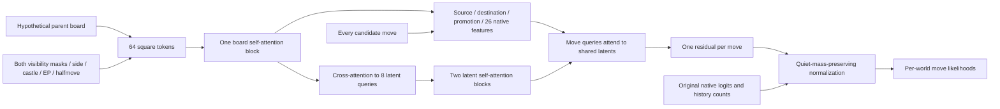

# Full-world quiet-move attention: unfitted prototype

The purpose is to test whether a richer board representation can improve
opponent-move likelihoods beyond the current scalar features. **There are no
trained weights, predictive results, native inference or playing results.**
The existing307 future-cohort test remains separate and unchanged.

## What differs from the earlier attempts

| Earlier work | Result | This prototype's difference |
| --- | --- | --- |
|208 attention teacher and visible-response student;224 actual-prior comparison|Student loses to deployed full prior by0.02387nats and on surprise captures by0.25524.|Condition on a hypothetical complete parent, as the native belief prior does, and preserve its capture probabilities. This is not an actor policy.|
|237/238 outcome teacher,271 query-compressed value student|Broader value evidence and compression gate fail.|Predict the opponent's action within quiet moves; no game-outcome or Stockfish-value target. Query compression itself is not new to this project.|
|293 capture-fixed scalar linear/quadratic heads|Combined configuration fails; full head retained for separately frozen307.|Reuse the same probability constraint, but provide spatial board relations that22 scalar features cannot explicitly describe. No claim that more capacity will help.|

The general input/latent/output-query pattern is inspired by
[Perceiver IO](https://arxiv.org/abs/2107.14795), a primary research source.
This is an adaptation, not a reproduction of that paper or evidence for a
Dark Chess improvement. There is no VQ codebook, autoencoder loss, quantization
or NNUE accumulator in this prototype.

## One parent, many candidate queries



Width128, four attention heads, eight latent queries, zero dropout. Each
square token includes piece, absolute a1-through-h8 square, both visibility
bits, castling-rook flag, en-passant flag, side and clipped halfmove count.
Black uses the same square order. The model does not receive player names,
actual target action, result, future frames or clocks. It **does** receive
the full hypothetical board and both masks: it cannot stand in for an
opponent strategy that respects the opponent's information set.

Encode the parent once. A query for a candidate combines its source and
destination board tokens, promotion type and26 native deterministic features.
It attends to the shared latents without candidate-to-candidate attention.
Permuting or removing other queries must not alter a move's residual beyond
floating-point tolerance. The output head starts at zero, recovering the
native prior. The prototype is intended as an offline teacher; no claim is
made that evaluating it for thousands of worlds is affordable in the arena.

## Probability constraint and its limits

For native logits b, quiet moves Q, residual d and native normalizer Z:

```
p(capture c) = exp(b[c]) / Z                     unchanged
p(quiet q)   = exp(b[q] + d[q]) / Z
               * sum_Q exp(b) / sum_Q exp(b + d)
```

With zero or one quiet move, return the original probabilities directly.
Then apply the unchanged native empirical blend: when N>=3,
`(count[a] + 4*p[a]) / (N + 4)`; otherwise use p. N can exceed the counts
available in a particular hypothetical world. Do not renormalize that deficit
away. The learned residual has zero gradient through capture-target losses.
Capture training rows stay present, with their original constant loss.

The quiet adjustment uses exactly 293's mathematics; eight tests include exact
CPU equality to that implementation. Capture identity is relative to the same
Torch normalization; native neural integration and parity remain untested.
It holds for identical parent inputs, and does not guarantee a future capped filter has the same
parents, support or risk: changed quiet paths alter later beliefs. Temperature2
also changes the sum of powered quiet likelihoods. Good action NLL is not
automatically good sequential inference, equal-clock decisions or Elo.

## Proposed fit for review — not launched or source-frozen yet

Use only318's recovered original4,000 TRAIN games. A chronological whole-game
split would fit the earliest3,500 and develop on the last500, with exact
timestamps then IDs defining order. These are reused development data,
not a new independent test. Do not read293's old validation/test trajectories
or307's prospective data for this mechanism. Captures/fatal/opening rows remain.

Refit matched linear and quadratic controls on the same3,500 games using293's
fixed recipe (12epochs, Adam0.03, ridge0.001, batch512). The existing quadratic
trained on all4,000 is not a matched comparator on the last500. One attention
teacher, one seed, at most12epochs, AdamW0.0003/weight-decay0.0001,
batch256, gradient clip1, FP32; choose each checkpoint by development primary
NLL. No architecture or learning-rate sweep. GPU admission must be checked
again, with no service stopped; proposed wall cap20minutes, GPU cap12GiB.

Proposed necessary quality bar: >=0.10nats over native and >=0.03 over the
matched quadratic, positive game-cluster lower confidence bound versus that
quadratic, all-move nonregression, exact capture identity, and no regression
in adequately represented priority groups. These are design proposals, not
retroactively applied results or an execution contract. Freeze exact split,
coverage rules, gates, hashes and fit source before scoring development data.
The proposed 0.10 nats is about a 10.5% geometric target-likelihood advantage:
the expensive teacher needs headroom for later compression. This is a research
screen with no claimed conversion to Elo.

A failure closes that fixed configuration. A development pass earns a
separate fresh temporal confirmation, then student design and native
cost/sequential-posterior tests. It does not earn a GPU-sized arena teacher,
an automatic ZIP, a changed307 head, or reclassification of any failed test.

## Current evidence

Eight CPU contracts pass on their first run: zero/singleton quiet identity,
capture bit identity and zero gradient, finite quiet/padding gradients,
capture and quiet mass, native missing-count semantics, exact293 equivalence,
candidate permutation/subset independence and gradient flow through the board
and latents. See `analysis/world-quiet-attention-20261110/`.

The initial prototype did not include a fit/data-loader implementation.
Those are now completed with a separate
[320 frozen contract](../../../chatroom/320-astra-world-quiet-fit-contract.md)
and structural loader preflight before training. These tests prove the
specified computations, not predictive skill, compression quality, native
runtime, posterior calibration or a reason to replace live v38.
