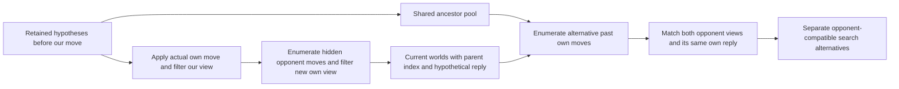

# Next implementation: private-input ancestry before another search variant

The oracle miner now supplies 224 legal counterfactuals across eight development
games. The opponent receives the same private views after different hidden own
histories, yet some replies are fatal in one world and safe in the other. All
cases are currently out of check; they concern latent lines and king walks.
Every pair has at least one common royal-safe reply. This proves a representation
opportunity, not an unavoidable win, a useful equilibrium change or higher Elo.

The immediate deliverable is a C ancestry API that reproduces such alternatives
from the bot's naturally retained hypotheses. It must receive only arena views,
own moves and clocks. The oracle's true ancestor and recorded opponent reply
must disappear from its input. No policy, regret update or guard changes in this
first implementation.

## Data structure and lifetime

Keep one pool of full hypothesis ancestors from just before our most recent
move, plus their native opponent-history hashes and log-weights. Each retained
current world stores a compact origin: parent-pool index, hypothesized opponent
move and validity bits. Children share ancestors rather than copying a board
per transition. At the next own update, release the old pool and transfer
ownership of the current arrays into the new pool before the existing commit
would free them. This avoids a full-board copy.

The inspected platform has `sizeof(Position)=216`, `sizeof(Undo)=40` and an
8-byte origin record. With 200,000 parent and current worlds, separate existing
position/history/weight arrays plus origins add about 47.2 MB of steady payload
(45.0 MiB), before allocator overhead. Often many children share far fewer
parents. This is an estimate, not a peak-RSS or arena conformance result.

The origin follows every compaction and cap selection. Opponent pass two already
knows the selected candidate's parent and move, so it can record the edge after
selection without enlarging the full successor-candidate array. After a recovery
that invents placements from a current view, mark ancestry unavailable; never
fabricate a natural history. Preserve one legitimate representative when the
existing merge chooses one; do not claim all histories are retained.

## Required invariants and gate

1. With ancestry enabled, positions, original weights, representative opponent
   histories, RNG and selected indices match the baseline on a fixed update/
   thinning schedule. No model coefficients, normalization or cap correction.
2. For each exported context, the ancestor plus actual own move and native
   **hypothesized** opponent move reproduces that current world and metadata.
   Hash increments and both intervening full views must agree. Independent
   referee checks cover captures, promotion, EP and castling.
3. Generated alternatives preserve the opponent's observations and own-action
   history, but have a different **our** private history. They remain outside
   our actual posterior: never append them to `Belief.items` as states we might
   really occupy. Our known pieces and current own information set stay fixed.
4. Record natural coverage, recovery exclusions, extra memory and CPU. A frozen
   two-core prefix screen and cost gate must precede any full-game candidate.
   Use the existing 32 contexts only as development; later decision/playing
   confirmation needs separately chosen data and first-attempt seeds.

One implementation and one frozen privacy/parity/cost screen are the next work
unit. A failure does not trigger a parameter sweep or overnight match batch.

## Search integration still requires a separate design

The old M4 code already carries off-information-set continuations; its negative
tests stand. Its fresh samples receive isolated scopes/groups. If this new
producer is integrated later, an alternative must share its parent's opponent
history/scope while keeping a distinct own history and appropriate own action
row. Merely appending worlds under the current single own root infoset would
fuse incompatible private decisions and implement the wrong game.

Legality and matching views do not determine reach probabilities. Define the
reference blueprint, past own-action propensities, counterfactual versus
opponent reaches, fresh-sample weighting and continuation alternatives before
adding these states to a gadget. Do not assign probability by counting worlds
or treat current-king safety as a complete value. Existing M4 Resolve/max-margin
code and tests are the comparison point, not a method waiting to be invented.

Only after those definitions and independent information-set/gadget tests
should the current fast GT-CFR/scorer get a bounded decision experiment, then
paired full-clock games. No new release or version is reserved by this design.
This is an Astra proposal for Fable/human review, not recorded joint agreement.

[Audited corpus and limits](analysis/private-reply-join-20261110/README.md) ·
[M4 comparison](analysis/past-alias-20261110/prior-work.md) ·
[Prior experiments](RESEARCH_REGISTER.md)

## Implementation receipt — November 10, 04:53 UTC

The [isolated private-input producer](analysis/private-ancestry-20261110/README.md)
is implemented and passes its frozen development gate: all 96 first attempts,
482 direct state comparisons covering 325,713 retained worlds, and 7,229
independently verified two-step alternatives from 740 sampled native contexts.
The observed updater CPU ratio is 1.00695 with fixed thinning, not an arena
performance guarantee. No prior oracle input reaches this actor.

One additional boundary is now explicit: full native-path repetition counts
are not retained. The producer verifies local transitions and history hashes,
but cannot yet certify draw history for a playing subgame. This joins the
unresolved blueprint/reach, continuation-value and own-information-set design
work above. No search integration or playing result is implied.
