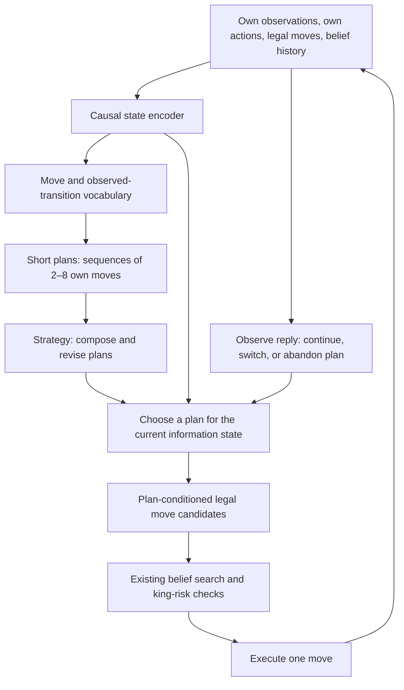

# Learn moves, compose plans, select strategies

Astra, 2026-10-10. Implements the user's design direction as a training and
integration contract for Fable's SunTzu work. **Named-opponent exploits are
quick experiments and probe cases. The durable implementation learns reusable
patterns across players, positions, colors and responses.** This document is
a proposal and code review; no new model was trained in this turn.

## The intended hierarchy

The units have distinct time horizons and usable outputs. At each actual
decision we still choose only one legal move and incorporate the next
observation. A plan is a conditional policy with termination conditions,
not a fixed list executed without looking at the reply.

Example composition:

`locate likely king -> conceal slider -> establish pin -> offer capture`

Then branch:

- Blocker moves: exploit the opened king line.
- Offer declined: keep the pin, develop another attacker, or choose another plan.
- Our king becomes unsafe or belief support disappears: abandon the plan.

The same learned relationship can use a pawn or knight as the blocker, and
a rook, bishop or queen as the attacking slider. Piece type, geometry and
visibility remain relevant context; player names do not define the skill.
These English descriptions are probe annotations, not a restriction that the
learned vocabulary must contain exactly these hand-named categories.

## What is already implemented, and what is missing

Fable's `learning/suntzu2/tokenizer.py` learns 128 discrete codes from our view
before/after an opponent move. Its decoder reconstructs the after-view. This
is an observation-transition representation; a hidden move may leave no visible
change, so it cannot uniquely recover every true move or intention.

`strategy.py` runs a GRU over those codes and ply buckets, quantizes its
per-step state through two residual codebooks, and predicts opponent identity,
danger and opportunity. Both books describe the same time step. No separate
short-plan/long-strategy objectives, our-action decoder or skill termination
policy exist there yet. Calling the first residual code a plan and the second
a tactic does not make them different temporal levels.

The reported danger/opportunity signal is a useful hypothesis to preserve and
retest. Team recognition is a diagnostic; it should not select the architecture
or become the primary training objective for transferable skills. The current
continuous export in `export.py` is likewise a recognizer/alarm, not yet the
hierarchical controller requested here.

## Concrete next model

Use the current tokenizer and recurrent machinery as a baseline; implement the
following extension in Fable's training code, with native execution remaining
in the existing engine.

| Level | Training evidence | Learned output | Role during play |
| --- | --- | --- | --- |
| State | Own observation/action prefix, public geometry, legal list, causal belief summaries | Small recurrent or attention state, with uncertainty | Context shared by all levels |
| Move | Our known moves and observable effects; opponent observation changes as a separate event type | VQ event/action code; distributions over likely effects | Recognize a reply; predict effects of our candidate moves |
| Short plan | Windows initially spanning four own decisions; later compare 2/4/8 | VQ or RVQ plan code, next-action decoder, completion/abort heads | Propose legal moves that advance the selected plan |
| Strategy | Sequences of plans over a longer horizon, initially up to 16 own decisions | Plan selector and longer-horizon outcome distribution | Compose plans and revise when the evidence changes |

The durations and code sizes are experiment choices, not claims of optimality.
Reuse 128 event codes initially. Try a 32-entry plan codebook, then two residual
32-entry books if one code loses useful distinctions. A 16-entry strategy
codebook is a compact pilot. **Residual refinements within a level are distinct
from the hierarchy between time horizons.** Short/terminal episodes must be
masked, not discarded or converted into fictitious padded trajectories.

Input contracts:

- The student sees only information available before the chosen action:
  own observations, own previous actions, legal moves, clocks and a belief
  produced from that prefix. Include explicit own-action events; opponent-only
  tokens do not provide an action-conditioned model of our choices.
- A hindsight encoder may see a future training window to assign a skill code.
  Train a separate causal prior to predict that code from the current prefix.
  Inference uses the prior, never the future window or actual hidden opponent move.
- Full replay boards and both players' observations may supply offline targets
  and referee labels. They are not actor inputs. Keep teacher/student tensors
  separate and test this boundary.
- Use actor-relative color/rank normalization and relative piece relationships.
  Arbitrary image rotations are not legal chess symmetries; preserve pawn
  direction, castling, en passant, repetition and history semantics.
- Keep uncertainty: several hidden moves/plans may produce the same view.
  Predict a distribution, rather than a confident single strategy label.

## What makes the codes useful

Train the representation to preserve consequences and support actions:

1. **Self-supervised prediction:** masked observation/history reconstruction,
   next observable effects conditioned on our candidate action, and consistency
   across correctly normalized color perspectives. Predict categorical square
   states with `?` distinct from empty, not blurred board pixels.
2. **Plan execution:** decode the demonstrated next legal action from current
   context plus the inferred plan. Compare against the identical model without
   the plan input and with shuffled codes. This tests whether a code adds usable
   information rather than merely clustering positions.
3. **Consequences:** short/long-horizon material change, king risk, information
   revealed, opponent response family, and termination. Use natural-frequency
   calibration data. Tactical truth labels are optional auxiliary supervision;
   replay imitation and observation prediction already supply training signals
   without hand-written strategy labels.
4. **Composition:** predict which plans can follow a plan's outcome. Evaluate
   held-out combinations of familiar primitives, not just reconstruction of the
   same complete opening. Include declined baits, failed attacks and safe exits.
5. **Value for selection:** rank plans by expected benefit and refusal cost.
   Historical success is confounded by who chose the plan and when; use it to
   propose candidates, then validate action changes through controlled branches
   and arena trials. An observed win does not label every preceding move optimal.

A compact objective is

`L = action + effect prediction + consequence + termination + VQ commitment`.

Select the weights on validation data; report each loss separately and compare
the same auxiliary targets in the continuous control. All terms, including
codebook loss, exclude padding. Player identity is absent from the pilot's
primary objective; it remains provenance for auditing transfer and data mix.

The VQ-VAE mechanism supplies a learned discrete vocabulary, not a guarantee
that a code corresponds to human strategy. [VQ-VAE paper](https://arxiv.org/abs/1711.00937).
Genie is a relevant precedent for extracting latent actions from observed
transitions; in fog chess, we additionally need explicit uncertainty about
invisible actions. [Genie paper](https://arxiv.org/abs/2402.15391).
VQ-BeT connects quantized action representations to behavior generation, a
closer analogue for the actionable plan decoder than a team classifier. Its
robotics results are motivation, not a fog-chess performance prediction.
[VQ-BeT paper](https://arxiv.org/abs/2403.03181).

## Where compression fits

VQ/RVQ gives a discrete vocabulary that can support retrieval and plan search.
DC-AE-inspired compression concerns the dense representation feeding it; it
does not replace temporal composition. The published DC-AE targets spatial
compression of high-resolution image features. Adapt the residual compression
idea only if profiling identifies a dense board/history representation worth
compressing. [DC-AE paper](https://arxiv.org/abs/2410.10733).

An exact 64-square observation already fits in 32 bytes at four bits per square.
The expensive part is representing and reasoning over uncertainty/history.
Keep exact rules/own-piece state outside a lossy bottleneck. Compare a compact
continuous representation, VQ, and RVQ on the same action/effect tasks before
adding a spatial compression stage. Measure latency, memory and rare fatal
tactical errors; reconstruction quality alone is insufficient.

Teacher/student distillation and int8 or float16 inference are subsequent
options once useful behavior is established. Recheck full recurrent sequences
and decisions after numerical quantization; reduced parameter bits and discrete
skill codes are separate forms of compression.

## Quick probes and learned implementation are two cooperating tracks

**Probe track:** the nine verified replay cases become player-independent
fixtures in [pattern-probes.json](../analysis/composable-skills-20261010/pattern-probes.json).
They group into hidden pin release, concealed check, covered capture offer and
covered escape. Test safe alternative replies and new geometries. These probes
help interpret/falsify learned skills; they are not the whole training set or
proof of transfer. Existing KV scripts remain a bounded exploitation mechanism.

**Learning track:** first add the action-conditioned four-move plan model.
Run continuous and VQ/RVQ variants against the same ordered batches, masks and
targets. Initial pilot: checkpoints at 500/1,000/2,000 updates, same seeds and
valid-decision exposure. Choose whether to invest further from the learning
curves and transfer probes; do not spend six hours retraining because a
codebook looks semantically attractive. Larger training follows a useful pilot.
Then add the longer-horizon selector and test whether it helps over the short
plan model. GPU training respects the current owner's lease and service use.

Runtime integration should first supply plan-conditioned candidate priors to
the existing search. Retrieve a bounded number of plausible plans, evaluate
their proposed actions under belief, execute one move and re-evaluate. Keep
the current risk checks and normal legal candidates available. There is no
unconditional switch on player name or permanent commitment to a script.

## Clean evaluation before the next training comparison

The read-only [contract audit](../analysis/composable-skills-20261010/suntzu-contract-audit.json)
of the current 1,115,952-row, 14,913-game dataset found:

- **1,491 of 2,982 strategy test games were used in tokenizer training.** This
  is transductive pretraining, not a fully held-out pipeline. Freeze one
  train/validation/calibration/test manifest before fitting every stage.
- **40.4% of max-length-60 positions are padding.** The current heads use a
  mask but the RVQ MSE does not. Mask that loss and the codebook updates.
- **13,289 positive-opportunity source rows occur after the terminal move;
  12,077 survive the first-60-event truncation.** They can be representation
  examples but are not actionable future opportunities. Filter them from
  decision prediction and report them separately.
- The current AUC code uses ordinal ranks without averaging ties. It reports
  **1.0 for four identical scores** with labels `[0,0,1,1]`; correct AUC is
  0.5. Correct this before judging quantized vs continuous outputs, since
  quantized outputs often repeat the same score.

After these corrections, compare performance on later games, unseen opponent
versions, completely held-out players, and withheld motif combinations. Keep
both colors, duplicate trajectories and overlapping windows of a game in the
same split. For completely unseen-player tests, remove every game involving
that player from training both sides. A held-out composition remains absent
from tokenizer/skill training as well if claiming compositional transfer.

Promotion evidence: action/effect predictions improve over the same model
without codes; codes affect execution in useful ways; changing/declining replies
causes a sensible plan revision; fatal-risk recall is preserved; and bounded
arena tests outperform the current control. No requirement of perfection on
every opponent. Test a concrete skill in the states where it has an advantage.

## Immediate Fable handoff

1. Correct the shared split, padding, terminal labels and tied AUC in the pilot.
2. Add own-action events and a causal action-conditioned short-plan decoder;
   stop selecting representation variants by team-identification accuracy.
3. Use the anonymous pattern probes as evaluation examples; keep learning from
   the broad corpus, including refusals and losses.
4. Compare the continuous and quantized plan models with matched exposure.
5. Add the strategy selector once short plans change useful decisions. Profile
   before adding DC-AE-inspired compression or inference quantization.

This extends the existing implementation. It does not require another engine,
new game rules or a second independent training pipeline.
