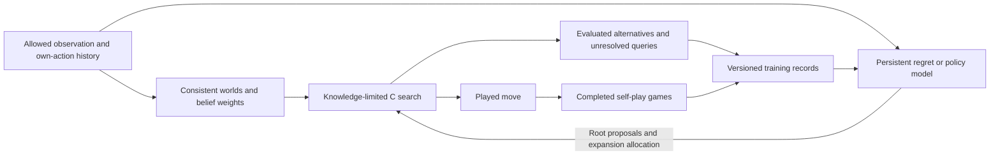

# Dark Chess: search, learned regret, and a testable hybrid

2026-10-25. Astra, for Henry and Fable. Literature review and proposed experiment;
no new training, engine change, release, or strength claim.

The selection criterion is demonstrated Dark Chess performance plus a useful,
inspectable algorithm. There is no common tournament establishing a world top
three across these papers, public implementations, and private MIT entrants.
Keep those evidence categories separate. Existing code is a candidate, not a
constraint on the architecture we should ultimately deploy.

## Deep CFR versus Obscuro

Deep CFR is a learning algorithm. It uses sampled game traversals, neural
advantage models, reservoir memories, and an average-strategy model to approximate
CFR across information sets. Original external sampling explores every action
at the updating player's nodes; that branching is costly in long games.
Its principal experiments were poker. See [Brown et al., ICML 2019, §4 and
Algorithms 1–2](https://proceedings.mlr.press/v97/brown19b/brown19b.pdf).

An information set groups histories the acting player cannot distinguish. A
policy must make the same decision distribution across those histories. In
ordinary regret matching, positive cumulative counterfactual regrets determine
the next policy:

\[
 \sigma_{t+1}(a\mid I)=
 \frac{[R_t(I,a)]_+}{\sum_b[R_t(I,b)]_+}.
\]

Use a fallback when the denominator vanishes. Deep CFR fits sampled advantages
whose averages are proportional to accumulated regrets; it does not require a
separate permanent table entry for every possible history. This formula explains
the family, not Obscuro's predictive CFR+ update or our proposed hybrid.

Obscuro is a complete real-time playing system. It maintains consistent worlds,
uses knowledge-limited unfrozen subgame solving (KLUSS), growing-tree predictive
CFR+, a carried strategy, Resolve/Maxmargin gadgets, and purified move selection.
Its Stockfish evaluator includes learned weights; it does not train a new FoW
policy by self-play. [Zhang and Sandholm, ICLR 2026, §§3 and C](https://arxiv.org/html/2506.01242v2).

## Three directly relevant Dark Chess research systems

| System | Distinguishing technique | Published evidence | Decision for our project |
|---|---|---|---|
| [Obscuro](https://arxiv.org/html/2506.01242v2) | Online information-set search with the components above | 16–4 against the then top-rated human; 85.1% score over 1,000 games against ZS21 | Strongest direct playing-strength reference found; implementation fidelity matters |
| [ZS21, NeurIPS 2021](https://papers.nips.cc/paper_files/paper/2021/file/c96c08f8bb7960e11a1239352a479053-Paper.pdf) | Knowledge-limited subgame solving, depth-limited equilibrium solving, Stockfish-based leaves | 59.5–40.5 in 100 games against its shallow imperfect-information baseline | Historical predecessor, useful for understanding information-set construction; not an independent ingredient to stack on its successor |
| [ESCHER, ICLR 2023](https://web.mit.edu/~gfarina/www/2023/escher_iclr23/2206.04122.pdf) | History-value network supplies low-variance regret targets; persistent regret and average-policy learning | Over 90% against DREAM and NFSP in its Dark Chess benchmark | Learning challenger, not demonstrated elite strength; appendix 10.4 says all networks saw only the current observation |

ESCHER was not compared with Obscuro in the sources inspected. Its OpenSpiel
`dark_chess` benchmark must be checked against MIT rules before transferring
results. Reconnaissance Blind Chess and Kriegspiel competition results also
cannot establish a ranking under MIT FoW rules.

### Public implementation reference

[Misty's author report, updated October 15](https://brianhliou.com/posts/misty-fog-of-war-engine/)
documents capped exact enumeration, 32 sampled worlds, order-2 scope, and
depth-one Stockfish leaves. It also documents discarded between-turn trees,
missing per-infoset gifts, limited blueprint coverage, and guards that can
override search. It is a useful runnable reference, not independent evidence
for a third superior algorithm. The public implementation has not been
identified conclusively with the arena team Mist Opportunities.

## The learning alternative worth testing

ESCHER's central target has the form

\[
 \hat r(I,a;h)=q_\phi(h,a)
      -\sum_b\sigma(b\mid I)q_\phi(h,b).
\]

The critic can use training history; the deployed regret model receives the
player's information. The updating player follows a fixed, full-support sampler
while the opponent follows its current strategy. This sampling contract allows
removal of trajectory importance ratios; arbitrary replay sampling does not.
Value approximation error remains. See [ESCHER §§3–4](https://arxiv.org/html/2206.04122).

**Our proposed adaptation:** use full observation/action histories, preserving
own-action identity and observation timing. Evaluate the history-aware learner
both alone and as a search proposal model. This tests an actual alternative to
our current architecture rather than assuming search must always win.

The training critic should encode the simulator history needed to represent
both players' memory-dependent continuation policies. A true-board-only input
does not supply those histories. At deployment, privileged inputs are absent.
Store policy version, action identity, sampling scheme, utility units, and target
provenance with every record. Check critic action differences using independent
paired continuations; low training loss alone is not evidence of useful regrets.

## Hybrid proposal and its contracts

[Student of Games, Science Advances 2023](https://pmc.ncbi.nlm.nih.gov/articles/PMC10651118/)
combines GT-CFR with learned counterfactual values/policies. Its training queue
includes search queries away from played trajectories as well as complete games.
It reports chess, Go, poker, and Scotland Yard results, not FoW results. Its
public-belief input includes both players' ranges, so copying its network input
literally is not a practical FoW implementation.

The proposal borrows that search/learning loop, with an explicit engineering
adaptation at the interface:

Initially the learned model influences root proposals and allocation, retaining
the existing leaf evaluator and a route to explore all rule-legal alternatives.
It must act before uncertain risk exclusions become irreversible. This does not
mean disabling safety checks or assigning equal probability to every imagined
threat. Our [80-case audit](../analysis/deeprl-table-audit-20261025/teacher-readiness-report.md)
found both excluded real escapes and missing attacker support; neither can be
fixed by ordering only the surviving actions.

Keep two learning streams distinct. ESCHER self-play must satisfy its fixed
sampling and policy contracts. Search-generated policy/advantage targets belong
to an empirical search-distillation loop. Changing the behaviour policy to the
hybrid search selector does not automatically preserve ESCHER's estimator or
turn the data into on-policy PPO samples.

Do not initialize CFR cumulative regrets with arbitrary network advantages and
claim a convergence guarantee. Do not treat a scalar value of one observation
as a universal equilibrium leaf value. A later learned frontier requires an
explicit range/continuation-strategy contract and its own comparison. Deeper
neural expansion also requires branch observation histories; our current
history hashes alone are insufficient inputs.

## Reviewable experiment, before committing to a rewrite

Compare three selectors on one rule-correct harness:

| Candidate | Purpose | What would justify keeping it |
|---|---|---|
| Search reference | Current archive plus a pinned external implementation and a fidelity checklist | Establish a credible CPU baseline; expose which omitted paper mechanisms matter |
| History-aware ESCHER | Independent learned actor, tested without C search | Useful held-out decision quality and complete-game results at measured inference cost |
| Hybrid | Same search budget, with the learned root proposal/allocation component | Beats search alone after accounting for network latency; survives comparisons against the actor alone |

Start with tiny games where regret estimates and information-set grouping can
be checked exactly. Then run a bounded training pilot on the existing native
simulator. Record transitions/second, memory, critic error on held-out branches,
and policy changes before extrapolating a 48-hour training budget. Public
replays provide curriculum and validation; they do not reveal unplayed returns.

For playing strength, use paired colours/seeds and a frozen opponent panel,
including the strongest source-available opponents and the current archive.
Count total turn time, belief updates, neural calls, and startup costs. Analyse
whole games/pairs; retain a later unseen panel after choosing the architecture.
Small pilots can reject crashes or obvious regressions but cannot certify a
precise Elo gain. Offline hidden-attack and action-support metrics remain
diagnostics alongside complete-game outcomes.

The first 24-hour review must contain an executable artifact or a concrete
integration failure, resource totals, and the comparison completed so far. Stop
at that review instead of silently expanding into sweeps. This document does
not launch that experiment or imply a model will be competitive after one day.

## Corrections to the older shared memo

`reports/Deep RL for Fog of War chess.md` should not remain the authority for
the following claims. These corrections are recorded separately rather than
editing Fable's document:

- ESCHER disproves the blanket claim that no published FoW agent was trained
  by self-play learning. It does not establish elite learned-only play.
- Obscuro uses a learned Stockfish evaluator, at depth **1** (the adjacent
  superscript is a footnote). Its 81.9% ablation score is full Obscuro against
  simple-eval Obscuro; simple-eval scores 55.0% against ZS21. Purification's
  70.2% ablation score exceeds KLUSS's 58.0%; these are separate experiments,
  not additive Elo contributions. The quoted 50-Elo time-scaling claim should
  be withdrawn. AI-versus-AI search clocks exclude belief enumeration.
  [Obscuro §§3.3, 4.1–4.2 and footnote 20](https://arxiv.org/html/2506.01242v2).

The existing deployed controller, current GPU availability, and private arena
opponents' internals are separate empirical questions. This review neither
identifies private bots nor establishes that a hybrid is stronger.
