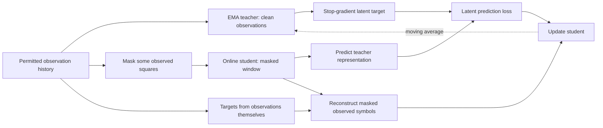

# Learn representations from observation histories without external labels

The user proposed self-supervised teacher/student learning as another direction.
This is separate from compressing a pretrained policy and separate from cloning
expert moves. A teacher need not possess true boards or manually supplied labels.

The implemented first experiment uses an online student and a slow exponential
moving average of its weights as the teacher. This follows the online/target
idea in [BYOL](https://arxiv.org/abs/2006.07733). The related
[DINO](https://arxiv.org/abs/2104.14294) demonstrates self-distillation for image
transformers. Those papers motivate the approach; neither proves it works for
Fog of War histories. Our masking, recurrence and auxiliary observation task
are board-specific adaptations, not reproductions of those papers.

The actor-only loader selects observations, phases, plies, side and already
chosen own actions. It works when the `targets` record is absent. It does not
use the hidden true board, outcome, king-danger labels, future opponent moves,
opponent identity or expert action supervision. Own actions are used only to
reconstruct the feature history after they were chosen.

Both networks rebuild their own recurrent state from the full clean prefix.
During the training window, the student sees additional random square masking;
the teacher sees the original actor observations at the same event. All square
channels are cleared at a masked location, including last-seen content, so the
answer cannot be copied from a second channel at that location. Past memory
can legitimately help recover it. Masking is training corruption, not an arena
observation or a statement that a legal visibility mask has changed.

The objectives are normalized latent prediction against the detached teacher
and cross-entropy reconstruction of *observed* symbols at masked squares.
Actual fog squares have no content label and are excluded from reconstruction.
This is self-supervision: targets come from observations themselves. It is not
unsupervised evidence of where an unseen enemy is located.

Self-target classes are parsed directly from the literal observation strings.
This matters for the existing `features-v1` contract: its current plane 12
combines visible empties and fog, despite an older comment describing separate
channels. An initial pilot that inferred visibility from plane 12 was stopped
and marked invalid; it omitted visible empty squares. The corrected loader
works independently of that legacy encoding and has regression tests using the
real feature builder. It does not change production features or trained weights.

The teacher receives no gradients and moves only after a successful student
optimizer update, with initial EMA momentum 0.996. Training-only projection,
prediction and reconstruction heads are discarded for deployment. A resulting
student initializes the same recurrent policy model for a separate fine-tuning
run. The gameplay heads have not learned to win merely because SSL converged.

## Experiment order and rejection criteria

1. Run unchanged CNN versus attention with the same supervised pilot budget.
2. On the selected encoder, compare random initialization with actor-only SSL
   initialization, using the same downstream data/windows and fine-tuning budget.
   Also report a supervised control given the same **total** compute as SSL plus
   fine-tuning. Equal fine-tuning steps alone hide the extra pretraining cost.
3. Test compression independently on a useful representation. Do not change
   encoder, pretraining objective and bottleneck simultaneously and then guess
   which one helped.

SSL loss reduction is insufficient. Track latent variance and covariance rank
on diverse held-out histories, observed-piece reconstruction separately from
empty squares, and memory-sensitive hidden-attacker tasks after fine-tuning.
Collapsed or position-only representations must be rejected. The implementation
logs normalized projection standard deviation and held-out effective covariance
rank. At or after update 250, a validation standard deviation below 0.005 combined
with effective rank below 2 stops the pilot as collapsed. These are conservative
diagnostic thresholds, not task-quality guarantees. A first 1,000-update SSL
pilot uses seed 253, batch 4, window 32, 40% masking, the same AdamW settings,
and evaluation every 250 updates. Full history ablations and equal-total-compute
fine-tuning comparisons remain necessary before a long training sweep or a
strength claim.

Promotion uses the same natural-frequency hidden-piece/danger metrics, trained
CPU export checks, tactical replays and clock-matched games as the attention
experiment. SSL is a way to use more histories efficiently, not evidence that
labels, belief consistency, search, or competitive evaluation can be skipped.
