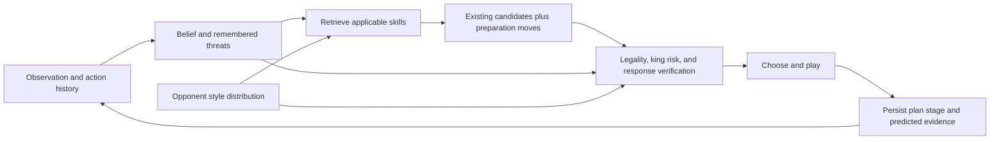

# Strategy first: retrieve a plan, test its premise, execute it

Astra, 2026-10-09. Design proposal, with a completed Misty compatibility audit.
The skill controller below is **not implemented or strength-tested**. Fable's
existing king-fusion/deception candidate can be fielded independently of it.

## The decision

Build a small library of multi-move skills around the actual opponents we face.
Retrieve a skill from observation history and belief, admit its preparation moves
to search, and test its predicted responses before committing. Keep enough plan
state to finish a combination rather than reconsidering every turn from scratch.

This is the actionable version of “learn the wisdom, then approximate it.” Our
objective is points against the arena schedule. A useful specialist is worth
deploying before it becomes a universal player. Opponent-model errors still have
to be priced: exploitation needs a fallback when its premise stops matching.

## What the research actually supplies

| Primary source | Finding we can use | What it does not establish |
| --- | --- | --- |
| [Obscuro, especially Appendix E](https://arxiv.org/html/2506.01242v2) | Hidden attacks, bluffing, mixing and risk-taking emerge from reasoning about players' information. Its worked positions are a useful strategic curriculum. | Adding one invisible-attack bonus does not reproduce its search. Its reported 16–4 human match is not a result for Misty or our bot. |
| [Knowledge-limited subgame solving, NeurIPS 2021](https://proceedings.neurips.cc/paper/2021/hash/c96c08f8bb7960e11a1239352a479053-Abstract.html) | Local reasoning can limit the order of knowledge rather than expanding the entire common-knowledge closure. | A sampled matrix of full boards is not automatically an information-set game. |
| [Option Keyboard, NeurIPS 2019](https://arxiv.org/abs/2106.13105) | Temporally extended skills can be composed toward new objectives. | Its experiments are not Fog of War evidence. Our first hand-authored skill library would be inspired by this idea, not an implementation of the full algorithm. |
| [Robust counter-strategies, NIPS 2007](https://papers.nips.cc/paper_files/paper/2007/hash/6e7b33fdea3adc80ebd648fffb665bb8-Abstract.html) | Exploitation and robustness to an incorrect opponent model can be traded deliberately. | A confidence-weighted heuristic does not inherit the paper's game-theoretic guarantees. |
| [Pluribus technical supplement](https://noambrown.github.io/papers/19-Science-Superhuman_Supp.pdf) | An offline strategy plus local search and continuation choices can work together. | Winning imperfect-information play is not just a lookup table without online verification. |
| [RBC 2022 competition report](https://proceedings.mlr.press/v220/gardner23a/gardner23a.pdf) | Opponent-specific strengths create exploit cycles; decision value matters more than indiscriminate information gathering. | RBC has a separate sensing action and different rules. Its strategies cannot be copied verbatim. |
| [Penumbra / DSMCP, NeurIPS 2021](https://arxiv.org/pdf/2110.01810) | Compact information-set summaries and opponent-specific policies are practical directions. | RBC supplies the opponent's identity. This does **not** validate our inferred-identity classifier in the MIT protocol. |
| [2025 championship organizer's report](https://www.chess.com/news/view/2025-fog-of-war-championship-keleberda-wins) | The champion connects king security with freedom to attack; the games illustrate concealed defenders and mistaken capture attribution. | Human advice such as “vision is king” is not a universal scoring rule. |

## What our engine already does, and the missing capability

Root `engine.cc` already contains an observation-keyed opening book, population
king-risk checks, vision/king-sighting terms and an invisible king-attack bonus.
Some terms are configuration-dependent. We should not describe fog evaluation as
absent or spend another iteration rediscovering these terms.

The root combines candidate moves with sampled board hypotheses, searches each
complete board and solves a matrix. Those columns are hidden worlds, not the
opponent's contingent strategies. The search does not fully enforce that an
opponent must choose the same response in histories it cannot distinguish.

Two gaps follow. A quiet preparation move can fail to enter the shortlist at all.
And a full-board defender can escape a concealed threat it would not recognize
from its actual information. Increasing neural capacity alone fixes neither.

## Work backward from the win: the first six skills

These are proposed capabilities, not claims that one heuristic guarantees a win.

| Skill | Plan and trigger | Abort or switch when | First opponent/use |
| --- | --- | --- | --- |
| Preserve the king's freedom | Remember recently seen attackers; shelter or interpose before using the king as a capturer. | A new observation invalidates the route or another line opens. | Our eight losses to Mist all had surviving final alternatives. |
| Locate the king to choose an attack | Scout only when the resulting observation distinguishes actionable king regions or defenders. | The scout costs more than the change in decision is worth. | Middlegames with diffuse king belief; complements king fusion. |
| Prepare a concealed battery | Bind a rook/bishop/queen to a line, prepare its access, preserve concealment, then threaten. | A blocker persists, the attacker becomes visible, or our own king becomes unsafe. | Duck, instructors, Mist: test separately. |
| Apply pressure, then offer bait | Set hidden cover, give the opponent a reason to change its previous response, then offer a capture. | The opponent repeatedly declines without pressure, can use another capturer, or has a cheap escape. | Mist diagnostic positions; extends Fable's immediate deception term. |
| Ambush a material route | Cover a likely queen/rook route from fog; induce or wait for entry while improving the position. | Waiting loses the initiative or the route model is contradicted. | Duck; use Fable's exploit cards as hypotheses. |
| Change the objective with the position | When ahead, constrain the king and convert; when behind, favor a plausible king race or survival over sterile exchanges. | King belief or material assessment changes materially. | All opponents; bare-king evasion is a defensive branch, not a guaranteed draw. |

The first offensive implementation should be **pressure before bait**, backed by
concealed-line preparation. This is concrete enough to implement without training
a large network, and it complements the candidate Fable already built.

## A skill is a contract, not a sequence of unconditional moves

Each record needs:

- `id`, version, goal and evidence game/ply identifiers;
- initiation conditions with separate observed facts and uncertain beliefs;
- bound piece roles, target region, cover line and candidate defenders;
- stages: prepare, induce response, execute, reassess;
- legal candidate generators for each stage;
- predicted opponent responses and the information available to that opponent;
- success, contradiction, danger and timeout conditions;
- resource budget, opponent-style applicability and confidence;
- accepted **and declined** examples, with training/diagnostic/held-out labels.

Example: `pressure_hidden_rook_bait` binds a hidden rook, a bait square beside
the suspected king, and a forcing piece. Its generator can propose improving the
rook line, advancing the forcing pawn, or presenting the bait. It must account
for an alternative defender capturing the forcing piece. “King is adjacent to
bait” alone is not sufficient.

In `o7pac9wt`, Mist declined Kxg7 seven times before h6–h7 changed the decision;
it then captured on g7 into the hidden rook. Nf6xh7 was a surviving alternative.
Across the frozen sample, only 3 of 33 optional fatal bait offers were accepted.
These observations motivate the skill, but do not prove pressure caused the
capture. See the [exact-referee audit](../analysis/mist-v1-20261009/README.md).

## Retrieval and integration

Start with six to eight skill records. A linear scan of that library is trivial;
the expensive work is verification. Index a larger case library by piece roles,
line geometry, king region, visibility and remembered threats, then retrieve a
bounded top-k. Literal board matching wastes useful analogies; treating `?` as
empty creates false ones. Keep pawn direction, castling and en-passant semantics
when canonicalizing boards.

Add at most two skill candidates before the hybrid shortlist closes. Preserve
the existing safety candidates, deduplicate moves, and record whether a skill
move would otherwise have been excluded. Persist `{skill, stage, roles,
predicted_evidence, expiry}` across turns. Re-evaluate its premise every turn.

The first response verifier can inspect one opponent reply and one continuation,
with a fixed budget and current search as fallback. Responses should be coupled
across worlds the opponent cannot distinguish. Current visibility alone is not
a complete information set: remembered observations and own actions matter.
If opponent history is approximated, record that approximation explicitly.
Reject impossible moves and apply MIT terminal rules after every simulated move.

This shallow verifier is an experimental approximation. Full knowledge-limited
search is a separate architectural lane, now made much easier to inspect through
Misty's source. We should compare these lanes instead of assuming that renaming
root regret matching “CFR” solves strategy fusion.

At runtime use a distribution over inferred styles, not an unavailable opponent
ID. Offline team/version labels are useful for building curricula and evaluating
matchups. They must not leak into runtime features. Exploit only as strongly as
the style and response evidence support; fall back when observations disagree.

## Data and release loop

1. Turn the audited Mist examples and Fable's exploit cards into skill-specific
   curricula, including refusals, safe alternatives and failed preparations.
   Full boards are offline labels; policy inputs are the player's actual history.
2. Use local Misty to generate counterfactual continuations under our referee.
   It is a source-available comparator, not a confirmed copy of arena Mist.
3. Compare the current candidate and one skill variant on both colors, fixed
   openings/seeds and recorded budgets. A 20–40 game pilot can reject crashes or
   an obvious disaster; it is not a precise Elo estimate. Use separate future
   games for validation, since the existing Mist cases are already development
   data and may also be imitation-training data.
4. Log candidate admission, stage completion, predicted-vs-actual replies,
   own-king failures, points, draws and clock cost. An attractive trap frequency
   with fewer points is a failed experiment.
5. After correctness and runtime checks, package an explicitly experimental
   candidate for arena feedback. Do not delay until every skill is complete, and
   do not infer a large Elo gain from a tiny pilot. Keep immutable bytes and the
   arena/archive mapping.

The first lane needs CPU simulation, not a GPU. Later, train a larger teacher to
predict plan applicability, hidden threats and opponent responses, then distill
compact runtime heads. VQ or another bottleneck is useful if it preserves those
decision-relevant distinctions. Reconstructing board pixels well is not itself
evidence that a latent representation helps select winning plans.

## Ownership and completed work

Fable owns Misty installation/adapter and its current king-fusion/deception
candidate. Astra has completed the independent rules/source audit and this
integration design. No root engine, Fable archive or running training job was
changed here. The [Misty audit report](../analysis/strategy-first-20261009/README.md)
records reproducible results and the adapter issues already sent to Fable.
