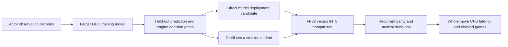

# Larger training models and smaller inference models

The user's proposal adds a useful axis: offline training capacity need not equal
the CPU model submitted to the arena. There are three distinct experiments:

1. A larger **trained teacher** can supply soft policy rankings, hidden-piece
   distributions and danger estimates to a smaller student. The teacher must
   earn those targets through held-out quality. More parameters alone are not
   evidence of better teaching.
2. **Self-supervised EMA teacher/student** learning bootstraps representations
   from actor observations without externally supplied labels. The current
   implementation uses teacher and student of equal capacity. It is not yet
   a large-teacher distillation experiment.
3. **Lower precision inference** reduces representation size and may reduce
   latency. It changes numerical behavior and needs its own tactical gate.

For an initial larger teacher, keep the same legal-candidate output interface
but allow a wider/deeper attention encoder and longer history context offline.
Then distill a compact encoder with policy-distribution, hidden-piece and danger
objectives. Compare against directly training the student using the same total
compute. The first CNN/attention comparison is complete and mixed: attention
improved danger ranking but worsened policy likelihood. A larger attention
encoder is now implemented separately: width 256, six blocks, eight heads,
4,763,322 parameters versus 1,631,826 in the small attention control. A learned
projection preserves the existing 64-channel spatial and 256-state recurrent
interface. The matched GPU capacity pilot is now complete; the larger encoder
has not yet earned a useful teacher role. See the
[capacity report](../analysis/capacity-v4/README.md) for the new features-v2
comparison, which is separate from the earlier features-v1 pilot.

There are two deployment paths to compare: run the larger model directly at
lower precision, or distill it to a smaller model and then quantize the student.
Quantization lowers numerical precision; it does not remove layers or reduce
the number of mathematical operations. Distillation can reduce network size
and work as well. A larger model must first improve held-out predictions under
the same information boundary before it earns either deployment experiment.
The original [knowledge-distillation paper](https://arxiv.org/abs/1503.02531)
motivates transfer from a more expensive teacher; it does not establish an
improvement for our bot.

The audited v3 FP32 graphs occupy only 7.51 MB, so weight storage is not
the binding arena constraint. A useful result buys better decisions within the
CPU time budget, not merely a smaller ZIP. Report full hybrid move latency and
clocked results in addition to neural inference time. Distillation and direct
larger-model inference remain research paths, not completed releases.

## Precision choices

- FP32 is the current inference control.
- FP16/BF16 are 16-bit floating point, rather than generic "Q16". They save
  weight storage, but CPU speed depends on the actual kernels and hardware.
  In particular, ONNX Runtime's [float16 conversion guide](https://onnxruntime.ai/docs/performance/model-optimizations/float16.html)
  warns that its CPU runtime does not support the float16 operators used by
  that workflow. Do not infer arena CPU support or a speedup from our RTX GPU.
  Validate the exported graph with the exact arena execution provider first.
- INT8 is the first integer-quantization experiment. The ONNX implementation
  currently quantizes constant-weight MatMul/Gemm nodes; the CNN convolutions
  and other operators stay FP32. Report actual quantized elements and bytes.
- Mixed precision can retain the recurrent state transitions or sensitive
  output layers in FP32. Try this when broad quantization changes tactical
  rankings. Calibration-aware or quantization-aware training is a later option.

[ONNX Runtime's documentation](https://onnxruntime.ai/docs/performance/model-optimizations/quantization.html)
distinguishes dynamic activation quantization, static calibration and
quantization-aware training, and recommends comparing affected tensors when
accuracy degrades. We first use dynamic quantization so no test or validation
examples are fitted as activation calibration data.

## The gate must include recurrence and decisions

Feed the FP32 and quantized models their **own** previous hidden state at every
observation. Supplying the quantized model with FP32 state would conceal error
accumulation. Compare all legal candidate rankings, top-k coverage, probability
calibration, and truth-labeled immediate king exposure of changed proposals.
Then measure the actual hybrid engine's decisions and complete clocked games.

The first v3-weight audit covers 16 validation games / 1,108 decisions. Partial
INT8 reduced the two graphs from 7,508,085 to 2,867,695 bytes. Top-1 policy
agreement was 1,089/1,108 (98.3%), but policy-only immediate fatalities rose
32→33, with one new and no saved fatal choice. Shared-host p95 observation plus
candidate scoring was 1.003→0.729 ms. Aggregate danger Brier improved slightly,
yet missed that added fatal choice. Maximum recurrent-state absolute difference
was 0.302. This is an explicit reason **not to promote** broad INT8 from average
metrics alone. It is not a claim about the hybrid search's resulting strength.

The next bounded precision ablation kept GRU nodes in FP32 on the same games.
Graph size was 4,038,061 bytes, maximum hidden-state difference fell to 0.099,
and top-1 agreement was 98.38%; the same extra fatal proposal remained. Neither
arm passes promotion. Any promising precision variant still needs a larger
held-out tactical set and a hybrid decision comparison. Current artifacts are
experiments, not arena releases.

## Capacity experiment before distillation

The completed training comparison uses the same frozen features-v2 game split and
observation interface in three arms: unchanged CNN, small attention, and the
larger attention encoder above. Keep full observation prefixes when cutting
training windows. Use paired seeds and the same training decisions, and record
wall time and examples as separate budgets. Give the small control an additional
equal-compute comparison so a longer teacher run is not mistaken for an
architecture gain. The test split stays sealed during architecture selection.

Measure policy likelihood, hidden-piece log loss, per-piece recall, and danger
recall at a fixed false-positive rate. Average Brier alone is insufficient:
the history-recovery experiment improved it while missing more terminal
threats. Inspect actual fatal candidate changes and run the hybrid decision
gate before complete clocked games. A teacher must improve a downstream task
before it supplies targets to a student.

Fable's v3 model provides a concrete caution: its better imitation and danger
scores did not survive the small clocked gate (3.5/8 against arena-v13 bytes on
the caution engine; `data/reports/v3model-vs-v13-lane2.json`). Earlier v1 results
used different seeds, so that comparison is not a paired estimate of the model
effect. The current hybrid takes a deterministic policy top-k after its particle
risk filter, then unions those moves with search and risk proposals. Merely
softening probabilities with temperature preserves policy rank and cannot repair
missing proposals in that path. Changed rankings, risk tie-breaks, and the
interaction with the row limit need direct measurement.

The representation evaluator now reports demonstration hit@4/8/16, policy
entropy, top-1 fatal and avoidable-fatal choices, and cases where every top-four
proposal is fatal despite an available escape. It separates forced-loss seats
and invalid tactical labels. These are unfiltered policy diagnostics; the
hybrid's actual shortlist and selected move remain the promotion instrument.

If it earns that step, compare direct larger-model FP32/INT8 inference with
distillation into the existing small model. The first distillation targets are
legal-candidate soft probabilities, hidden-square distributions and candidate
danger probabilities; both models reconstruct their own recurrent states from
the same actor history. Retain real replay targets so teacher errors are not
the only supervision. A supervised teacher's soft labels are **not** the same
experiment as label-free EMA self-supervision. Larger-teacher distillation is
specified here but not implemented or trained yet.

The untrained large export is 19.24 MB and passes tensor parity with maximum
absolute error 1.44e-6. Shared-host p95 observation plus scoring 96 candidates
was 9.69 ms in a short synthetic profile. This is an engineering feasibility
measurement, not a playing-strength result, and it cannot be compared as an
isolated speed ratio with timings from earlier host loads. It suggests we can
test the larger model directly first; distillation is useful only if it retains
better decisions at a worthwhile reduction in whole-move cost.

Training, checkpoint initialization, export and precision audits now reject
feature-version mismatches. Legacy features-v1 runs remain in their frozen
checkout. The large-model CPU smoke and export are kept separately from
selection runs and will not seed a claimed strength comparison.

Quantization reduces bytes per parameter; distillation can reduce parameter
count and computation. A 4.76-million-parameter model has roughly 19 MB of
FP32 weights versus 4.8 MB if every weight were INT8, before graph overhead,
scales, activations and operators retained in floating point. Those arithmetic
sizes are not promised export sizes or CPU speedups.

The model-to-search connection also limits what extra training capacity can
deliver. In the frozen hybrid used for these experiments, policy supplies root
candidate rankings after the particle-risk filter; neural danger breaks ties
among some risk proposals. The value head is logged, and the hidden-board head
does not update the particle posterior. Lower hidden-piece NLL therefore does
not automatically produce a more accurate runtime belief. Any proposed use of
those heads is a separate integration experiment, with calibrated uncertainty
and actual decision checks, rather than a reason to assume a larger checkpoint
already improves play.

The capacity comparison is now complete through 6,000 updates in all three
arms, following the earlier roughly equal-time comparison. Each arm saw the
same 374,435 training decisions; the validation set contains 5,179 decisions.
CNN/small/large attention produced 170/163/181 avoidable fatal top-1 proposals
among 5,167 decisions with an available escape. The large-versus-small tactical
difference is inconclusive. Large attention improves hidden-enemy NLL from
1.1644 to 1.1399, but all-hidden-square NLL and demonstration hit@4 worsen.
An exploratory piece breakdown also finds worse rook NLL. Aggregate belief
likelihood therefore does not establish a useful teacher for hidden slider
threats. No model from this comparison has passed the actual hybrid/game gate.

All three policy-loss curves worsen after earlier checkpoints. The next
capacity experiment should expand the number of distinct training games and
specify checkpoint selection in advance, with a second seed for any promising
result. A belief-specialized larger teacher is a hypothesis to test against
actual attacker coverage and downstream decisions, not a result already won.
The GPU was released after this comparison. Detailed curves, paired intervals
and checkpoint hashes are in the linked capacity report; the test shard remains
sealed. Larger-teacher distillation has not been implemented or trained.

At 05:16 UTC on 2026-10-08, a subsequent comparison started after verifying
the GPU was idle. It expands the training pool from 512 to all 3,766 v4 training
games, preserving the source revision, architecture definitions, seed and the
same 64 validation games. All three arms start fresh and run 6,000 updates,
with evaluation every 1,000. CNN and small attention have completed; large
attention is still running. The test shard is not copied or used. The
[full-data design](../analysis/capacity-v4/full-data-design.json) fixes the
primary comparison and requires comparison with earlier-stopped controls as
well. This tests whether broader training data makes extra capacity useful
before spending resources on teacher distillation or another precision audit.

The [broader-data results](../analysis/capacity-v4/full-data.md) improve both
completed models' prediction metrics. Small attention makes 137 avoidable
fatal top-1 proposals versus full-data CNN's 157 on the same 5,167 validation
decisions, while its imitation likelihood is worse. The actual CNN hybrid gate
is tied with the existing v4 model: 165 versus 164 terminal fatal decisions,
two saved and one newly fatal. Small attention passes export parity and the
same completed hybrid gate also produces 164 terminal fatal decisions, tied
with full-data CNN. This is why the deployment sequence remains: establish a useful model,
then compare direct inference with distillation and INT8. Larger training
capacity and lower numerical precision cannot substitute for a better decision
rule or a demonstrated downstream model benefit.
