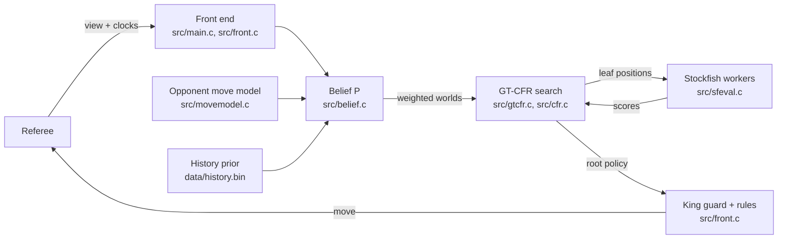

# Current engine: mist-c

*The engine behind arena versions 33 and 34 (October 2026). Source: [htansetiawan/mist-c](https://github.com/htansetiawan/mist-c), a clean-room C implementation of Obscuro-style imperfect-information search, shipped with Stockfish as a leaf evaluator.*

[TOC]

## What the arena gives us

Fog of War chess as played in the course arena: a player sees only the squares its own pieces could move to, captures of its pieces are revealed, there is no check, and capturing the king wins. The referee speaks a line protocol: before each of our moves it sends our current view of the board (64 characters, `?` for unseen squares) and the clocks; we answer with a move. The arena box has **2 cores, 4 GiB of RAM, no network, a 15-second start-up limit and 180 s + 2 s per move**, and runs about 1.9 times slower than our development machine.

Everything below is shaped by those limits: the belief must stay bounded, the search must give an answer in a few seconds, and nothing may be downloaded at run time.

## The decision loop

One move is produced in five steps.

1. **Observe.** The front end parses the view and clocks. Every unseen square is an unknown; every seen square is a hard constraint.
2. **Update the belief.** `P` is the set of full positions consistent with everything we have seen so far, each with a weight. The opponent's hidden move is enumerated for every position in `P`, positions that contradict the new view are dropped, and positions reached by several histories merge their weights. Past a cap (200,000 positions) the set is kept by weighted sampling. The update runs on two threads.
3. **Search.** A sample of worlds is drawn from `P` by weight and a public-tree game is solved with GT-CFR: PCFR+ regret matching on information sets keyed by each player's own history, the tree grown between solver rounds where the current strategy and a visit bonus lead. Leaves are scored by Stockfish on worker processes, in waves, so the main thread never waits on a pipe.
4. **Guard.** Before the root policy is purified into a move, the **king guard** removes root moves whose probability of leaving our king capturable, under the belief, exceeds a margin (2%). Since v12 the risk is computed under two weightings of the sampled worlds, the sharpened one the search uses and the fitted one, and a move excluded under either is excluded.
5. **Rules of thumb.** Threefold-repetition avoidance when ahead by two points or more; a legality guard that never sends a move the view forbids on some consistent board; a fallback that rebuilds the belief from the view if the cap ever empties it; a time manager that spends the clock divided by 20 per move plus the increment, with the first decisions getting the most.

## The belief in detail

The belief is exact while it fits under the cap. On 40 recorded arena games between strong bots the exact set overflowed a 100k cap in 24 games, so the weighting matters:

- **Referee rule.** A move that leaves the mover's own king capturable ends the game, so positions that would require the opponent to have made such a move are impossible and are dropped.
- **Opponent move model.** Every hidden opponent move is scored by a conditional-logit model (`src/movemodel.c`) fitted on 2,029 arena games; on held-out games it gains 0.63 nats per move over uniform with 27.7% top-1 accuracy. A world's weight is the product of its moves' likelihoods.
- **Empirical history prior.** A table keyed by the opponent's information history (`data/history.bin`, built from the arena corpus by `tools/history_table.c`) adds what real opponents actually did from the same view; it fixed a family of early queen-check losses that the fitted model under-weighted.
- **Temperature.** The log-likelihood is multiplied by `MIST_MODEL_TEMP` (2.0 since v11). Sharpening concentrates the sampled worlds: a search samples 3 to 6 distinct worlds where the flat belief samples 25 to 28. On the regression suite this cut hidden-check blunders from 73 to 59 of 399 while leaving the material kind unchanged, but only together with the two-weighting guard, since the sharpened weights alone would drop a 3% check world below the 2% margin.

## Search in detail

- **Solver.** PCFR+ (predictive CFR+ with last-iterate play) on a tree whose information sets are keyed by each player's own observation history, which is what the Obscuro paper calls search without common knowledge. On Kuhn poker the implementation converges to the game value and its last iterate is unexploitable to 1e-5 by iteration 100.
- **Expansion.** GT-CFR: the tree grows between solver rounds, alternating which player explores; about 310k nodes per move fit in the arena budget.
- **Leaf evaluation.** Stockfish 19 at depth 1 with MultiPV, called on two worker processes and scored in waves. A single call costs 0.3 to 1.8 ms depending on the number of legal moves; the pipe itself is 0.01 ms. Children not yet scored take the worst scored sibling's value as a floor.
- **Pipelining.** The main thread used to idle while waiting on Stockfish (0.1 s of CPU in a 2.5 s search). Asynchronous scoring (`MIST_ASYNC`) and a MultiPV cap of 16 or 8 (`MIST_SF_MULTIPV`, an opt-in knob) gave 2.1 to 2.65 times more expansions on an opening decision in tests; more expansions alone did not reduce hidden-check blunders, which is why the calibration work followed.
- **Purification.** The root policy is purified before play, the king guard runs on the purified candidates, and a repetition rule can veto the top candidate.

## Resource profile in the arena

| quantity | value |
| --- | --- |
| think time at decision 1 (median) | 6.5 s, falling to 3.1 s by decision 40 |
| clock left at the end of a 72-ply game (median) | 74 s |
| belief update at the 200k cap (local) | 0.27 s, about 0.5 s in the arena |
| suite decisions that hit the cap | 44% |
| lowest clock seen in 120 local bench games | 21 s |
| time forfeits in 440 arena games of v34 | 0 |

## What ships in the zip

The submission is self-contained: the engine binary, a Stockfish 19 build, the history table, the move-model weights compiled into the binary, and a run script that sets the two environment variables. No Python, no network, and the course starter kit is never bundled. Validation before upload replays recorded arena decisions through the exact zip contents with the course referee protocol.
