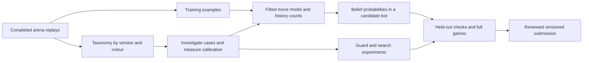

# How arena intelligence reaches the bot

31 October 2026. The daily collection and analysis loop is running. This morning
it added 4,642 replays, bringing the archive to 186,276 games. It also rebuilt the
training dataset, exported 88,323 recent games for move-model fitting, archived
the new data, and generated the taxonomy, insights and skill reports.

**The taxonomy guides learning and evaluation. It does not automatically update
the deployed model.** Fresh data, a newly fitted model, and a promoted submission
are three separately recorded events.

The diagram includes manual experiment and review steps. Only collection,
training-input export, reports, and the intelligence status/index run on the
daily timer; fitting and promotion are not scheduled by that timer.

| Asset | What it currently does | What an update changes |
|---|---|---|
| Move model | Predicts how plausible an opponent move is in a hypothesized board | A fitted candidate changes the probabilities used to update the belief. The working model was refitted on 6,776 games on 29 October; that does not mean v35 contains it. |
| History table | Counts moves after an opponent's own information history | A rebuilt table changes the empirical prior when packaged and loaded. The v35 archive still contains its fixed 151,316 records. |
| Regression suite | Replays 1,379 fixed decisions through a candidate with the original permitted inputs | Reveals fixes and regressions. Keep this comparison set fixed; collect new cases in a separate supplement. |
| Taxonomy and scorecard | Describe fog attacks, exposure, sacrifices, king activity and other behaviour | Identify investigation cohorts and distribution changes. The tags themselves are not model weights or guard thresholds. |

In the belief update, a consistent successor world's weight depends on the
previous world's weight multiplied by the estimated probability of the
opponent move. The fitted model and history counts supply that move probability.
A statistic such as "duck makes more hidden threats" does not currently multiply
its worlds' weights. It must first become a specified, validated predictor or
sampling change.

## How we use it for king and queen safety

An increase in unseen queen exposure or king vulnerability tells us which
replays to inspect. We then reconstruct the observation history and compare the
guard's predicted risk with what the true board shows. This can identify a
missing hypothesis, too little probability on an attacker, insufficient search
coverage, or an unsuitable guard decision rule.

The taxonomy alone cannot decide the fix. An attacked piece may be making a
sound trade; an apparent material lead may be halfway through an exchange.
The recent frame-30 conversion correction is an example. Static attack labels,
material after a reply/recapture, and actual game outcomes must stay distinct.

A model/guard change earns promotion through held-out calibration, fixed-suite
comparison plus separate fresh cases, and full games against v35 and relevant
opponents. A lower offline loss or a better-looking taxonomy rank is not an Elo
result. In particular, the refreshed hybrid opponent proxies have not passed
their control-fidelity check and cannot replace authentic opponent evidence.

## What the daily loop now preserves

- Day-to-day taxonomy changes now select the previous dated arena report. A
  scorecard JSON could previously be mistaken for that report, hiding deltas.
- All 19 move tags are saved by **played version and colour**, with raw counts,
  move denominators and opponent-version mixtures. These are descriptive rates;
  changes in opponent mix can explain changes in them.
- The [learning status](../data/reports/daily/intel-latest.md) distinguishes
  fresh data, the working model, the reference archive's history table, and the
  frozen suite. It explicitly flags an active-version/reference-version mismatch.
- A bounded rolling index points to recent losses by opponent version, our
  version and colour. It currently contains 203 games. These are candidate cases
  to investigate, **not** 203 newly validated regression decisions.
- Current reports are copied to external storage after generation. Optional
  report failures no longer prevent the publication block from committing the
  reports that exist, and unrelated staged changes are excluded.

Timer: `iamavirus-daily.timer`, daily at 10:00 UTC plus up to ten minutes of
jitter, with catch-up after downtime. The backing drive is selected through
`data/store`. It currently points to `/media/henrytan/seagate1/iamavirus-data`.

Fable owns model/history candidate refreshes and deployment. Astra maintains
these report changes and reviews experiments. The missing automation is a fully
validated retrain-and-promote loop; this maintenance change does not claim to
implement one or alter the active bot.

## 1 November: what has reached learning and testing

The taxonomy now selects a fresh development comparison of 51 decisions from
25 v35 games against Instructors, duck and HYPOTHERMIA. It includes king-fatal
moves, unseen queen exposure, net material loss, recovered exchanges and
ordinary controls, with both wins and losses. This is a deliberately selected
diagnostic set; its failure rate is not a population failure-rate estimate.

The first root-loss correction tested on these cases fixed two fatal choices
and broke two. It was not promoted. Its traces motivated a separate calibration
study, selected without using outcomes: 140 complete games, split by date into
80 training, 20 validation and 40 test games. Reconstructing v35's own inputs
produced risk estimates for 184,554 candidate moves; true-board labels were
joined only after the engine exited.

The fitted two-coefficient king-loss calibration improves held-out log loss
from 0.07212 to 0.05887 and Brier score from 0.02079 to 0.01889. On historically
played test moves, the average risk rises from 0.459% to 0.909%, against an
observed fatal-choice frequency of 1.286%. Whole-game bootstrap intervals
support the improvement. It remains a probability result, not an Elo result.

This curve adjusts an action's estimated immediate king-loss probability. It
does **not** change the weights of individual hidden boards, repair a wrong
risk ranking, or calibrate queen exchanges. Its C implementation and data are
published under `astra-submissions/*/king-event-calibration-20261101/`.

Two isolated search integrations completed 204 runs against v35 and a
feature-off control: a terminal-loss residual, and a mixture that also rescales
surviving continuations. Existing guards and the doubled root-loss utility
were fixed. The residual matches v35's 10 fatal choices and 5 material losses;
the mixture records 11 and 7. The feature-off control itself records 6 material
losses. Neither passes the recorded gate; neither earns a new ZIP or full-game
trial. Native and sanitizer checks pass, including tree growth and both
players' regret updates. Evidence and the bounded follow-up plan are under
`astra-submissions/analysis/calibrated-root-20261101/`.

Separately, Fable's v37 refresh of the move model and history table scores
56W–2D–42L against v35 in 100 unique local games. Its paired 95% score interval
is 46.5–67.0%, so superiority is not established. The recovery audit excludes
three duplicate rows and explicitly records two unavailable original replays;
see `astra-submissions/analysis/v37-recovery-20261101/`.

These are concrete model-learning and testing steps, not an automatic update
of the deployed bot. The record preserves both the positive calibration
result and the decision experiments that did not justify promotion.
