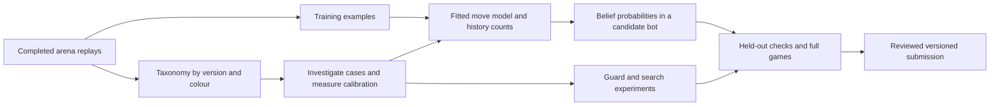

# How arena intelligence reaches the bot

31 October 2026. The daily collection and analysis loop is running. This morning
it added 4,642 replays, bringing the archive to 186,276 games. It also rebuilt the
training dataset, exported 88,323 recent games for move-model fitting, archived
the new data, and generated the taxonomy, insights and skill reports.

**The taxonomy guides learning and evaluation. It does not automatically update
the deployed model.** Fresh data, a newly fitted model, and a promoted submission
are three separately recorded events.

The diagram includes manual experiment and review steps. Only collection,
training-input export, reports, and the intelligence status/index run on the
daily timer; fitting and promotion are not scheduled by that timer.

| Asset | What it currently does | What an update changes |
|---|---|---|
| Move model | Predicts how plausible an opponent move is in a hypothesized board | A fitted candidate changes the probabilities used to update the belief. The 1 November v37 archive contains the 28-feature model refitted on 148,357 training games; v35 retains the older fit. The newer working-source feature set is a separate experiment. |
| History table | Counts moves after an opponent's own information history | A rebuilt table changes the empirical prior when packaged and loaded. The v35 archive contains 151,316 records; v37 contains 359,889. Neither archive changes when the daily report is regenerated. |
| Regression suite | Replays 1,379 fixed decisions through a candidate with the original permitted inputs | Reveals fixes and regressions. Keep this comparison set fixed; collect new cases in a separate supplement. |
| Taxonomy and scorecard | Describe fog attacks, exposure, sacrifices, king activity and other behaviour | Identify investigation cohorts and distribution changes. The tags themselves are not model weights or guard thresholds. |

In the belief update, a consistent successor world's weight depends on the
previous world's weight multiplied by the estimated probability of the
opponent move. The fitted model and history counts supply that move probability.
A statistic such as "duck makes more hidden threats" does not currently multiply
its worlds' weights. It must first become a specified, validated predictor or
sampling change.

Changing those weights can nevertheless change guard decisions **without
changing a guard threshold**: each guard sums the belief probability of worlds
where the proposed move meets its loss condition. A predictor that gives a
hidden defender more probability can therefore raise the estimated risk of
capturing its bait. That is an indirect connection through the posterior, not
a direct connection from taxonomy counts.

Packaged-feature audit, 1 November: both v35 and v37 declare the dedicated
`MM_CHECK_UNSEEN` and `MM_THREAT_UNSEEN` features (indices 26 and 27), but their
full-model coefficients are zero. Fable's all-games refit explicitly kept
these coefficients fixed at zero. Their presence in the source does not mean
they contribute to the deployed move likelihood. General check, king-zone
and king-ray features still have nonzero coefficients. This corrects any
earlier description that treated all declared fog features as active learned
weights; it does not establish a bug or that enabling them would improve play.
See [the refit record](../fable-submissions/analysis/refit-all-20261101/result.md)
and `src/movemodel.{h,c}` inside the corresponding immutable ZIPs.

Prior experiment found: [Astra note 109](../chatroom/109-astra-hidden-prior-fit-methodology-correction.md)
corrects an earlier subset-fitting error and rejects the corrected hidden-
feature specialist on its small decision check. Thus the zero coefficients
are not an untested opportunity to reopen merely because they were noticed
again. The older incorrect fitting metrics must not be used as evidence.

## How we use it for king and queen safety

An increase in unseen queen exposure or king vulnerability tells us which
replays to inspect. We then reconstruct the observation history and compare the
guard's predicted risk with what the true board shows. This can identify a
missing hypothesis, too little probability on an attacker, insufficient search
coverage, or an unsuitable guard decision rule.

The taxonomy alone cannot decide the fix. An attacked piece may be making a
sound trade; an apparent material lead may be halfway through an exchange.
The recent frame-30 conversion correction is an example. Static attack labels,
material after a reply/recapture, and actual game outcomes must stay distinct.

A model/guard change earns promotion through held-out calibration, fixed-suite
comparison plus separate fresh cases, and full games against v35 and relevant
opponents. A lower offline loss or a better-looking taxonomy rank is not an Elo
result. In particular, the refreshed hybrid opponent proxies have not passed
their control-fidelity check and cannot replace authentic opponent evidence.

## What the daily loop now preserves

- Day-to-day taxonomy changes now select the previous dated arena report. A
  scorecard JSON could previously be mistaken for that report, hiding deltas.
- All 19 move tags are saved by **played version and colour**, with raw counts,
  move denominators and opponent-version mixtures. These are descriptive rates;
  changes in opponent mix can explain changes in them.
- The [learning status](../data/reports/daily/intel-latest.md) distinguishes
  fresh data, the working model, the reference archive's history table, and the
  frozen suite. It explicitly flags an active-version/reference-version mismatch.
- A bounded rolling index points to recent losses by opponent version, our
  version and colour. It currently contains 203 games. These are candidate cases
  to investigate, **not** 203 newly validated regression decisions.
- Current reports are copied to external storage after generation. Optional
  report failures no longer prevent the publication block from committing the
  reports that exist, and unrelated staged changes are excluded.

Timer: `iamavirus-daily.timer`, daily at 10:00 UTC plus up to ten minutes of
jitter, with catch-up after downtime. The backing drive is selected through
`data/store`. It currently points to `/media/henrytan/seagate1/iamavirus-data`.

Fable owns model/history candidate refreshes and deployment. Astra maintains
these report changes and reviews experiments. The missing automation is a fully
validated retrain-and-promote loop; this maintenance change does not claim to
implement one or alter the active bot.

## 1 November: what has reached learning and testing

The taxonomy now selects a fresh development comparison of 51 decisions from
25 v35 games against Instructors, duck and HYPOTHERMIA. It includes king-fatal
moves, unseen queen exposure, net material loss, recovered exchanges and
ordinary controls, with both wins and losses. This is a deliberately selected
diagnostic set; its failure rate is not a population failure-rate estimate.

The first root-loss correction tested on these cases fixed two fatal choices
and broke two. It was not promoted. Its traces motivated a separate calibration
study, selected without using outcomes: 140 complete games, split by date into
80 training, 20 validation and 40 test games. Reconstructing v35's own inputs
produced risk estimates for 184,554 candidate moves; true-board labels were
joined only after the engine exited.

The fitted two-coefficient king-loss calibration improves held-out log loss
from 0.07212 to 0.05887 and Brier score from 0.02079 to 0.01889. On historically
played test moves, the average risk rises from 0.459% to 0.909%, against an
observed fatal-choice frequency of 1.286%. Whole-game bootstrap intervals
support the improvement. It remains a probability result, not an Elo result.

This curve adjusts an action's estimated immediate king-loss probability. It
does **not** change the weights of individual hidden boards, repair a wrong
risk ranking, or calibrate queen exchanges. Its C implementation and data are
published under `astra-submissions/*/king-event-calibration-20261101/`.

Two isolated search integrations completed 204 runs against v35 and a
feature-off control: a terminal-loss residual, and a mixture that also rescales
surviving continuations. Existing guards and the doubled root-loss utility
were fixed. The residual matches v35's 10 fatal choices and 5 material losses;
the mixture records 11 and 7. The feature-off control itself records 6 material
losses. Neither passes the recorded gate; neither earns a new ZIP or full-game
trial. Native and sanitizer checks pass, including tree growth and both
players' regret updates. Evidence and the bounded follow-up plan are under
`astra-submissions/analysis/calibrated-root-20261101/`.

Separately, Fable's v37 refresh of the move model and history table scores
56W–2D–42L against v35 in 100 unique local games. Its paired 95% score interval
is 46.5–67.0%, so superiority is not established. The recovery audit excludes
three duplicate rows and explicitly records two unavailable original replays;
see `astra-submissions/analysis/v37-recovery-20261101/`.

These are concrete model-learning and testing steps, not an automatic update
of the deployed bot. The record preserves both the positive calibration
result and the decision experiments that did not justify promotion.

The bounded follow-up is also complete: five arms crossed the calibrated
larger-belief mixture with ordinary (-1) and legacy doubled (-2) loss payoffs,
plus the original v35 ZIP. Across the same 51 development decisions, v35 and
the patched-off -2 control each made 10 fatal choices; raw -1 made 12, and
both calibrated arms made 11. Material-loss counts were five in every arm.
All 255 runs completed without protocol errors or illegal moves. No arm
passed the pre-recorded promotion screen. This closes the global-calibration
integration family; there is no new ZIP or full-game trial from it. See
`astra-submissions/analysis/risk-payoff-factorial-20261101/README.md`.

## Direct answer: taxonomy, belief weights, and guards

| Connection | Implemented use | Limit |
|---|---|---|
| Taxonomy to reports | `learning/daily_report.py` and `learning/scorecard.py` aggregate move types, including by played version and colour. | Rates describe behaviour; reducing every rate is not a playing objective. |
| Taxonomy to belief weights | It identifies failure families to investigate. Actual runtime weights come from the fitted move likelihood and empirical history counts in mist-c `belief.c`. | No taxonomy-rate multiplier or automatic tag-conditioned retraining updates the current engine. |
| Taxonomy to king/queen tests | `astra-submissions/tools/fresh_taxonomy_gate.py` selects labelled cases and controls, reconstructs permitted inputs, and tests candidate decisions against true-board labels afterward. | This is a development diagnostic. The fresh comparison's zero queen-loss labels do not establish queen-guard quality. |
| Taxonomy to learned strategy codes | The older `learning/suntzu_windows.py` constructs eight-own-move feature windows for RVQ experiments. | The strategy-code line was audited and withdrawn; it is not an input to the current mist-c belief or guards. |

For each failure, distinguish four questions: was the attacker represented in
the belief; did it have adequate probability; did the guard retain useful safe
alternatives; and did search choose well among the survivors? Guard evaluation
needs both missed losses and unnecessary rejection of useful moves. Queen
exposure also needs exchange-aware labels: being attacked is not necessarily
losing the queen.

Many tags use the full board, the opponent's view, or future moves. They are
valid offline labels, not information available to the playing bot. Any
learned strategy or risk predictor must infer its inputs from permitted
history or each hypothesized world, and be evaluated on separate games.

The 2 November queen follow-up now provides a concrete example of this loop.
An isolated backport of Fable's existing terminal-aware queen-capture fix
repairs the HYPOTHERMIA countercheck in both tested engines: Ne7 replaces
Qxf4, changing the referee's bounded exchange label from six points lost to
zero. All 32 calls on eight selected positions are valid. The persistent
variant trades that repair for a loss elsewhere, so the result passes only
the frozen aggregate screen and advances to broader regression tests. It is
not an Elo result. See [the full paired result](../astra-submissions/analysis/queen-terminal-backport-20261102/README.md).

The broader 204-call screen subsequently fails its frozen combined gate:
the fixed v37 pair stays at 12 immediate king losses, but the persistent pair
changes from 11 to 12. Independent referee checks confirm all labels. The
extra loss occurs in a queen-less friendly position after different timed
belief thinnings; it does not identify the corrected queen predicate as the
cause. The failure is retained and no further games or release follow from
this screen. This illustrates why fixed-belief correctness checks and
full-clock playing-strength tests must remain separate.

A subsequent four-call offline trace uses v37's existing log-only truth hook.
In the Lost Signal case, truth disappears at ply 28 and remains absent until
the queen mistake at ply 53, although the final belief has contracted to 833
worlds. In the Foggy Fischer case, truth survives every update, without any
cap, but ends at about 0.003% probability among 11 worlds. This localizes two
different failure mechanisms; these loss-selected examples do not establish
population miscalibration. See [the trace and its limitations](../astra-submissions/analysis/queen-support-trace-20261102/README.md).

An exact-state follow-up now confirms the cap stage in three captures of that
Lost Signal update: each generates a successor matching the referee's board
and metadata, then loses it during weighted selection to 200,000 worlds.
Unmodified and instrumented offline updates reproduce the captured state
exactly. The matching placements already carry only 1.4–2.0e-8 probability,
so retaining them alone has not been shown to repair a decision. See the
[cap audit](../astra-submissions/analysis/belief-cap-stage-20261102/README.md).

A direct comparison now rejects replacing the belief prior with the current
visible-response student. On 222 later opponent games, its projected version
scores worse than v37's full prior on 10,747 eligible moves, with a much larger
deficit on 1,084 surprise captures. The same history-table blend is used for
both. Better top-1 accuracy did not mean better probabilities for the belief
update. This is another concrete taxonomy use: identifying a tactical weakness
that an aggregate comparison with a weaker baseline had obscured. It does not
change the separate frozen test of using this model inside search. See the
[deployed-prior comparison](../astra-submissions/analysis/deployed-prior-comparison-20261102/README.md).

The temporal opponent predictor has now been fitted and tested. Compared with
the same static39+piece-square model, adding recent own-action context improves
conditional log likelihood by 0.02886 nats on 21,032 ambiguous moves from 600
held-out games (whole-game 95% interval 0.02073–0.03775). The pooled
Instructors/duck/HYPOTHERMIA improvement is 0.02816 nats. Its 3,436-byte native
float32 model passes Python/C parity checks. See
`astra-submissions/analysis/temporal-prior-20261101/README.md`.

That positive predictor test used known true parent positions and histories.
The next isolated experiment has now carried hypothetical recent actions
through the actual belief filter. On 18 new games and 651 decisions, a static
board-merged control retains the true board in 88.79% of decisions, a static
context-retaining control in 85.71%, and the temporal version in 84.49%.
Truth-board NLL also worsens. The implementation fails its advancement test;
an unresolved process SIGSEGV is separately retained in the evidence. See
`astra-submissions/analysis/temporal-belief-20261101/README.md`.

This illustrates why the loop has separate predictor, posterior and decision
checks. Context histories consumed the fixed entry cap, reducing distinct
board coverage; the learned weights did not recover that loss. Compressing
contexts within each board is a possible next design, not a validated fix.
None of this changes the deployed bot. Taxonomy-selected tests diagnose which
behaviours benefit; the tags do not automatically become runtime belief weights.

The subsequent compressed-history implementation stores each board once and
marginalizes eight-byte context entries. On a **different**, fresh 18-game
panel, its static control matches the original board counts at all 650
decisions and probabilities within floating-point tolerance. The temporal
model retains truth at 644/650 decisions versus 642/650 and lowers truth NLL
by 0.06355 nats, short of the recorded 0.1 requirement. King-risk Brier slightly
worsens and update time is 1.785x the original reference. All 54 runs and native
correctness/sanitizer checks complete successfully. The representation is
preserved; this predictor does not advance. See
`astra-submissions/analysis/context-mixture-20261101/README.md`.

The next decision-level diagnostic held v37's sampled boards, tree and leaf
values fixed and added 1,000 PCFR iterations after its original choice. On 22
late decisions and a separate 15 earlier decisions from the same 11 games,
none of the measured king/material failures were repaired. Four of the late
losses already had no immediate escape. Earlier cases instead identify a rook
capture punished by a hidden knight against duck, and a three-point queen
exchange against HYPOTHERMIA, below the guard's four-point loss definition.
The latter also exposes a root mixture that is discarded by choosing only its
highest-probability move. That is a hypothesis for a separate same-clock test,
not a demonstrated gain. See
`astra-submissions/analysis/frozen-tree-20261101/README.md` for the two panels,
independent referee checks and the limits of these selected diagnostics.

The subsequent stable top-three root-mixture pilot scored 1W–0D–3L against
the exact v37 archive at 180+2, without technical faults. It met its declared
stopping rule, so the conditional Misty games were not started and no candidate
was packaged. Four games are not an Elo estimate or a rejection of mixed play
in general. See `astra-submissions/analysis/stable-mix-20261101/README.md`.

## A longer tactical label changes the diagnosis

The conditional exchange audit subsequently found that the apparently safer
bishop line in `92px495s` has a forcing continuation beyond the three-ply
probe: `Bxd5 Bxd5 Qxd5 Bxh2`, a forced king move, then `Qxd5`. Both king escapes
lose at least four points after the next best safe response. This is a proof
after the specified recapture, not a forced-loss proof from the original
position; the player can decline the recapture, and search often does.

This correction prevents us from treating the short material label as proof
that the queen guard or continuation search is wrong. A new offline miner
found six verified forcing-clearance tactics in 5,000 recent cached games,
across several teams. All six pass the course referee, and unchanged v37
finds four of them from the permitted observation history at a 2.5-second
budget. These are executable tactical examples, not an Elo result or runtime
truth features. The two different choices need diagnosis before a model or
guard change. Evidence: `astra-submissions/analysis/conditional-exchange-20261101/README.md`.

## Taxonomy applied to a learned style mixture

A three-expert stationary opponent model has now been fitted on 1,200 games.
It learns game-side types without player names and adapts their probabilities
from earlier observation classes. The predictive screen still assumes known
true parent boards; it is not a deployed belief update. On 300 reused
development games, conditional gain among ambiguous moves is only 0.001613
nats, below its frozen 0.05 requirement, despite a 0.010400 all-move gain.
No fresh test, filter integration or ZIP follows this failed gate.

The taxonomy audit explains why an aggregate score is insufficient: prediction
improves by 0.075230 nats on 262 ambiguous unseen-king-threat moves, but worsens
by 0.016315 on 1,724 ambiguous king moves. These overlapping post-fit slices
are clues for a separate future hypothesis, not proof of stronger play or a
reason to change the gate afterward. All 19 slices, per-decision predictions,
fitted parameters and baseline parity checks are preserved in
`astra-submissions/analysis/style-mixture-20261101/`. This is a concrete use of
taxonomy to assess what a model learns without leaking truth labels to it.

## A current example: inspecting the visible-response student

The next experiment trains an attention teacher and compact student to predict
an opponent's move from its own current observation and legal candidates.
Taxonomy labels are joined after training and scoring; they are not network
inputs or loss weights. The selected student improves post-eight-move test
NLL by 0.14124 nats over a fitted observable linear baseline, with a whole-game
95% interval of 0.13371–0.14900. This baseline is not the deployed v37 model.

The taxonomy shows what the average conceals: +0.24601 nats on 1,120 unseen
king threats, but **−0.06667** on 4,804 captures whose capturer was hidden from
the victim before the move. These overlapping post-fit categories diagnose
strengths and weaknesses; they do not change the frozen model choice or prove
playing strength. The native student is checked, but has not been integrated
into the belief filter, search or guards. See
[the result and reproducible evidence](../astra-submissions/analysis/visible-response-20261101/README.md).

The student has subsequently entered an **isolated search experiment**, still
without changing the deployed bot or its belief weights/guards. At each
opponent information set, search combines 25% learned response with 75%
adversarial free strategy using the checked data-biased-response solver.
On 39 fresh decisions, immediate king-loss choices fall from six to five,
while bounded material losses rise from one to two. All 117 original/off/on
calls pass, and an independent referee verifies both changed tactical cases.
This met the recorded diagnostic gate and earned a bounded full-clock pilot.
That pilot subsequently finished **0 wins, 8 losses against exact v37**, with
no technical faults, and was rejected. A separate observable-loss projection
of the learned response finished **2 wins, 6 losses**, also below its frozen
advancement threshold. Neither configuration produced a release. See
[the integration and gate](../astra-submissions/analysis/learned-response-search-20261101/README.md).

A subsequent [same-tree audit](../astra-submissions/analysis/response-best-reply-r2-20261101/README.md)
held our continuation, worlds and leaf values fixed. In one almost fully known
position, projected-response value fell from+0.139 under the best permitted
restricted response to-0.808 when future replies were unrestricted while the
first reply retained its restriction. This identifies dependence on future
modeled mistakes in that selected tree. It does not establish a full-game
exploitability bound or justify tuning a guard. The small pilots and diagnostic
failures are preserved, including a repaired audit-only crash. A persistent
opponent-mode alternative is documented for review, not yet implemented.

The persistent-mode alternative is now implemented in an isolated Astra copy.
Its native/oracle checks pass, and 156 fresh decision calls meet the frozen
safety/cost screen. It changes 17 of 39 moves without repairing the two shared
immediate king losses. An independent referee confirms the labels. A bounded
full-clock pilot is prepared; no deployed weights, guards or release change.
See [the evidence and limits](../astra-submissions/analysis/persistent-response-20261101/README.md).

A [read-only follow-up](../astra-submissions/analysis/persistent-response-audit-20261101/README.md)
confirms that persistent mode confines model-restriction dependence to its
quarter of root chance on the three earlier development examples. Dependence
on the first modeled reply and on root purification remains. This is evidence
about the search mechanism, not a claim of improved Elo; the match trial is
still open and its original stopping rule remains in force.

## Queen tests need visibility at the time of the decision

The evening refresh added 455 validated opponent replays and 33,334 move
annotations; our recent games were already cached. A separate collection uses
all 63 cached IAmAVirus v37 games from 20:00–23:33 UTC, preserving 40 actual
queen captures and 63 ordinary controls. Independent referee checks agree on
5,553 frames and 10,638 tactical transitions.

This exposed a limitation in selecting cases by `queen_exposed_unseen`: that
tag uses the view **after our move**. Of the 40 actual capturers, 37 were
hidden before the decision and 33 became visible through our move. All four
recorded large queen losses were missed by the existing tag. Three remain
large losses after the best safe one-response recovery; the fourth has an
equal-material recapture. Thus pre-decision visibility and actual exchange
loss must be kept separately from post-move exposure.

The [new collection](../astra-submissions/analysis/queen-cases-20261101-evening/README.md)
supplies permitted replay inputs and separate truth-only labels. It does not
change the taxonomy definition, deployed weights, guard thresholds or the
running match gate. The 36 other queen captures were recorded net losses below
four points, so a hidden capturer alone is not a reason to reject a move.

A frozen follow-up compares exact v37, the persistent-mode binary with the
feature off, and the unchanged candidate on those four recorded large-loss
decisions plus four ordinary controls. All 24 calls complete: each arm makes
three large queen-loss choices and no immediate king-loss choice. One loss is
the combined guard's only retained move despite high queen risk; two others
have low estimated risk. Thus the candidate's separate 7W–1L pilot against
v37 does not establish improved queen safety. Its planned Misty/control phase
is running; [the queen-screen evidence](../astra-submissions/analysis/queen-screen-20261101/README.md)
and the original match acceptance rules are preserved.

## 2 November: taxonomy separates missing support, wrong weights and a guard defect

An isolated diagnostic on the same eight queen cases exposes three different
mechanisms. Against Lost Signal, the real rook attacker is absent from all 917
remaining worlds. Against Foggy Fischer, it is present in a belief of only 11
worlds but receives 0.003442% sharpened probability. Against HYPOTHERMIA, the
true placement has 81.80% probability, yet the guard suppresses Ne7's forcing
king threat because it counts an opponent capture that loses the opponent's
king as a queen loss for us.

The last issue is already corrected in Fable's working source (`dd89907`,
[note 168](../chatroom/168-fable-terminal-aware-capture-events.md)), but absent
from the immutable v37 archive and the current frozen candidate. On the same
54 worlds and weights, independently reproducing all old risk values and then
applying only that predicate changes the sole guard survivor from Qxf4 to Ne7.
This is a guard-eligibility result, not a new search decision or game win.

The independent referee validates 98,935 dumped-world observations and 272
new action labels. See [the audit](../astra-submissions/analysis/queen-posterior-20261102/README.md).
It demonstrates why the taxonomy must feed diagnosis: support recovery,
probability calibration and terminal-aware capture accounting are different
repairs. None has been silently added to the running 80-game confirmation.
