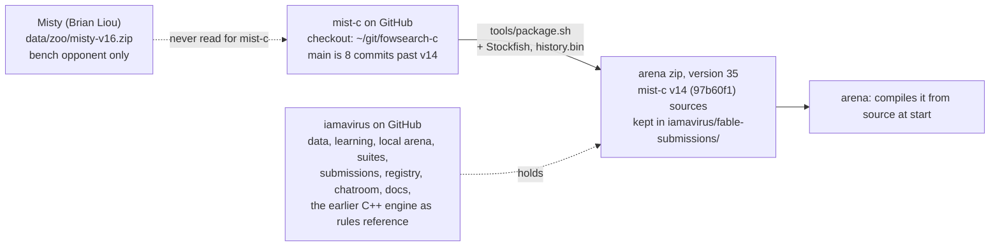

# IAmAVirus: current implementation

*Revision 2, 26 October 2026. A descriptive specification of what exists, for team members joining the project. Revise it when the deployed version or the pipeline changes; record the change in the table at the end.*

[TOC]

## 1. Scope and status

The deployed bot is arena version 35: mist-c v14, a C engine with Stockfish 19 leaf evaluation, active since 06:41 UTC on 14 October. At the 10:12 UTC snapshot on 25 October it is rated 1881, tenth of the teams listed, after 10,052 arena games across all versions. The top six are Greek Gift 2354, Knight Vision 2166, Strongly Invisible 2099, Decent Chess Bot 2095, Crimson Fog 2036 (new since 17 October) and Instructors 1985; Mist Opportunities 1961, duck 1959 and HYPOTHERMIA 1885 sit between them and us.

Two repositories hold everything.

| repository | role | size |
| --- | --- | --- |
| github.com/htansetiawan/iamavirus | the project: C++ rules engine and local harness, Python learning pipeline, data pipeline, submissions, registry, chatroom, docs site | 158 numbered chatroom notes, 35 arena versions, 158,000 mirrored games |
| github.com/htansetiawan/mist-c (local checkout `~/git/fowsearch-c`) | the engine that plays: clean-room C reimplementation of Obscuro's search | 3,603 lines of C in `src/`, 10 test programs, 9 tools; `main` at 2dc62ee (17 October); branches `astra/m4` (subgame gadgets, unmerged) and `offence` |

Version 36 is reserved by Astra (25 October) for a king-guard variant; its match gate closed without promotion, so v35 remains active. Experiments under way in the project repository (en-passant history inference, a PPO risk-prediction head, search-teacher data collection) are not in the deployed engine.

## 2. Engine: mist-c

mist-c is a single C11 program (`src/`, 3,603 lines, no dependencies beyond libm and pthreads) that speaks the course referee protocol and decides each move by counterfactual-regret search over sampled hidden boards. It was written from the Obscuro paper (Zhang and Sandholm, arXiv:2506.01242) without reading Misty's source; Misty is used only as a local opponent.

**Rules and board** (`board.c`, `fow.h`). Bitboards with 64-square piece and colour arrays, Fog of War move generation (king capture ends the game, no check rule, castling, en passant, promotion), make and unmake, the visibility rule (a side sees the squares its pieces could move to) and the referee's 64-character observation string. Verified against the course referee on 13,467 positions with no mismatch (`tests/vectors.txt`).

**Belief** (`belief.c`). The set P of full boards consistent with every observation so far, each with a log-weight. After an opponent move, every board in P is expanded by all opponent moves consistent with the new view; boards that would require the opponent to have left its king capturable are dropped; boards reached by several histories merge their weights. Past a cap (`MIST_CAP`, 200,000) P is thinned by weighted sampling; the opponent update runs on two threads (`MIST_THREADS`) and is paid from the clock (P is thinned to what half the move budget can expand). If P ever empties, it is rebuilt from the current view. Weights come from two sources: a conditional-logit opponent move model (`movemodel.c`, fitted by `tools/fit_move_model.py` on 2,029 arena games, +0.63 nats per move over uniform), sharpened by `MIST_MODEL_TEMP` (2.0), and an empirical prior keyed by a hash of the opponent's own view-and-move history (`data/history.bin`, 2.4 MB, built by `tools/history_table.c` from arena counts; blend `(count + n0·model)/(N + n0)`, `MIST_HISTORY_N0` 4, `MIST_HISTORY_MIN` 3).

**Search** (`gtcfr.c`, `cfr.c`). Each decision samples 32 worlds from P by weight (`MIST_SAMPLES`; 128 to 256 without Stockfish) and builds a public game tree whose information sets are keyed by each player's own observation history. The solver is predictive regret matching+ with last-iterate play; the tree grows between solver rounds where the current strategy and a visit bonus lead (growing-tree CFR), about 310,000 nodes per move on two cores, 1,500,000 cap. New information sets start on their best child by leaf value (`MIST_BEST_INIT`). A root move that leaves our king capturable is scored as `MIST_KING_RISK` (2.0) losses. The root strategy is purified to one move.

**Leaf evaluation** (`sfeval.c`, `eval.c`). Stockfish 19 at depth 1 with MultiPV scores every child of an expanded node in one call; calls go to `MIST_SF_WORKERS` (2) worker processes in waves so the main thread never waits on one pipe (`MIST_ASYNC`). A call costs 0.3 to 1.8 ms. Children Stockfish leaves unscored take the worst scored sibling's value as a floor; without Stockfish, `eval.c` scores material, placement, king shelter and the best immediate capture. Values are `tanh(cp/400)`. Two fitted logistic hazard models (`hazard_features`, `hazard_prob`: king captured within four plies, 3+ material lost within four plies; fitted on 466,001 positions) are compiled in but off by default (`MIST_HAZARD` 0), as are the hand hazard tables of v17 and v18 (`MIST_FOG_HAZARD` 0.5 standing-exposure term on; `MIST_KING_MOVE_HAZARD` 0).

**Guards** (`main.c`). Before the search, root moves are removed when their risk over all of P (strided to 20,000 boards) exceeds the safest move's by a margin, under both the fitted and the sharpened weighting (a move out under either is out; if that leaves nothing, the sharpened alone). The risk is one number: the share of boards on which the move leaves the king capturable plus 0.9 times the share on which it loses the queen for 4+ pawns net (`queen_risks`; `MIST_KING_GUARD` 0.02, `MIST_QUEEN_GUARD` 0.05, `MIST_QUEEN_WEIGHT` 0.9, `MIST_QUEEN_LOSS` 4). A one-ply material guard (`MIST_MATERIAL_GUARD`) and a uniform-weighting clause (`MIST_GUARD_UNIFORM`) exist and are off.

**Front end and clock** (`main.c`, `front.c`). Reads views and clocks, forces our earlier moves on replay (`MIST_FORCE_MOVES`), never sends a move the view forbids on some consistent board (`view_moves`; a fallback when the belief is capped), leaves out a third repetition of our piece placement when two or more points ahead (`MIST_REPEAT_LEAD`), and budgets `(remaining − reserve)/20 + 0.8·increment` per move, capped at `MIST_MAX_SECONDS` 10 and 30% of what is left (`MIST_DIVISOR`, `MIST_RESERVE`). Median think time 6.5 s at the first decision, 3.1 s by the fortieth; no time forfeit in about 2,500 arena games of v33 to v35.

**Build and packaging.** `tools/package.sh` produces the arena zip: sources, `build.sh` (gcc, with g++ fallbacks), `run.sh` (sets `MIST_STOCKFISH` and `MIST_HISTORY_TABLE`), `bin/stockfish` with its licence, `data/history.bin`; about 82 MB. The arena builds it from source at start-up within the 15 s limit. Tests: `make test` runs rules conformance and belief soundness on 40 recorded arena traces; `tests/test_cfr.c` checks the solver on Kuhn poker; `tests/test_guard.c` and `tests/test_front.c` check legality and repetition on 1,616 recorded decisions.

## 3. Data pipeline

A systemd user timer (`iamavirus-daily.timer`, 03:00 PDT) runs `tools/daily_refresh.sh` once a day without any agent involved. The 25 October run (11:34 UTC) fetched 3,914 new games with no errors and no quarantines; the mirror holds 158,573 games of all teams in `data/raw/games/<id>/` (5.7 GB on the local SSD), each with `listing.json` (players, versions, result, reason, timestamps) and `replay.json` (per ply: the true board, both players' views, the move, both clocks). Leaderboard snapshots land in `data/raw/snapshots/<time>/leaderboard.json`; 20-minute snapshots exist from 7 October.

Steps, in order, each logged to `data/logs/daily/<date>.log`:

1. `learning.ingest`: our newest 1,000 games and all teams' newest 6,000 (the arena plays about 4,000 a day); validation and quarantine of malformed replays.
2. Training data rebuilt from all of `data/raw`: `data/manifests/arena-latest.json` with shards (imitation and RL episodes) and `data/derived/moves/arena-latest-{train,test}.txt` (the opponent-move export mist-c's model is fitted on, last 21 days).
3. `learning.daily_report`: `data/reports/daily/<date>.md` and `latest.md`: standings, our results by version and opponent over 24 hours and 7 days, the 19-tag move taxonomy per team per 100 moves over 3 days, and us against the teams above us.
4. `learning.daily_insights` (added 17 October): `insights-<date>.md` and `insights-latest.md`: opponents' version changes with our score per version, rating point flow per opponent (Elo, K = 8), the first queen event per game against the top six, king moves per 100 by phase, the four-ply king-capture rate by fog lines, and every loss in 20 plies or fewer with its moves.
5. Archive to the external disk (`tools/mirror_raw.py`: a base tarball plus one per day) and a path-limited commit and push of the reports.

Storage of record is `{storage}/iamavirus-data`, where `{storage}` is the bulk-storage drive of whichever machine runs the pipeline. The path is per machine, not shared: each team member sets their own through the `STORE` environment variable or the untracked file `data/store` (one line, the path). `data/derived` and `data/manifests/arena-latest*` are symlinks into it. On the lead's machine the drive faulted on 24 October and came back under a new mount name, so steps 2 and 5 did not run on 25 October; the setting and the symlinks were repointed on 26 October. Ingest, reports and insights were unaffected.

Other data products: `data/zoo/` (opponent zips: Misty v16, our earlier versions), `releases/` (hybrid-era model releases and behaviour-cloned opponent replicas; the replicas' training games end on 7 October), the suite files under `~/fable-persist/suite/` (persisted outside the repository, tarred to `{storage}`), and `data/derived/hazard/hazard-fit.json` (the fitted hazard coefficients).

## 4. Evaluation tooling

Four instruments, in the order a change passes through them.

**Regression suite** (`~/fable-persist/suite/suite.json`, 1,379 decisions from our losses against the top opponents, built by mist-c `tools/suite_build.py` from `data/raw`). Each entry holds the engine's exact protocol input up to that decision (`feed`), our earlier moves to force (`forced`), the true board, the move played and its kinds: `check` (king attacked by an unseen piece), `fatal` (the move left the king capturable), `material` (3+ points lost within two plies). `tools/suite_run.py` replays entries through a given binary with `--seconds`, `--workers`, `--seed`, optional `--env` overrides and `--truth RAW_DIR`, which makes the engine report the true board's weight share and rank in its belief after every update (`MIST_TRUTH_SEQ`); it records the new move, whether it repeats the game move, whether it is fatal, the Stockfish depth-8 centipawn loss on the true board, and which guards fired. `compare.py A B` gives fixed and broken counts and paired centipawn differences per kind; the noise floor between identical runs is about five flips each way. Out-of-sample sets: `suite-v34-queen.json` (114 queen losses, 3-ply net label), `suite-queen.json` (64), and one-decision mini-suites for the a5, e3 and a4 losses. `queen_calib.py` runs the guard diagnostics (`MIST_RISK`) at 0.3 s to calibrate a margin against a control set. Known sensitivity: the belief is thinned by measured wall-clock cost, so oversubscribed cores thin it harder than the arena would; one worker per core pair.

**Local arena** (`learning.arena_local run QUEUE --slots a,b c,d`). Paired games on the course referee between two zips at 180+2, pinned to core pairs, both colours, seeded openings; `status QUEUE` prints W-D-L, score, Elo difference and an SPRT log-likelihood ratio. Games are logged to `data/arena_local/games.jsonl` (matchup, pair, colour, score, reason, plies, final clocks, replay path) and replays to `data/arena_local/builds/`. Astra's paired-gate runner (`astra-submissions/analysis/ep-target-inference-20261025/run_ep_history_paired_gate.py`) does the same for a patched binary against an unmodified extraction of the live zip, with binary hashes and a seed manifest, and an integrity audit of every frame against the referee. Core reservations are written to `chatroom/cores.json` before a timed run.

**Zip validation** (`validate.sh`, scratchpad `mistc10-val/`): unpacks the exact zip, builds with gcc and the two g++ fallbacks, starts the engine with Stockfish and the history table, checks the first decision and a second view, then plays `baseline.py` as both colours on the course referee.

**Arena checkpoints** (`checkpoint.py VERSION N`, scratchpad `stats/`): once a version has N games, its score by opponent group against what v25 and v30 would have scored on the same opponents from their own per-opponent records, with a binomial margin and z; time forfeits counted. Used at 20 games for the fail-fast rule and at every 20 games for the log in `fable-submissions/README.md`; since 15 October only on request or at a version change, with the daily insights report carrying the standing in between. `watch_alarm.py` polls the arena API and exits at the first forfeit, crash or illegal move.

**Opponent tooling.** `astra-submissions/tools/compare_team_skills.py` computes the 11-tag capability panel on a common opponent set; `learning/move_taxonomy.py` is the shared 19-tag labeller behind the daily report; opponent replicas under `releases/replica-*` are behaviour-cloned CNN-GRU players from the hybrid era.

## 5. Repositories, layout and collaboration protocol

**iamavirus** (`~/git/iamavirus`, remotes `origin` and `public` at htansetiawan/iamavirus, `harvard` mirror at henryatharvard/iamavirus; pushed with `tools/push_safe.sh`, which fetches first and pushes both). Top-level C++ sources (`bitboard`, `position`, `observation`, `belief`, `regret`, `search`, `engine`, `bot.cc`, `neural_*`) are the hybrid-era engine, still the rules reference and the differential test against the referee. `learning/` is the Python pipeline: ingest, features, datasets, the CNN-GRU model, imitation pretraining, recurrent PPO and the batched C++ simulator (`rl_train.py`, `batch_env.cc`), export to ONNX, evaluation, the local arena, reports and insights. `tools/` holds the daily refresh, mirroring, the docs renderer and `push_safe.sh`. `fable-submissions/` and `astra-submissions/` hold every uploaded or candidate zip with a README version map (upload time, archive, sha256 prefix, source commit, design note, prediction, fail-fast rule, status) and a dated log. `MUTATIONS.md` is the registry of arena versions: parent, exact change, archive hash, fate. `docs/` is this site, rendered by `tools/render_docs.py` through the Pages workflow. `data/` is gitignored except the daily reports.

**mist-c** (`~/git/fowsearch-c`, github.com/htansetiawan/mist-c): `src/` (10 C files and headers), `tests/`, `tools/` (packaging, the move-model fit, the history table builder, the suite builder and runner, decision replay, the hazard fit), `docs/SPEC.md` (the specification written from the paper), `arena/` (`build.sh`, `run.sh`). Pushed with the htansetiawan token. Astra's subgame-solving work (2-KLUSS, resolve and max-margin gadgets) is on branch `astra/m4`, not merged.

**Collaboration protocol.** Two agents (Fable, Astra) and one human share the repositories through `chatroom/`: 158 numbered notes (`NNN-<author>-<topic>.md`), each a dated memo with its evidence paths; `ledger.jsonl` records claims and handoffs; `INBOX.md` and `msg_NNNN.md` carry the human's messages from a phone, answered in `msg_NNNN-fable.md`; `cores.json` reserves core pairs for timed runs. One arena version sequence is shared: a zip is named for the version it will become, a number is never reused, candidates are renamed at upload. Every upload carries a prediction written before its first game and a fail-fast rule; checkpoints are logged against the prediction. Engine source edits were split by agreement: Fable owns mist-c `src/`, Astra reviews and runs gates. Astra's operating rules are in `astra-submissions/AGENTS.md`. Each agent keeps a file-based memory of facts not derivable from the repositories.

## 6. Known limits and open issues

- **Top-six rate is flat at 0.23 to 0.27** across v33, v34 and v35 while the rating gain came from Mist, Instructors and the mid-table; v35's rating has drifted from 1922 to 1881 as the pool deflated (two entrants in mid-October, Crimson Fog since) and eight opponents changed versions in one week.
- **Belief weights miss deliberate low-probability play.** Every loss under 20 plies in v35 is an early queen sortie the move model rates implausible (true board at weight 0.0006 and 0.0004 in beliefs of 132 and 18 boards). The history prior has no counts for new opponents. No share-based guard can fire on those.
- **Queen trades, then material.** The queen guard halved outright queen losses against the top six (43% to 23% of games) but the games became queen trades (54%) scored 0.20 to 0.28, lost later on material; no rook or minor-piece equivalent of the guard exists.
- **King walking.** Our king moves 28 times per 100 moves in the endgame against the top six's 21, and with three or more fog lines in the middlegame is captured within four plies 34% of the time. Three leaf-value corrections (v17 standing exposure, v18 king-move charge, v19 fitted hazard) reduced the walking but not the score and were withdrawn; the finding is that a per-leaf hazard double-counts risk the sampled worlds already carry.
- **Self-play benches against our own bytes do not predict arena results** against the top six (v32: 0.55 locally, 0.14 in the arena); Misty is the better local judge for search-level changes; opponent-specific changes are only readable in the arena.
- **Suite load sensitivity.** Belief thinning is paid from measured wall-clock time, so oversubscribed cores shrink the belief and change every risk number; calibration runs need one worker per core pair.
- **Replicas are stale.** The behaviour-cloned opponent replicas were trained on games up to 7 October (duck v4/v5, Instructors v4); Crimson Fog has no replica.
- **Storage is per machine.** `{storage}` is a local setting; the drive's data products (archive, training data, derived moves) exist on one machine and are mirrored nowhere else. A drive fault on 24 October stopped the training-data export and the daily archive for two days until the path was repointed.
- **Not deployed.** The fitted hazard models, the uniform-weighting clause, the material guard, Astra's 2-KLUSS subgame branch, the en-passant history inference (paired gate run on 25 October), the PPO risk-prediction head and the search-teacher collection are all measured or in progress but not in the active engine.
- **Clock margin under load.** The lowest clock seen in a bench is 19.8 s under the bench's double load; in the arena no forfeit has occurred, and the time budget has no explicit safety reserve (`MIST_RESERVE` 0).

## 7. Codebase orientation for new members

There is one engine of ours and it has two names. **mist-c** is the repository on GitHub (htansetiawan/mist-c); **fowsearch-c** is only the name of its local checkout directory, `~/git/fowsearch-c`, kept from the project's first working title. Both refer to the same code: our clean-room C reimplementation of Obscuro's search. Fable led the core engine; Astra built the subgame-solving components on the `astra/m4` branch, which is not merged. The split and its ground rules are recorded in `chatroom/035-fable-to-astra-mist-c-split.md`.

The arena zip is a snapshot of mist-c at one commit, packaged with Stockfish and the history table; the checkout keeps moving, so its files are not the deployed version. What plays in the arena today is version 35 = mist-c v14, commit `97b60f1`; `main` is eight commits past it (v15 to v19, all opt-in and off by default).

| name | what it is | where | who edits it |
| --- | --- | --- | --- |
| **iamavirus** | the project: data, learning pipeline, local arena, suites, submissions, registry, chatroom, docs | `~/git/iamavirus`, GitHub htansetiawan/iamavirus | Fable, Astra, the human |
| **mist-c** (checkout `fowsearch-c`) | our C engine, the one in the arena since version 26/32 | `~/git/fowsearch-c`, GitHub htansetiawan/mist-c | Fable owns `src/`; Astra on `astra/m4` |
| **the hybrid-era C++ engine** | the earlier bot (versions 1 to 27): belief particle filter, alpha-beta, root matrix game, ONNX network adapter; now the rules reference and differential test | root of `iamavirus` (`bitboard.cc`, `position.cc`, `engine.cc`, `bot.cc`, `neural_*.cc`) | frozen except for tests |
| **Misty** | Brian Liou's separate Obscuro implementation (Python and Rust, GPL-3.0), arena versions 28 to 30 behind our adapter; now a local bench opponent only | `data/zoo/misty-v16.zip`, adapter `misty_bot.py` | nobody; never read while writing mist-c |
| **arena zips** | one per arena version, named for the version it became, with sha256 and source commit in the README version map | `fable-submissions/`, `astra-submissions/`, candidates in `data/candidates/` | whoever builds the version |

To find the code behind the live bot: `fable-submissions/README.md` row 35 gives the commit; `git -C ~/git/fowsearch-c show 97b60f1` is that source; the zip's `src/` is a copy of it.

## 8. Limitations of the current implementation, and the ideal version

Every limit below is a consequence of the arena box (2 cores, 4 GiB, 15 s start-up, no network, 180 s + 2 s) or of time, not of the method. The right-hand columns say what the same design becomes with unlimited memory and compute, and what it would take to get there.

| component | today (v35) | the limit it imposes | ideal, unlimited memory and compute | what it takes |
| --- | --- | --- | --- | --- |
| belief | exact set of consistent boards, capped at 200,000, thinned by weighted sampling, paid from the clock | past the cap the true board can be dropped (in 24 of 40 recorded games at 100k); thinning depends on measured wall-clock, so load changes the belief | the exact set always, with exact weights, never thinned; the update off the critical path | memory (the set reaches millions mid-game) and a parallel update |
| belief weights | one conditional logit fitted on 2,029 games, sharpened ×2, plus a history prior keyed by the opponent's information history | a deliberate low-probability move (an early queen sortie) gets weight 0.0006; new opponents have no history | a per-opponent model trained on all 158,000 games, updated online as the opponent is identified from its first plies; calibrated so no legal line falls below a floor | the week-2 work of the plan; no hardware needed |
| worlds searched | 32 sampled by weight per decision | rare attackers are under-represented by construction; the guards exist to cover this | every board in the belief, or thousands sampled with disagreement weighting | compute per decision scales with the number of worlds |
| search | growing-tree PCFR+, about 310,000 nodes per move, one solver thread; the tree is rebuilt every move | shallow where the hidden tactics are; no carry-over between turns | tens of millions of nodes per move on many threads; the tree and regrets carried over between turns; safe re-solving with the 2-KLUSS, resolve and max-margin gadgets of Obscuro section 4 (Astra's `astra/m4` branch, unmerged) | cores, memory for the tree, and finishing M4 |
| frontier value | Stockfish 19 at depth 1 per leaf, a perfect-information value | the one measured systematic bias: an exposed king scores as active; per-leaf hazard corrections double-count and were withdrawn | a Fog of War value and policy network trained by self-play GT-CFR (the Player of Games recipe), or Stockfish at depth 10+ where the world is known | GPU training time and a self-play generator; depth costs compute per leaf |
| root decision | the solver's last iterate, purified to one move; guards remove moves whose king-or-queen risk over the whole belief exceeds a margin | mixing the equilibrium calls for is discarded at the root; the guards are hand-set thresholds | play the mixed strategy; risk handled inside the solver by a value that already prices hidden-information hazard, no guards | a correct frontier value removes the need |
| opponent modelling | the move model and the history prior; no online adaptation; exploitation only through those weights | the intransitive matchups (Instructors beats us 0.67 while level with Mist) are not addressed | an opponent classifier from the first plies, a per-class model, and safe exploitation (deviate from equilibrium only where the model is confident and the downside is bounded) | the data exists; it is modelling work |
| material and piece safety | the queen guard; nothing for rooks and minors; the one-ply material guard measured worse | games against the top six are now queen trades lost later on material | one fitted material-risk model for every piece inside the solver's value, not a guard | the fitted model exists; needs the right place to apply it |
| time use | remaining/20 per move, cap 10 s, first decisions longest; the clock is spent on the belief update first | decisions get 2 to 6 s; the belief update takes 0.5 s of each | unlimited: the whole clock is thinking time, the update is free | compute |
| learning | none at arena time; the hybrid-era networks are retired; fitted models are offline | the engine cannot improve from its own games between uploads | self-play with search as the teacher, a learned prior for the search, continual retraining on the mirror | GPU and the week-4 distillation pipeline |
| engineering | one process, two Stockfish workers, two belief threads; packed boards not implemented; MultiPV 256 | the second core is only partly used; visibility is recomputed per leaf | one traversal of the belief for all guards, packed 32-byte boards with incremental hashing, batched leaf scoring, NUMA-aware threads | engineering time; measured as paired expansions per second |

**The ideal system in one paragraph.** An exact, uncapped belief weighted by a per-opponent model that never rates a legal line as impossible; a public-belief-state search that keeps its tree between turns and re-solves safely with Obscuro's gadgets; a frontier valued by a network trained on Fog of War self-play rather than a perfect-information engine; the equilibrium's mixed strategy played as it is, with no guards because the value already prices hidden danger; and a learning loop that retrains the model and the value from the mirror every day. Each item is a known method with a known cost. What the arena box permits is the subset in the month plan: the belief weights and the sampling this month, the learned prior as a small network next, the rest as the paper's statement of what the full system would be.

## 9. Appendix: engine knobs and file map

Every knob is an environment variable read once at start; the arena zip sets only `MIST_STOCKFISH` and `MIST_HISTORY_TABLE`. Defaults are the deployed v35 values.

| knob | default | what it sets |
| --- | --- | --- |
| `MIST_CAP` | 200000 | belief cap (boards) before weighted thinning |
| `MIST_THREADS` | 2 | threads for the opponent belief update |
| `MIST_MODEL` / `MIST_MODEL_TEMP` / `MIST_MODEL_FULL_BELOW` | on / 2.0 / — | opponent move model, its log-likelihood sharpening, exact weighting below a size |
| `MIST_HISTORY_TABLE` / `MIST_HISTORY_N0` / `MIST_HISTORY_MIN` | path / 4 / 3 | empirical opponent prior and its blend |
| `MIST_SAMPLES` | 32 with Stockfish | worlds sampled per decision |
| `MIST_ITERS` / `MIST_ASYNC` / `MIST_BEST_INIT` | 0.3 / on / on | solver iterations per expansion, pipelined scoring, best-child start |
| `MIST_KING_RISK` | 2.0 | losses counted for a root move that leaves the king capturable |
| `MIST_STOCKFISH` / `MIST_SF_WORKERS` / `MIST_SF_MULTIPV` | path / 2 / 256 | leaf evaluator and its workers |
| `MIST_KING_GUARD` / `MIST_GUARD_TEMP` | 0.02 / belief temp | guard margin and the sharper weighting |
| `MIST_QUEEN_GUARD` / `MIST_QUEEN_WEIGHT` / `MIST_QUEEN_LOSS` / `MIST_QUEEN_CAP` | 0.05 / 0.9 / 4 / 20000 | queen guard on, its weight in the combined risk, the loss threshold, boards measured |
| `MIST_MATERIAL_GUARD` / `MIST_MATERIAL_CAP` / `MIST_GUARD_UNIFORM` | off / 5000 / off | one-ply material guard; uniform-weighting clause |
| `MIST_FOG_HAZARD` / `MIST_FOG_HAZARD_THEM` / `MIST_KING_MOVE_HAZARD` / `MIST_HAZARD` / `MIST_HAZARD_MATERIAL` | 0.5 / 0 / 0 / 0 / 0 | leaf hazard terms (v17 to v19) |
| `MIST_FOG_LINE` / `MIST_FOG_KNIGHT` | 0 / 0 | fog terms in the fallback evaluator |
| `MIST_DIVISOR` / `MIST_RESERVE` / `MIST_MAX_SECONDS` | 20 / 0 / 10 | clock budget |
| `MIST_REPEAT_LEAD` | 2 | lead at which a third repetition is avoided |
| `MIST_SEARCH` / `MIST_TWOPLY` / `MIST_PRUNE_CAPTURABLE` | gtcfr / — / — | the fixed two-ply search and pruning (diagnostic) |
| `MIST_FORCE_MOVES` / `MIST_TRUTH_SEQ` / `MIST_RISK` / `MIST_TIMING` / `MIST_MATERIAL_DIAG` / `FOW_SEED` | — | replay and diagnostics |

**File map, mist-c `src/`:** `fow.h` types and the board API; `board.c` rules, moves, visibility, observations; `belief.c`/`.h` the belief and its updates, resampling and history prior; `movemodel.c`/`.h` the fitted move model; `cfr.c`/`.h` PCFR+ on a generic game tree; `gtcfr.c`/`.h` growing-tree search, children scoring, hazards; `search.c`/`.h` the earlier fixed two-ply search; `eval.c`/`.h` the fallback evaluator, fog lines, fitted hazard models; `sfeval.c`/`.h` Stockfish workers; `front.c`/`.h` the view-legal move set, repetition and lead tracking, the last-resort move; `main.c` protocol, clock, guards, diagnostics.

**File map, iamavirus:** `learning/` (ingest, api_client, features, dataset, model, pretrain, rl_train, batch_env.cc, export, evaluate, arena_local, arena_watch, top6_report, daily_report, daily_insights, move_taxonomy, fatal_corpus, gym_replay, replay_book, opponent_model); `tools/` (daily_refresh.sh, mirror_raw.py, push_safe.sh, render_docs.py, watch_loop.sh); `harness/` (sprt.py, selftest.py); `fable-submissions/`, `astra-submissions/` (zips, README version maps, analysis directories, patches); `chatroom/`; `docs/`; `MUTATIONS.md`; `data/` (raw, derived, manifests, reports, zoo, arena_local, candidates, logs).

## Revision history

| revision | date | author | change |
| --- | --- | --- | --- |
| 1 | 2026-10-25 | Fable | first version, at arena v35 / mist-c v14 |
| 2 | 2026-10-26 | Fable | storage written as the per-machine `{storage}` placeholder; `STORE` read from the environment or `data/store` |
