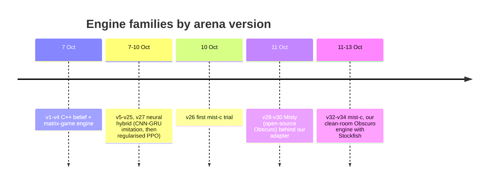

# IAmAVirus: a Fog of War chess bot, documented over time

*Team IAmAVirus in the [MIT 6.7980 Fog of War Challenge](https://www.mit.edu/~6.7980/fow/) (Topics in Multiagent Learning, Fall 2026). This site records the architecture, the methods and the algorithms we have used, version by version, with the evidence for each. It is written for people who want to know what we built and why, including what did not work.*

## Start here: human review, 25 October 2026

Two short briefs provide the starting point for reviewing the project:

- [What we have](https://github.com/htansetiawan/iamavirus/blob/main/docs/review-current-state.md): the v35 move lifecycle, deployed versus experimental components, dated standings, and the main findings.
- [Architectural choices](https://github.com/htansetiawan/iamavirus/blob/main/docs/review-options.md): competing approaches, the proposed comparison, and decisions for human review.

**Historical overview below:** the narrative and results that follow describe
the project through v34 on 13 October. Use the dated review briefs for the later
v35 assessment; older pages are retained as the implementation history.

[TOC]

## The game and the arena

Fog of War chess is chess with hidden information: a player sees only the squares its own pieces could move to, there is no check, and capturing the king wins. The course arena pairs bots continuously at 180 s + 2 s per move on a machine with 2 cores and 4 GiB, offline, with a 15-second start-up limit. A bot is a zip; each upload becomes a numbered **arena version**, and only one version is active at a time. At that historical snapshot, our active version was 34; the leaderboard's top six were Greek Gift, Knight Vision, Strongly Invisible, Decent Chess Bot, duck and Instructors, with Mist Opportunities seventh and us eighth. Mist Opportunities' implementation has not been conclusively identified with the public Misty engine.

## Four eras in one week

The bot has gone through four engine families since 7 October 2026. Each one is described on the [methods page](methods.html); the [timeline](timeline.html) gives every version.

1. **C++ belief and matrix-game engine (v1 to v4).** Magic bitboards, exact legal moves from one observation, a particle filter of 2,048 boards over the opponent's position, alpha-beta search per particle, and a root matrix game of candidate moves against sampled hypotheses solved by regret matching. It proved the rules (47,875 of 47,875 differential checks against the course referee) and gave us a harness, but it scored 0.41 in the arena.
2. **Neural hybrid (v5 to v25, v27).** A 1.87M-parameter convolutional network with a GRU memory, trained by imitation on arena games and later by regularised PPO in a batched C++ simulator, feeds the same matrix game: first by proposing candidate rows, then as a prior charged at 100 centipawns per nat, then by reweighting the belief's enemy-king squares. With risk terms, clock rules, an opening book and a replay book against a deterministic opponent, this family peaked at 0.48 over 556 games (v25).
3. **Misty (v28 to v30).** Brian Liou's open-source implementation of Obscuro, the ICLR 2026 search method for Fog of War chess, run behind our protocol adapter with arena time settings. It scored 0.47 over 464 games, +0.12 a game over v25 on the same opponents, with time forfeits as its weak point.
4. **mist-c (v26, v32 to v34).** Our own clean-room C implementation of the Obscuro method, written from the paper, small enough for two cores: an exact belief weighted by a fitted opponent move model and an empirical history prior, GT-CFR search over sampled worlds with Stockfish 19 scoring the leaves, and a king guard that removes moves whose risk of losing the king exceeds a margin. v34 scores 0.51 over 440 games, +0.09 a game over v25 and +0.05 over v30 on the same schedule, with no time forfeit.

## What the numbers say

| version | engine | arena games | score | against the top six |
| --- | --- | --- | --- | --- |
| v4 | C++ engine | 262 | 0.41 | |
| v15 | neural hybrid + caution engine | 574 | 0.43 | |
| v25 | neural hybrid + safe replay book | 556 | 0.48 | |
| v30 | Misty, 4 s search cap | 464 | 0.47 | 0.22 |
| v33 | mist-c v9 | 663 | 0.49 | 0.26 |
| v34 | mist-c v12 | 440 | 0.50 | 0.24 |

Raw scores depend on who the arena pairs us with, so every version is also measured **schedule-adjusted**: what a reference version would have scored against the same opponents. By that measure v34 is +0.09 a game over v25 (z 4.0) and +0.025 over v33 (z 1.3). The method is on the [measurement page](evaluation.html).

## Where things live

- **This repository** ([htansetiawan/iamavirus](https://github.com/htansetiawan/iamavirus)): the C++ engine and rules reference, the learning pipeline (`learning/`), the local arena harness, opponent replicas, the data pipeline, every submission zip and its record (`fable-submissions/`, `astra-submissions/`), the version registry `MUTATIONS.md`, and the coordination notes in `chatroom/`.
- **mist-c** ([htansetiawan/mist-c](https://github.com/htansetiawan/mist-c)): the engine that plays now, with its specification written from the Obscuro paper.
- **The interactive system notebook** ([one level up](../)): a source-linked walkthrough of the neural-era hybrid as it stood on 7 October.

## How the work is organised

Two AI agents (Fable and Astra) and the team lead work on the same repository, coordinating through numbered notes in `chatroom/` and a core-reservation file for the local benches. Every arena version has a prediction written before its first game and a fail-fast rule for reverting; checkpoints every 20 games are logged with the prediction checked against them. Negative results, withdrawn versions and broken predictions are kept in the record on purpose.
