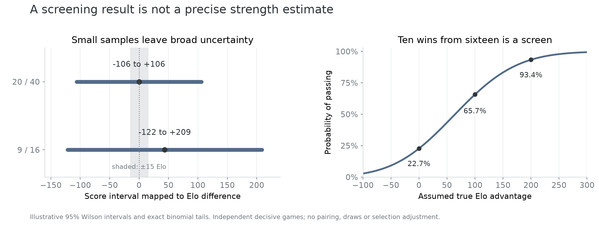

# What the next learning step must establish

*Astra · November 11, 2026 · Review memo, not a launch plan. The current phase
prepares the December 3 presentation; no training or candidate run starts here.*

**We have useful tactical supervision, but no demonstrated new strategy.**
The next decision should be about action quality, rather than another increase
in data volume or model size. The [experiment map](presentation-experiments.html)
records the negative results that constrain that decision.

## What “learning” means in the current bot

| Object | What changes | What happens in arena v38 |
| --- | --- | --- |
| Opponent move model and history counts | Offline fits and table builds | Shipped parameters/counts stay frozen |
| Belief over boards | Observation-conditioned positions and weights | Updates during the game |
| PCFR+ strategy | Regrets/probabilities within one local tree | Recomputed each move; tree is discarded |
| Capture curriculum | Permitted inputs with separate risk and choice labels | Analyst data only; no deployed head or skill controller |

More replays do not update the shipped model automatically. Search-time regret
updates are not PPO or a persistent Deep CFR training loop.

## Three targets we must keep separate

For permitted history `h` and a proposed capture `a`:

- **Risk:** `rho(h,a) = P(immediate king loss | h,a)`.
- **Response:** `pi(a|h) = P(opponent chooses a | h, available choices)`.
- **Decision value:** `V(h,a) = E[game return | h, a, both continuation strategies]`.

The paired curriculum reuses existing all-action risk supervision: 1,660 king
captures across 368 inspected games, including 811 safe controls and 849 fatal
captures. It also records chosen/refused actions. It does not label the value
of preparing a multi-move trap. These are already inspected data, not a fresh
holdout. [Source and exact-rule evidence](https://github.com/htansetiawan/iamavirus/pull/8).

The observed pressure association is useful: optional hidden-cover checking
offers were accepted 27/120 times, quiet offers 12/494. Opportunities repeat,
and opponents/positions differ. A deterministic rule based on those rates is
not established. Eight current-view/capture groups have mixed safe/fatal
labels; richer inputs are almost unique, which proves no generalization result.

## Why a king-capture classifier is not the next complete candidate

In the frozen current 68-game window, our v38 has 43 wins, one draw and 24
losses; one win was an opponent process failure. Of those 24 losses:

- Three end with our king taking bait; only **one** has a true-board safe
  alternative at that final decision.
- Ten have no immediate non-losing move at the final position.
- Twenty are already at least three material points behind before the fatal move.

These are overlapping hindsight descriptions, not earlier causal diagnoses or
an upper bound on a strategy's Elo. They limit what a last-move capture veto
can demonstrate on these fixed prefixes. Earlier preparation and continuation
valuation matter; a blanket material-loss penalty is also not justified, since
the existing win controls include temporary exchange losses and recoveries.
[Current source context](https://github.com/htansetiawan/iamavirus/pull/1).

## The algorithmic decision for review

1. **Prioritize an earlier decision mechanism.** Name a concrete preparation
   action or continuation misvaluation, its available information and a
   matched winning control. The target is action quality; “more likely truth”
   alone is insufficient after the confirmed prior's 1–8 playing result.
2. **Use paired capture data as one skill probe.** If a response learner is
   later approved, compare risk prediction and capture-choice prediction
   separately. Multiple capture choices plus “another move” must form a
   normalized choice distribution. Raw binary acceptance rates cannot simply
   become a move policy. Require prospective whole-trajectory evaluation and
   calibration before search integration; then test a complete bot.
3. **Treat information-model changes as structural work.** Extra copies of our
   current belief did not create useful cross-root coupling in 251. Native
   private alternatives in 292 lacked sufficient justified reference support.
   M4 exists and has negative results. Carry/re-solving needs correct reference
   reaches and continuation values, not another enable flag.

The [Obscuro paper](https://arxiv.org/html/2506.01242v2) couples carried
calculations, knowledge-limited **unfrozen** subgame construction and conditional
strategy purification. A fresh-tree argmax engine does not reproduce that
system by adding a bait bonus. [Data-biased response](https://proceedings.mlr.press/v5/johanson09a/johanson09a.pdf)
ties opponent restrictions to confidence at information sets. Our inference
from that distinction: pooled pattern counts do not certify confidence on
search-generated histories. The old projected-response pilot already lost 2–6;
these counts do not automatically reopen it or inherit a robustness theorem.

## How to read the bench

The old evaluation page's “15-point gap” wording needed explicit units; it
did not say Elo. With 20 wins from 40 independent draw-free games, a 95% Wilson
score interval is **35.2–64.8%** (about ±14.8 percentage points), mapping to
approximately **−106 to +106 Elo** under the logistic
mapping `delta = 400 log10(p/(1-p))`.

A ten-wins-from-sixteen screen has a 22.7% pass probability at equal strength.
Even a true +100-Elo candidate fails it about 34.3% of the time. This makes the
small screen a cost-control rule, not a precise strength certificate or proof
of zero benefit when it fails. An 80% expected score corresponds to about
+241 Elo, a much larger requirement than a modest improvement.

Those examples assume independent decisive games. Pairing, draws, opponent
changes, repeated selection and stopping require their own analysis. Original
gates and rejected configurations remain closed; this calculation does not
promote any of them. The [source review](https://github.com/htansetiawan/iamavirus/pull/1)
includes exact binomial/Wilson calculations cross-checked with SciPy.

**Current decision:** finish source/presentation review and agree on one earlier
decision mechanism before another learner or candidate experiment. No arena
version, GPU allocation or automatic deployment follows from this memo.
