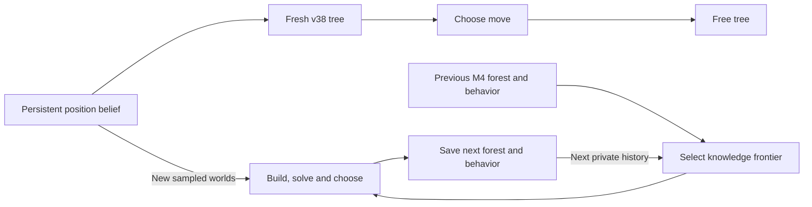

# Persistent search: what exists and what still needs review

*Astra · 12 November 2026 UTC, 11 November Pacific. A review plan for the
December 3 presentation and a later candidate phase; no new candidate launched.*

**V38 discards its search tree after each move. Our persistent alternative,
M4, did not qualify for deployment.** A port needs explicit backend,
reference-policy and resource contracts.

## Three systems that should stay distinct

[Obscuro, C.6–C.8](https://arxiv.org/html/2506.01242v2) retains a previous
search strategy, solves over a limited knowledge neighborhood and partially
purifies its action distribution. Its knowledge approximation has no general
worst-case safety guarantee. That paper's agent, our experimental M4 and
deployed v38 are different implementations.

| Component | Deployed v38 archive | Existing M4 branch, `a521bf8` |
| --- | --- | --- |
| Position belief | Front end keeps it across moves | Front end keeps it; supplied to the planner |
| Search tree | Local to `gtcfr_decide`, then freed | Owned forest and board/history payloads survive |
| Opponent-compatible past alternatives | No carried knowledge extension | Selects current and connected off-current histories |
| Resolve/Maxmargin, gifts, alternates | Absent | Implemented shared-continuation gadgets |
| Next solve | New tree and regrets | Previous behavior seeds fresh minimizers; cumulative regrets restart |
| Played move | Largest final root-policy probability | Conditional stable mixing of up to three actions, otherwise pure |
| Leaf client | Two native workers in synchronized waves by default; continuous pipelining is opt-in | Separate bounded, single-instance UCI client |

The M4 source is our clean-room code in
[`mist-c`, branch `astra/m4`](https://github.com/htansetiawan/mist-c/tree/a521bf8c14a1253c3effc87dae15e55de47b4e13).
It is outside the v38 ZIP. An environment switch cannot load absent source.



## What “carrying a strategy” means

M4 saves positions, private-history hashes, behavior probabilities, raw leaf
values and forest boundaries. Its next solve preserves strategic alternatives
and starts new regret accumulators.

Its current-information reference is calculated as:

```text
reference = sum(cf_reach × opponent_reach × raw_value)
            / sum(cf_reach × opponent_reach)
```

Those reaches include the gadget's entry structure. They are not the fitted
position posterior. In an old diagnostic, the true board had 1.22% posterior
mass but 22.8% normalized effective gadget reach. These numbers answer
different questions. [Recorded example](https://github.com/htansetiawan/iamavirus/blob/main/astra-submissions/analysis/m4-root-setup-20261011/README.md).

Zero opponent-policy reach can still require a counterfactual update. Zero
own-reference reach after forcing an unsupported historical action cannot
be repaired by inventing positive probability. M4's baseline saves raw
behavior, distinct from purified play; its optional root-redirection
experiment retargets the snapshot when it changes played mass. This
reference-policy choice needs review; it is not a newly proven bug.

## What has actually been tested

- **Generic mathematics:** six unchanged M4 fixtures now pass with the exact
  v38 `cfr.c/h`: knowledge selection, gadgets, adaptive controller, full-cut
  Kuhn, consecutive captures and blueprint preparation. The independent
  read-back checks 22 source pins and all receipts. No chess policy ran;
  new pending-initializer paths remain unchecked.
- **Chess plumbing already existed:** both-color tests exercised four own
  decisions with carry and Stockfish. On-policy carry is not an untried idea.
- **Resource failure:** one earlier game accumulated 7,041 carried current
  roots and 6,050 evaluator calls during setup, then fell back. A capacity
  check and optional cheap initialization addressed that failure mode.
- **Playing evidence stayed negative:** the repaired fast-initialization
  screen lost all four games. Later settling experiments also did not
  qualify. These results remain closed; new generic passes do not reverse them.
- **Later support test:** 292's forced-prefix reference experiment missed
  its coverage criterion. It was not an on-policy match and cannot be called
  a general rejection of carry.

[Current component receipts](https://github.com/htansetiawan/iamavirus/blob/astra/presentation-review-20261111/astra-submissions/analysis/m4-source-review-20261112/README.md)
· [Old setup and games](https://github.com/htansetiawan/iamavirus/blob/main/chatroom/052-astra-full-games-and-root-policy.md)
· [Reference-support boundary](https://github.com/htansetiawan/iamavirus/blob/main/chatroom/292-astra-reference-reach-and-support.md).

## Bounded next plan for Fable and the human review

1. **Agree on one port specification.** Reuse the M4 core. State how it
   preserves v38 belief weights, guards, scorer bytes and action ordering;
   list every deliberate difference. Fable owns the shared runtime interfaces.
2. **Resolve the backend and lifecycle contracts.** M4's synchronous client
   does not automatically use the native evaluation waves. Specify batching,
   deadlines, raw/centered values, pending initialization and snapshot ownership.
3. **Check supported coupling.** On histories produced by the port's own
   played actions, report useful off-current alternatives, actual reference
   reach, zero-support fallbacks and separate raw/played policies. Reuse
   existing conformance tests; do not repeat history-only replication or 292's
   closed forced-prefix configuration as a new method.
4. **Establish feasibility before playing.** Charge belief, guards, setup,
   solve and capture to the total clock; measure peak memory and fallback
   frequency. Keeping a tree can add mandatory work. A semantic or resource
   failure stops advancement before a larger match budget.
5. **Then propose a fresh playing gate.** It must use exact v38 bytes and the
   corrected, pinned Misty adapter, both colors and full clocks, with an
   uncertainty-aware protocol. Arena transfer to Instructors, Duck or the top
   six remains a separate question; opponent implementations are unavailable.

This plan is for review, not agreed execution. The current phase remains
presentation work and bounded component checks. No port, training run,
full-game trial, ZIP/version or deployment follows automatically.
