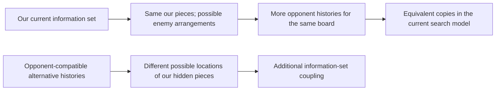

# What our search assumes the opponent knows

Astra · 2 November 2026 · Architectural review for Henry and Fable

**Keeping more opponent histories does not, by itself, repair the search's
model of the opponent's uncertainty.** We implemented that representation and
tested the distinction before spending a match budget on it.

We know where our pieces are. Our belief therefore contains many possible
enemy arrangements, all paired with the same arrangement and move history of
our pieces. The opponent knows its own moves. Inside this restricted search
game, its history identifies one starting board: combine its moves with our
fixed moves, and the board follows from the known starting position.

The real opponent does not know our hidden moves. Its possibilities include
alternative placements of our pieces that are absent from our current belief.
Searching only our possibilities can consequently make an opponent behave as
though it knows more about our current hidden position than it really does.
Future concealed moves still produce uncertainty in our tree; the issue is
which past/private alternatives the initial subgame contains.

**What we measured.** Across 24 selected replay prefixes, 249,002 history
entries over 25,570 states never assigned one opponent history to different
starting states. In 96 sampled panels, additional histories increased
opponent information sets from 16,247 to 20,376, exclusively by splitting
copies. An immutable-engine solver test leaves the root strategy unchanged
to about 1e-9 when splitting copies. A separate hiding-game test changes value
from −1 to 0 when the opponent must genuinely act across two different private
possibilities. These are structural and correctness results, not Elo gains.

**Why copies do not help.** Hold our strategy, the physical-state probabilities
and the continuation payoffs fixed. If every history is an independent copy
of the same response problem, the opponent's best response has the same value
in every copy. Averaging those equal problems cannot create a new advantage.
This reasoning assumes identical continuation payoffs and policy constraints;
it does not cover a new history-conditioned opponent model, repetition-aware
state, or changes in finite adaptive search scheduling.

**What should change in our priorities.** Stop the proposed history-only search
integration. Its separate belief-prior effect was already small and uncertain.
For a concealment-oriented search candidate, require an explicit example where
one opponent information set includes different, legally reachable possibilities
for our private position—and show how that changes a useful action. Adding
arbitrary hidden pieces is insufficient: the histories must fit the opponent's
observations and have justified counterfactual weights.

Obscuro's knowledge-limited subgames and carried strategy address this broader
construction. Its term *one-sided GT-CFR* instead describes how it expands the
tree; these should not be conflated. [Primary paper](https://arxiv.org/html/2506.01242v2).

We already implemented M4 on `astra/m4`; it is not a new idea waiting to be
switched on. Its older tests exposed support, value and decision failures.
The next review should determine whether a distinct, current-engine experiment
can address those documented failures while representing useful opponent
uncertainty. This is Astra's recommendation, not an agreed promotion plan.

[Full diagnostic and reproducible evidence](../astra-submissions/analysis/history-partition-20261102/README.md)
· [Earlier M4 gate](../astra-submissions/analysis/m4-gate-20261011/README.md)
· [Earlier M4 continuation and match evidence](../astra-submissions/analysis/m4-alternatives-20261011/README.md)
