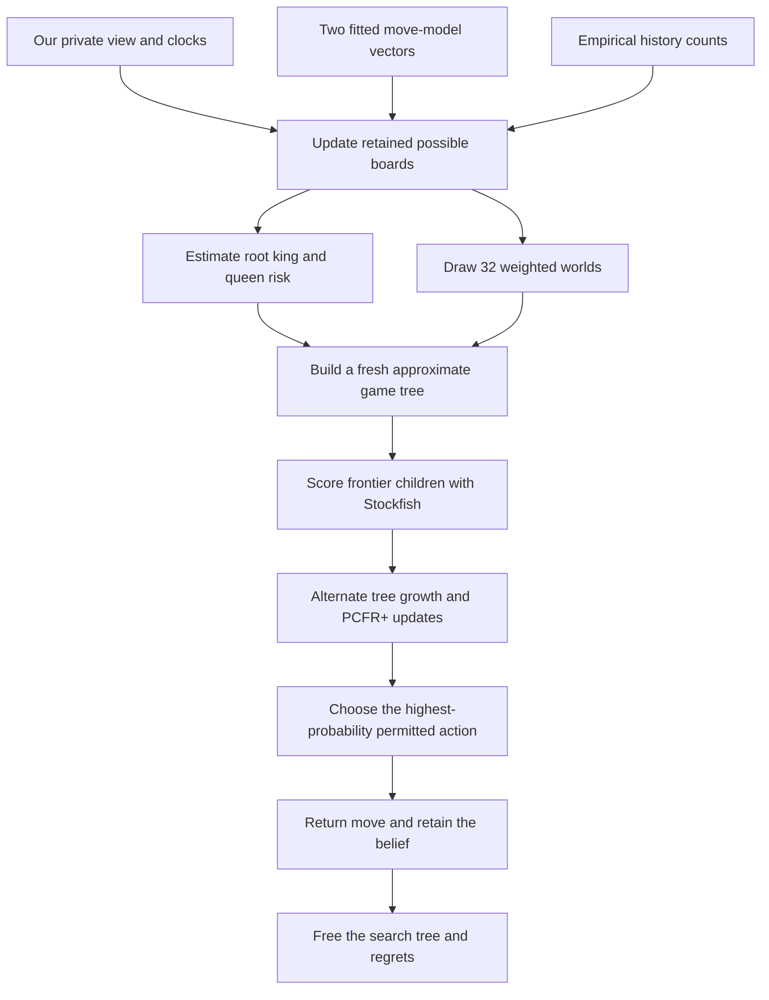

# December 3: understand and explain IAmAVirus

*Human review brief. Audited November 11, 2026 UTC. This is the current
presentation preparation entry point. The older workshop draft and v35
specification remain historical documents.*

Our immediate objective is to explain the system accurately: its decision
process, data structures, connection to the course, experimental findings
and limits. Henry has made this more important than producing v39. No new
candidate experiment or training run is part of this review phase.

The current materials are in the
[source review](https://github.com/htansetiawan/iamavirus/pull/1).
Website publishing remains disabled, so the live site retains its earlier
snapshot.

Read next: [speaking outline](presentation-rehearsal.html) ·
[one real decision](presentation-move.html) ·
[tables and algorithms](presentation-tables.html) ·
[experiments and lessons](presentation-experiments.html) ·
[next learning decision](learning-review-20261111.html) ·
[two illustrated game walkthroughs](presentation-cases.html).

[TOC]

## The central question

**How can a chess bot choose a move when it does not know which board it is
playing on, or what its opponent knows?**

Our answer is a weighted set of possible boards, a small sampled game tree,
counterfactual regret minimization, and a conventional chess evaluator at the
frontier. This is an approximation to an imperfect-information decision
problem. It is not a solved full-game equilibrium.

## What actually plays

The reviewed arena-v38 package is
[`iamavirus-v38-mist-c-allchildren.zip`](https://github.com/htansetiawan/iamavirus/blob/main/astra-submissions/iamavirus-v38-mist-c-allchildren.zip),
SHA-256 `ba6610f299c1589118ae335f3c46fbff802bf158456db9260ac911dce0d4f69f`.
The arena/archive association is recorded from the human upload and shared
registry. The public arena API does not independently expose this ZIP hash.

It contains our C search engine, an offline fitted opponent move model,
one empirical history lookup file and a modified Stockfish 19 evaluator.
Our earlier CNN–GRU/PPO policy is **not** deployed in v38. Stockfish itself
uses pretrained NNUE; “no deployed FoW policy network” does not mean “no
neural computation.”

The [read-only archive audit](https://github.com/htansetiawan/iamavirus/blob/main/astra-submissions/analysis/presentation-audit-20261111/inventory.json)
checks the manifest member hashes and counts the shipped model/table.
The moving `mist-c` checkout and experimental branches are different objects.

## The lifetime of one move

1. **Observe.** The bot receives its own 64-square view. `?` means hidden.
   Completed-replay truth is available to our analysts, never to the arena bot.
2. **Infer.** Expand retained boards through possible opponent moves, keep
   compatible observations and merge duplicate positions. Weight the hidden
   moves using the fitted model and, where available, empirical history counts.
3. **Bound the work.** The retained belief has a configured cap of 200,000.
   Clock-dependent thinning can reduce it further. Neither this cap nor the
   retained board count is the search-tree node count.
4. **Screen and sample.** Root guards estimate king/queen danger over a larger
   retained population. Search normally draws 32 worlds by weight, with
   replacement. Repeated draws merge. When at most 32 worlds remain, use all.
5. **Imagine continuations.** Build a shared tree whose decisions are grouped
   by the acting player's represented information history. Grow promising
   branches and ask Stockfish to score complete hypothetical boards.
6. **Minimize regret.** Within this decision, compare each action's value with
   the current strategy's value. PCFR+ changes action probabilities at each
   information set. The detailed equations and an example are on the next page.
7. **Act.** Execute the highest-probability root action allowed by the front
   end and guards. Sampling can vary the result, but this is not direct sampling
   from the computed root mixed strategy.
8. **Carry some state.** Keep the belief and front-end history. Discard the
   tree and regret arrays. Offline training/table rebuilding requires a later
   package; arena games do not update the shipped weights or history file.

The course referee ends a game when a move leaves the mover's own king
capturable. Giving an attack on the other king does not itself end the game;
the opponent can escape on its turn. This distinction matters when explaining
the terminal rules and the difference from ordinary chess check legality.

## What is implemented, missing, or experimental

| Component | Status in v38 | Main qualification |
| --- | --- | --- |
| Rules, observations, weighted board inference | Deployed | Finite retained set; duplicate boards keep a representative opponent history |
| PCFR+ and growing-tree search | Deployed | Solves our approximate local game, with approximate frontier utilities |
| Stockfish depth-1 child scoring | Deployed | Sees the whole hypothetical board; v38 uses an approximate faster scoring modification |
| Empirical history and fitted move prior | Deployed | Frozen offline; not an online opponent-learning loop |
| King/queen guards | Deployed | Relative thresholds under model weights; no guarantee of true safety |
| Cross-turn search/blueprint reuse | Absent | Experimental M4 implementation exists; its tested configurations failed |
| Full 2-KLUSS plus Resolve/Maxmargin construction | Absent | Parts implemented in M4, not a qualified deployed reproduction |
| Learned FoW policy/value replacing Stockfish | Absent | Historical hybrid and later teacher/student experiments exist |
| Direct conditional mixed-action rule from Obscuro | Absent | Restricted mixture tested and rejected; current final selector is argmax |

Our engine implements important ingredients of Obscuro, but omits coupled
parts of its subgame construction. Matching the solver name does not establish
equivalent information modelling or strength.
[Zhang and Sandholm's paper](https://arxiv.org/html/2506.01242v2),
[current source comparison](https://github.com/htansetiawan/iamavirus/blob/main/chatroom/358-astra-current-obscuro-gaps.md).

## What we can defend as findings

The faster v38 child scorer measured about 1.6× scoring throughput and roughly
38% more equal-time search nodes. A local comparison against v37 scored
11W–1D–4L. Its Misty gate failed; Henry separately authorized an arena trial.
The first 300 arena games passed a predeclared operational retention rule.
These are distinct findings, not a controlled estimate of arena Elo gain.
[Release evidence](https://github.com/htansetiawan/iamavirus/blob/main/astra-submissions/v38-release.md).

Fable's later **620-game** reading records 339W–27D–254L, a **56.9%** raw
score with no technical losses. After the first 127 games, v38 scored
approximately at v37's historical level against the same opponents. This
supports retaining the candidate, but does not establish a lasting strength
gain. The comparison is observational, with changing opponent versions and
scheduling rather than randomized assignment.
[Arena follow-up](https://github.com/htansetiawan/iamavirus/blob/main/fable-submissions/analysis/v38-arena-20261108/result.md).

The latest learned prior improved independent replay posterior scores but
then lost **1–8** to v38 at 180+2. All 901 game frames passed independent
rules validation, with no technical faults. This is a useful scientific
result: better average inference is not sufficient evidence of better play.
The [experiment map](presentation-experiments.html) explains the chain.

## Limits we should be ready to explain

- **Support:** capping can remove the real board. Search sampling can omit a
  retained danger. These are different failures.
- **Weighting:** keeping the real board does not mean assigning useful action
  risks. One observed low-probability event alone does not prove miscalibration.
- **Information:** history keys describe distinctions inside the constructed
  tree. They cannot create missing opponent-compatible possibilities outside it.
  The [two-history example](presentation-knowledge.html) shows this even when
  our own current board is uniquely determined.
- **Continuation:** Stockfish supplies ordinary-chess guidance on each complete
  world. It does not directly value ignorance, information leakage or bluffing.
- **Guarantees:** last-iterate finite search, guards, pruning and argmax action
  selection do not establish a Nash guarantee for full FoW chess.
- **Measurement:** changing opponents, versions, color balance and scheduling
  affect raw arena scores. Selected losses explain failures, not their rate.
- **Data lineage:** raw replays, completed training exports and the frozen
  submitted models advance separately. The [data-flow review](presentation-tables.html#how-the-arena-record-reaches-the-bot)
  records the historical export gap, its [November 11 recovery](data-refresh-20261111.html),
  and the [prepared source fixes](data-refresh-20261111.html#source-fixes-prepared-after-this-snapshot).
  Those options have not changed a production generation or submitted model;
  they are not measured Elo causes.

## Preparation checkpoints through December 3

| Dates | Human-review deliverable |
| --- | --- |
| November 11–16 | Trace one move end to end; review table counts and deployed/experimental status; explain weighted sampling and regret without code |
| November 17–23 | Annotate one arena win and one loss; review three central experiment stories and their limitations; agree on the talk's claims |
| November 24–29 | Assemble the presentation narrative and technical appendix; practice questions on common knowledge, sampling, Stockfish and learning |
| November 30–December 2 | Rehearse to the confirmed time limit; freeze numbers, versions and citations; verify figures against their evidence |
| December 3 | Present the verified system, findings and open questions |

This is a review plan, not an authorization for unattended experiments. Each
working review should record what became clearer, corrected claims and the
next questions. The talk duration and required deliverables await confirmation.
The [course schedule](https://www.mit.edu/~6.7980/) includes a December 3
project-presentation session; Henry supplied our presentation target date.
