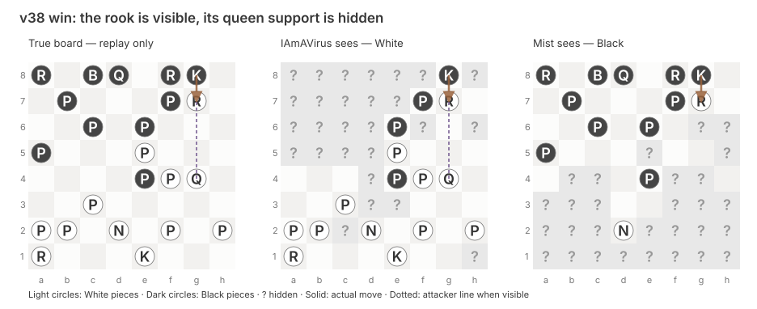
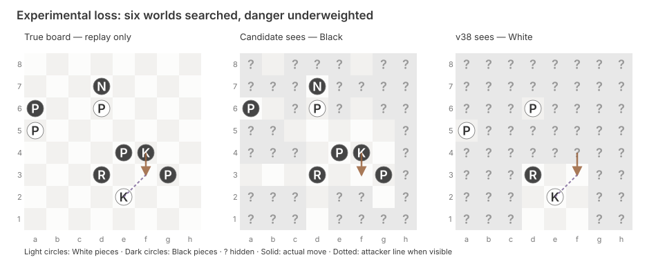

# Two games: visibility, probability and decisions

*Annotated examples for the [December 3 review](presentation-20261203.html).
The first is deployed arena v38. The second is the rejected experimental
prior candidate. They are selected teaching fixtures, not a representative
comparison of their strength. No new bot execution was used to make this page.*

[TOC]

## A real v38 win: visible rook, hidden queen

In arena game
[`c8ozqj0m`](https://www.mit.edu/~6.7980/fow/?tab=arena&game=c8ozqj0m),
IAmAVirus v38 plays White against Mist Opportunities v2. White places its
queen on g4, then moves its rook from g5 to g7. Mist sees the rook next to
its king, but its recorded view still hides the queen.

<figure style="margin:1.5rem 0;overflow-x:auto">

<figcaption>The square contents are the recorded position and private views after ply 33. Solid arrows annotate the actual next move retrospectively; they were not information sent to either bot. Dotted attacker lines appear only where the attacker is visible. Coordinates remain a1–h8 for both colors.</figcaption>
</figure>

| Step | What happened | What we can conclude |
| --- | --- | --- |
| White Qd1–g4, ply 31 | The queen moves onto the g-file | Its later support matters on the true board |
| Black Qb6–d8, ply 32 | Mist makes its intervening move | We do not know its internal reasoning |
| White Rg5–g7, ply 33 | The rook visibly attacks the king on g8; the queen supports g7 from g4 | The resulting position contains a hidden-support bait |
| Black Kg8×g7, ply 34 | Mist takes the rook and puts its own king on the queen's line | The referee ends the game: king capturable |

The true-board immediate surviving reply was **Kh8**. This is a retrospective
rules label. It does not mean Mist could identify Kh8 as safe from its private
information, or that White had forced a win against every possible strategy.
White finishes four material points behind, illustrating why FoW terminal
safety can dominate material.

This is a **composable pattern**: visible bait + hidden support + a king
capture onto the support line. It can occur against different players with
different pieces. The replay establishes the pattern occurred; without
internal search traces it does not prove that v38 explicitly recognized and
planned a bluff.
[Existing two-game rules audit](https://github.com/htansetiawan/iamavirus/blob/main/astra-submissions/analysis/v38-mist-positive-20261111/result.json).

## An experimental loss: searching every retained world was insufficient

In local game `mass-p2-black`, the rejected compact-prior candidate plays
Black against exact deployed-v38 bytes at 180+2. Before Black's 58th decision,
its king is on f4 and the actual White king is on e2. Black sees f3 as empty
but cannot see e2. It chooses **Kf4–f3**, stepping next to the hidden king.
The referee ends the game immediately.

<figure style="margin:1.5rem 0;overflow-x:auto">

<figcaption>Recorded position and views at ply 115, before the fatal Black move. The solid arrow is a postgame annotation. Seeing an empty destination does not establish its safety against a hidden attacker.</figcaption>
</figure>

Black was nine material points ahead. The independent true-board audit finds
many immediate surviving alternatives. This makes a useful illustration,
but the one example does not establish their probability of winning under
Black's information or diagnose the whole match.

### Read the actual engine log

```text
n=58 |P|=6(capped) samples=6 moves=24 infosets=1528 nodes=53020
iters=6490 p=1.00 v=+0.999 lead=+9 clock=26.0
sf=437672/237.7s hist=30/963365 move=f4f3
```

The original line also contains `mr=-1.00/-1.00`, the disabled optional
material-guard diagnostic. The shortened formatting above preserves the
reported values and omits the `mist:` prefix.

| Log field | Meaning here | Common mistaken reading |
| --- | --- | --- |
| `n=58` | Our 58th move decision in this game | Number of imagined boards |
| `P=6(capped)` | Six retained worlds; the overflow flag records earlier capping | Six worlds were just reduced from 200,000 at this turn |
| `samples=6` | All six retained worlds enter search | Thirty-two distinct worlds were searched |
| `moves=24` | Root actions available to this search | Twenty-four game moves have been played |
| `infosets=1528` | Information sets across the constructed tree, for both players | Fifteen hundred full current boards |
| `nodes=53020` | Nodes in this decision's continuation tree | Fifty-three thousand root worlds |
| `iters=6490` | Alternating PCFR+ iteration calls for this decision | Training epochs across old arena games |
| `p=1.00` | Rounded last-iterate probability assigned to the selected action | A 100% chance of winning |
| `v=+0.999` | Estimated local-game heuristic utility | A calibrated 99.9% win forecast |
| `lead=+9` | Front-end material estimate | A guaranteed winning position |
| `clock=26.0` | Reported remaining clock at this decision | A 26-second search allocation |
| `sf=437672/237.7s` | Cumulative Stockfish call/timing counters | This move performed 437,672 Stockfish calls |
| `hist=30/963365` | Cumulative empirical-history hits/lookups | Number of rows in the shipped history table |

### What the later diagnosis reveals

The fixed-history reconstruction includes the true board among its six
worlds, but assigns the fatal action only **0.0262% sharpened king risk**.
Its larger unsharpened guard estimate is about **0.896%**. These are computed
afterward using the unchanged prior on the recorded private history. All
reconstructed/live population counts match; live weight fingerprints were
not recorded, so the reconstructed weights are not certified live snapshots.

An illustrative calculation shows why the local value can remain near +1:
if a fatal branch has mass 0.000262 and utility −2, while the other branches
have utility +1, their expected value is about **+0.99921**. This is arithmetic
illustrating the scale, not a reconstruction of every continuation value in
the actual tree.

Increasing the 32-world sample size cannot add more than the six worlds
already retained on this turn. Better weighting, information modelling and
continuation values are different questions. The full match also contained
earlier material failures; this selected king loss is not their sole cause.
[Actual game audit](https://github.com/htansetiawan/iamavirus/blob/main/astra-submissions/analysis/compact-mass-playing-20261111/independent-audit.json)
· [Reconstructed weighting audit](https://github.com/htansetiawan/iamavirus/blob/main/astra-submissions/analysis/onpolicy-prior-diagnosis-20261111/independent-audit.json).

## How to explain the two examples in the talk

The win shows a hidden-support pattern that raw material evaluation misses.
The loss shows that retaining and searching the true possibility does not
ensure a good decision under the model's weighting. Neither licenses claiming
that every rare event should have received probability one. Calibration is
an aggregate property, and selected examples explain mechanisms rather than
estimate frequencies.

For each figure, first show only the actor's view and ask what can be known.
Then reveal the full board. Identify which inference comes from legal move
rules, which number comes from a model, and which conclusion is available
only after seeing the replay.

The illustration generator reads only the already-audited replay fixtures.
It launches no search or model, and exports the two selected snapshots rather
than a raw game corpus.
[Generator](https://github.com/htansetiawan/iamavirus/blob/main/astra-submissions/tools/illustrate_presentation_cases.py)
· [Source hashes and exact log](https://github.com/htansetiawan/iamavirus/blob/main/astra-submissions/analysis/presentation-audit-20261111/case-illustrations.json).
