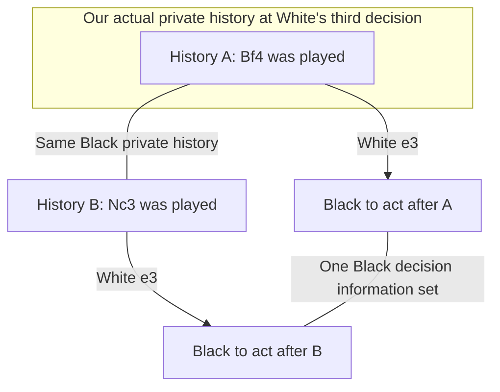

# One known board is not common knowledge

*A constructed teaching example, checked November 11 UTC against the course
referee and our independent C++ rules. It is not a new agent or a claim
about the opponent's actual internal beliefs.*

[TOC]

## Two legal histories Black cannot distinguish from its views

Start with the [real-decision example](presentation-move.html), then change
just White's second move:

| History | White 1 | Black 1 | White 2 | Black 2 | White 3 |
| --- | --- | --- | --- | --- | --- |
| A: recorded arena prefix | d4 | c6 | Bf4 | d5 | e3 |
| B: constructed alternative | d4 | c6 | Nc3 | d5 | e3 |

Both histories are legal and continuing. Every Black observation is identical
at **all six recorded positions**, including the initial board. Black's own
actions are also identical. At the final position it is Black's turn; the
two boards have the same **28 legal Black actions**.

The complete Black protocol prefixes can be identical too: we hold Black's
clock messages equal and use the same initialization. This checks the
information fields our implementation uses; it does not model timing side
channels. White distinguishes the histories immediately from its own moves
and pieces.

## Where the hidden difference lives

After White's third move, the two complete boards differ at four squares:

| Square | History A | History B | Black's view in both |
| --- | --- | --- | --- |
| b1 | White knight | Empty | Hidden |
| c1 | Empty | White bishop | Hidden |
| c3 | Empty | White knight | Hidden |
| f4 | White bishop | Empty | Hidden |

This is not a hidden-piece arrangement invented without a legal past. Both
come from complete move sequences starting at the standard initial board.
The alternative is a teaching counterfactual, not another recorded arena game.

At the preceding White decision, the actual White information history admits
only history A. Exhaustively enumerating histories through that short prefix
gives **1 → 1 → 14 → 1 → 1**. This extends the earlier position-count check:
there is also only one complete compatible move history here.

Nevertheless, Black's observation/action history admits at least A and B.
**White knowing the board does not make White's hidden move public.**

## The knowledge edge and the game-tree edge are different

The vertical arrows are real possible moves. The horizontal edges express
indistinguishability. [Lecture 7](https://www.mit.edu/~6.7980/efg_intro.html)
uses information sets to constrain a player to one action distribution at
indistinguishable decision histories.

Obscuro defines a knowledge graph using such edges, including private
information at nonacting nodes. Its order-two set reaches one edge beyond
our own information set. The paper's 2-KLUSS optimizes a limited extension
and carries a previous strategy; it does not enumerate the full closure or
guarantee safety in every game. These knowledge steps are different from
looking two chess plies ahead.
[Paper, B.2 and C.6](https://arxiv.org/html/2506.01242v2).

## What our deployed search represents

V38 starts from worlds in **our** retained belief. In this prefix, that is
history A's board. The Nc3 alternative contradicts our known earlier move,
so it is absent from those starting worlds. More iterations or deeper future
expansion cannot retroactively change that earlier move.

The tree does represent uncertainty about **future** hidden actions when
its history keys group the resulting nodes. The missing distinction is
opponent-compatible alternatives to our **past** private actions. Describing
the engine as universally omniscient would also be inaccurate.

Correct regret arithmetic solves the response problem encoded in the tree;
it does not supply an omitted history. The deployed root construction lacks
the paper's coupled knowledge-limited re-solving machinery. Existing M4 and
ancestry experiments attempted parts of this and did not qualify a deployed
replacement. See the [architectural review](https://github.com/htansetiawan/iamavirus/blob/main/docs/opponent-uncertainty-20261102.md)
and [experiment map](presentation-experiments.html).

## Why “just add board B” is not yet an implementation

Observational compatibility supplies **membership**, not probability.
For example, if a known fixed White policy never chooses Nc3 there, history
B can have zero policy reach even though its moves are legal. An opponent
can also infer information from knowing a policy. We have not estimated the
actual opponent's probabilities for A or B.

A useful search extension therefore needs justified strategy reach and
continuation values, appropriate information-set coupling and a consistent
re-solving construction. This example provides none of those quantities.
It also does not establish a better move, bluff, exploitability gap or Elo
gain. The prior negative M4/ancestry gates remain closed.

## What was checked

Both five-ply histories have 12 total positions. Course Python and the pinned
C++ library agree on every board, both views, side to move, castling,
en-passant state, halfmove count and complete legal-action set. All moves
are legal and neither history terminates. The actual prefix matches its
saved replay; only history B is constructed. Black view/action transcripts
and the equal-clock protocol strings match exactly.

Local evidence: `astra-submissions/analysis/presentation-knowledge-20261111/`.
No bot search, model fitting, new match, GPU use, candidate, package, commit,
push or deployment accompanies this illustration.
