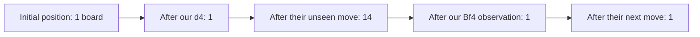
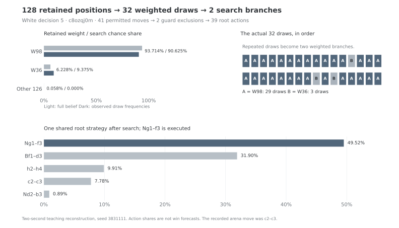

# One v38 decision, end to end

*A source-checked teaching reconstruction, November 11 UTC. This uses a
recorded private history with a new, two-second search. It is not the
arena's original internal trace or a playing-strength experiment.*

[TOC]

## Start with what White received

We use White's third decision in arena game `c8ozqj0m`, already selected
for the [hidden-support walkthrough](presentation-cases.html). The earlier
own moves are fixed to **d4 and Bf4**. The bot receives its recorded White
views after each ply and the recorded clocks. It receives no opponent moves
or true boards. We use replay truth only in the later verification.

The control has exactly v38's 19 C/header source files, Stockfish binary
and history table. A separate annotated copy prints state without changing
the algorithm. Logging still costs time; this cannot reproduce the arena's
tree, seed or exact strategy.

## 1. Infer boards from the whole private history



The bishop move changes our observation. Among the 14 retained possibilities,
only one matches the newly received view: Black played c7–c6. The pawn on
**c6 remains hidden**, but c7 becomes visibly empty. Its location is inferred
from the history and movement rules, rather than directly observed.

On the next opponent turn, d5 changes from visibly empty to hidden. Given
the retained preceding position and the full new view, only **d7–d5** fits.
An independent enumeration with the course referee reproduces every count:
**1 → 1 → 14 → 1 → 1**. No capping, thinning or belief rebuild occurs here.

One retained world does not establish common knowledge. For example, White's
bishop on f4 is still hidden in Black's recorded view. Our board certainty
does not imply that Black knows the board or White's private observations.

| Square at this decision | Recorded White view | White's retained complete world | Recorded Black view |
| --- | --- | --- | --- |
| c6 | Hidden | Black pawn | Black pawn |
| d5 | Hidden | Black pawn | Black pawn |
| f4 | White bishop | White bishop | Hidden |

The middle column is inferred state. It is not an extra observation sent
by the referee.

### What did the fourteen probabilities look like?

A separate inference-only probe checks the earlier stage, **before Bf4**.
Of 20 generated Black moves, 14 match our received view. The history key has
152,835 recorded action occurrences. The model contributes four pseudocounts:
`q(move) = (count(move) + 4 × p_model(move)) / (152835 + 4)`.
Filtering removes incompatible moves, and the default power of two makes
each surviving weight proportional to `q(move)²`.

| Compatible move | Small-model probability | History-blended probability before filtering | Retained weight |
| --- | ---: | ---: | ---: |
| Nf6 | 12.5825% | 15.9805% | 37.9538% |
| Nc6 | 12.5825% | 13.6160% | 27.5530% |
| c6 | 5.2105% | 10.8671% | 17.5510% |
| e6 | 5.2105% | 10.5374% | 16.5020% |
| Other ten surviving possibilities | — | — | 0.4401% |

Stored log weights are relative and centered on their largest value. A
stored zero therefore means relative weight one; normalization across all
fourteen worlds produces the percentages above.

History counts distinguish moves that this feature model ties. On this
heavily observed key, the four model pseudocounts contribute only 0.002617%
of the blend; that is not a coverage estimate for other turns. The actual
c6 move has 17.5510% weight before Bf4 and is resolved by its later
observation. A realized event does not need probability one in advance.

The sampler returns all 14 with these weights. This probe runs no search;
the third-decision reconstruction below still has only one world. Full
source/count/arithmetic evidence is local under
`astra-submissions/analysis/presentation-belief-weights-20261111/`.

## 2. Screen moves and choose search worlds

| Object | Actual count in this reconstruction | What it means |
| --- | ---: | --- |
| Retained current worlds | 1 | The consistent position after filtering |
| Search worlds | 1, with chance weight 1 | All retained worlds are used when there are at most 32 |
| Available root moves | 32 | Candidate actions, a different object from worlds |
| Guard exclusions | 0 | Every root action has zero measured combined king/queen risk here |

The 200,000-board setting is a **cap**, not a required population size.
This particular decision does not exercise weighted sampling with replacement;
the [sampling explanation](presentation-tables.html#what-do-32-weighted-samples-mean)
covers that larger-population case, and the [later real prefix](#7-a-later-decision-128-positions-and-32-draws)
below measures it. The history lookup has two hits in two
lookups by this point, but the final unique world has normalized weight 1.
That does not demonstrate useful probability calibration on uncertain boards.

## 3. Score the initial frontier

Stockfish sees the complete hypothetical parent board. One request scores
all 32 root actions here; all return matched scores. These become initial
child utilities using `tanh(cp / 400)` with White as our side:

| Move | Initial Stockfish score | Initial child utility |
| --- | ---: | ---: |
| Nf3 | +15 cp | +0.037482 |
| Nd2 | +12 cp | +0.029991 |
| e3 | −6 cp | −0.014999 |

No missing-score fallback or worst-sibling floor is used in these 32 initial
children. These are the values **before** the outer FoW tree grows. A move's
final probability need not follow this initial ranking.

## 4. Measure regret against the current mixture

The first root strategy assigns each of 32 moves **1/32 = 3.125%**. Its
mean utility is **−0.142644**. In this initial one-world tree, the first
instantaneous regret is simply each child's utility minus that mean:

```text
Nf3: +0.037482 − (−0.142644) = +0.180126
e3:  −0.014999 − (−0.142644) = +0.127645
```

Both are better than that initial mixture, even though e3's own score is
negative. “Regret” compares alternatives inside the current search; it does
not mean regret over a previous arena loss.

CFR+ adds the instantaneous regret to accumulated regret and clips at zero.
The predictive variant also uses the previous instantaneous regret as its
prediction. The next strategy is proportional to `max(R + previous, 0)`.
In the second iteration, Nf3 receives **6.1323%**, and e3 **4.3456%**.
Both updates were independently recomputed from all 32 recorded values.

Tree expansion and regret updates then continue. These later strategies
use the growing continuation tree; they are not repeated calculations on
the unchanged initial Stockfish table.

## 5. Act on the final strategy

The annotated search finishes with 136,824 tree nodes, 1,653 information
sets and 1,360 PCFR+ iteration calls. These are continuation-search counts,
not counts of current hidden boards or offline training epochs.

| Root move | Final last-iterate probability |
| --- | ---: |
| e3 | 53.15% |
| Nd2 | 18.01% |
| Nf3 | 15.81% |
| Qd3 | 8.36% |
| c3 | 3.94% |
| Other moves combined | 0.74% |

V38 executes the **largest-probability action, e3**. It does not draw an
action from this mixed strategy. The probability is a share of the computed
strategy, not a 53.15% chance to win. The estimated utility is **+0.060422**,
also not a calibrated win forecast.

For e3, the final accumulated regret is about 1.852173 and the previous
instantaneous regret is +0.001368. Normalizing the positive `R + previous`
values across all actions reproduces 53.1496%. The same formula is used at
the other information sets in the constructed tree.

The unannotated control also chooses e3 in this pair of runs, as did the
recorded arena game. That agreement is descriptive; one fixed prefix does
not establish policy equivalence or that e3 is optimal. The selected game
was already used in the presentation and is not an independent test set.

## 6. Carry the belief; discard the search

After returning the move, the bot retains its belief and front-end history.
It frees this tree and its regret arrays. Neither the fitted coefficients,
the empirical history file nor Stockfish's neural weights are trained by
this decision. The next turn builds a fresh FoW search tree.

The source annotations, raw logs, independent referee enumeration and all
32-action arithmetic checks are recorded locally in
`astra-submissions/analysis/presentation-real-decision-20261111/`.
The immutable v38 ZIP and deployed arena bot are unchanged. No new candidate,
game, GPU training, commit, push or website deployment accompanies this page.

## 7. A later decision: 128 positions and 32 draws

The same recorded game supplies a larger example at **White's fifth
decision**, after the fixed own moves d4, Bf4, e3 and Nd2. Selection used
population size before any new action was searched: the first White turn
from ply 6 onward with 33–4,096 retained positions. It chose **ply 8**.

The unweighted course enumeration reproduces the native position counts:
**1 → 1 → 14 → 1 → 1 → 1 → 14 → 14 → 128**. Received views can resolve
uncertainty and later unseen moves can expand it again. No capping,
clock-thinning or rebuild occurs in this prefix.



### Thirty-two draws can produce two distinct search worlds

The native sampler builds cumulative weights, draws a random threshold,
and binary-searches its position in that array. It repeats this 32 times
with replacement, then merges repeated indices. The cumulative pass costs
O(N), followed by K binary searches costing O(K log N), plus a small sort
of the K indices. Here N = 128 and K = 32.

| Retained position | Normalized belief weight | Times drawn | Search chance weight |
| --- | ---: | ---: | ---: |
| W98 | 93.7145% | 29 | 29/32 = 90.625% |
| W36 | 6.2280% | 3 | 3/32 = 9.375% |
| Other 126 positions combined | 0.0575% | 0 | 0% |

An independent implementation of the native random-number generator and
inverse-CDF selection reproduces **all 32 indices**, including their order.
The search uses the observed frequencies as chance weights. They approximate
the retained weights and need not equal them exactly in one sample.
Sampling leaves the full 128-position belief available for later observations;
it chooses which worlds enter this search. The retained-population cap is a
separate operation.

Replay truth, joined afterward using the complete native position identity,
matches W98. That single outcome does not certify calibration or make its
93.7145% weight a certainty.

### Two worlds feed one root information set

The guards assess all 128 retained positions here. Of **41** permitted moves,
the existing combined king/queen rule removes **Qd1–g4 and Qd1–h5**, leaving
**39** root actions. These action counts are independent of the world count.

The constructed tree has two chance branches, both pointing to decisions
in **the same root information set**. Our current private history is the
same in both worlds. Each root action therefore gets one shared probability;
the solver cannot choose a different root move based on the hidden world.

Stockfish returns all 39 initial child scores in each world, **78** scores
in total. For Ng1–f3, they are +29 cp in W36 and +30 cp in W98. Its initial
sample-weighted utility is:

```text
q(Ng1–f3) = (3/32) × tanh(29/400) + (29/32) × tanh(30/400)
          = +0.074626586
```

The first strategy is uniform across 39 actions. Its mean utility is
**−0.201810801**, so Ng1–f3's first instantaneous regret is:

```text
+0.074626586 − (−0.201810801) = +0.276437387
```

The next shared strategy assigns Ng1–f3 **4.4526%**. All 39 actions' first
two updates reconcile to the sample-weighted values, clipped cumulative
regret and predictive term. Later updates use the growing continuation tree.

### What the reconstructed search executes

| Root action | Final probability |
| --- | ---: |
| Ng1–f3 | 49.5230% |
| Bf1–d3 | 31.8997% |
| h2–h4 | 9.9125% |
| c2–c3 | 7.7780% |
| Nd2–b3 | 0.8868% |

The annotated search has **131,943 nodes**, **1,790 information sets** and
**1,140 PCFR+ iteration calls**. It executes Ng1–f3 by argmax. These are
action shares, not probabilities of winning. The control also chooses
g1f3; the original arena move was **c2c3**. The fixed local seed, shortened
budget and logging make this a teaching reconstruction with a fresh search.

### What counts as one retained position?

The native position key includes piece placement, side to move, castling
rights and en-passant square. In this case, **106 piece arrangements** form
128 such positions. The key omits the halfmove counter and full history.
Keeping distinct halfmove counters gives **155** course-enumerated states;
27 native positions combine two counter alternatives. Each stored native
counter matches a consistent continuation, but it represents only one of
those alternatives. This check covers the native position projection;
it is not a lossless enumeration of game or private histories.

The original probe and two search calls are preserved. The first reviewer
incorrectly assumed every piece arrangement was unique; it stopped at that
association check. The corrected reviewer associates initial child blocks
using the pinned root builder's sample order. It passes without rerunning
either search. Numeric source/output evidence, the earlier page snapshot,
and exportable SVG/PNG are recorded under
`astra-submissions/analysis/presentation-multistate-20261111/`.

No model, arena submission, training run or website deployment changed.
