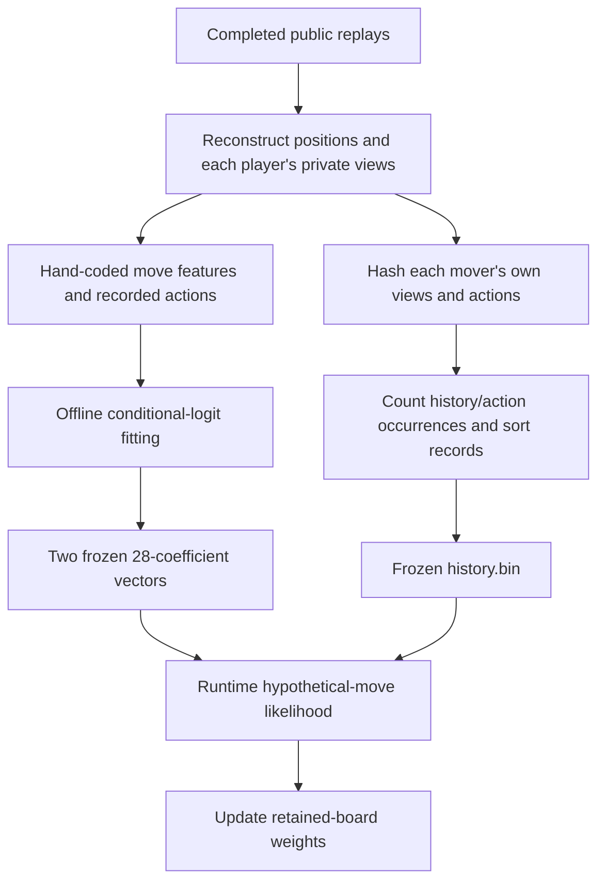
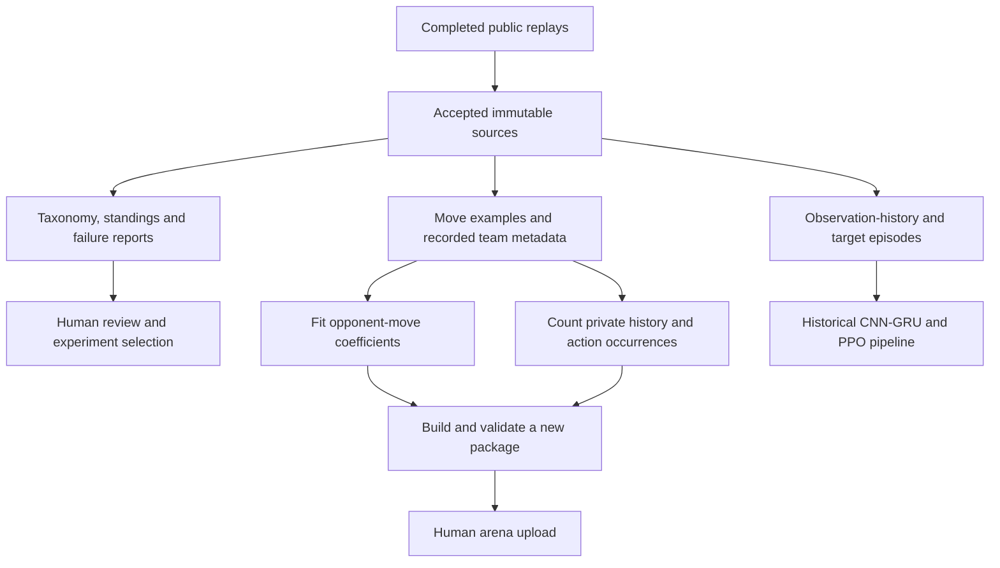

# Inside v38: tables, probabilities and regret

*Companion to the [December 3 review](presentation-20261203.html).
Counts come from the immutable v38 archive audit, November 11 UTC.*

[TOC]

## How many tables do we actually have?

**One shipped empirical history lookup file, two fitted coefficient vectors,
and four persistent-within-a-decision CFR arrays.** The belief, search tree
and indexes are additional runtime structures. They have different keys,
sizes and lifetimes. There is no single giant learned table that contains
the whole strategy.

| Structure | Key and contents | Verified size or configured bound | Lifetime |
| --- | --- | --- | --- |
| Empirical history table, `history.bin` | Opponent history hash + encoded move → observed count | **359,889 rows**, **219,137 distinct 64-bit history keys**, **5,758,240 bytes**; summed recorded counts 2,200,230 | Frozen in package; loaded once per bot process |
| Full move-model vector | 28 move features → logit | **28 coefficients**, 25 nonzero | Frozen in package |
| Cheap move-model vector | Same 28 slots; costly features omitted | **28 coefficients**, 17 nonzero | Frozen in package |
| Belief rows | Complete position + representative opponent history + log weight | Up to **200,000** retained entries by default; can be smaller | Across turns within one game |
| Belief membership index | 64-bit position key → membership | Open-addressing hash table; grows with retained entries | Rebuilt/updated with the belief |
| Search nodes and edges | Chance/player/frontier nodes, action edges and chance probabilities | Variable; configured node limit **1,500,000** | One move |
| Information-set index | Represented history hash with nominal player tag → ID; action count checked on reuse | Open-addressing map; tag qualification below; no full ordered-action signature comparison | One move |
| Four CFR arrays | `(information-set ID, action)` → regret, previous instantaneous regret, allocated generic strategy field, accumulated strategy sum | **Four allocated arrays**; each has one slot per information-set/action pair | One move |
| Expansion visits and frontier records | Action visits; leaf board/history; node → leaf index | Variable with the tree | One move |
| Front-end repetition record | Our piece configurations and visit counts | Capacity **1,024 configurations** | Across turns within one game |
| Fixed move geometry | Square → knight/king attack bitboard | Two arrays of **64** entries | Initialized once; unchanged during play |
| Zobrist hash keys | Piece/square, side, castling-rook square and en-passant square → hash contribution | **897** 64-bit keys | Initialized once; unchanged during play |

The history record is 16 bytes: an 8-byte hash, 4-byte move and 4-byte count.
The file also has a 16-byte header. Distinct hashes are not a count of games
or a collision-free count of full histories. They are the lookup keys actually
stored. Stockfish has its own NNUE parameters, search history and transposition
table; those belong to the external evaluator, outside the four CFR arrays.

One implementation detail matters: the generic `strategy` field is allocated
and resized, but current strategies on the deployed path are calculated into
separate temporary buffers. It is not an additional learned model. Similarly,
the accumulated average is maintained although final action selection uses
the current iterate. Our last-only optimization experiments examined part of
this accounting; they are not deployed in v38.

**Reproducible count:**

```bash
.venv/bin/python astra-submissions/tools/audit_v38_presentation.py
```

[Audit source](https://github.com/htansetiawan/iamavirus/blob/main/astra-submissions/tools/audit_v38_presentation.py)
· [Frozen inventory and source hashes](https://github.com/htansetiawan/iamavirus/blob/main/astra-submissions/analysis/presentation-audit-20261111/inventory.json).

## How a hidden move changes the belief

For a hypothetical complete board `s`, the fitted model computes one logit
per possible opponent move:

```text
logit(s, a) = sum over 28 features of coefficient[k] × feature[k](s, a)
p_model(a | s) = exp(logit(s, a)) / sum over legal moves b exp(logit(s, b))
```

The full feature computation is selected for smaller populations, with a
default full-model threshold of 10,000; larger updates use the cheap model.
The feature vectors include captures, piece type, development, retreat,
recapture and, in the full model, attack relationships. The deployed vectors
give zero coefficients to the two explicit unseen-threat feature slots.
Those features and failed attempts to use them are already documented; they
are not a newly discovered untried improvement.

For a history seen enough times, empirical counts blend with the model:

```text
p_blend(a | s, h) = (count(h, a) + 4 × p_model(a | s)) / (N(h) + 4)
```

The default minimum history count is 3. Unseen/insufficient histories fall
back to the fitted model. The lookup first binary-searches the sorted history
hashes, then scans that history's move records. It is not a player-name lookup
or an exact solution lookup.

Of the 219,137 stored history keys, **106,425 meet that default count
threshold**; 112,712 have fewer than three recorded occurrences. The latter
occupy 145,345 of the loaded rows but do not activate the default blend.
These are file-level counts, not a live query-coverage rate. Table size and
useful coverage of the positions we actually face are different quantities.
[Source/count audit](https://github.com/htansetiawan/iamavirus/blob/main/astra-submissions/analysis/presentation-audit-20261111/information-review.json).

For every observation-compatible successor, the native default update adds
`2 × log(p_blend)` to its parent's log weight. This temperature sharpens move
likelihoods. Duplicate positions add their incoming weights; one opponent
history represents the merged board. Consequently, the implementation is
not a lossless distribution over every possible private history, and the
sharpened weights should not be called a guaranteed calibrated posterior.

There are two precise qualifications. The source does not normalize the
squared move probabilities separately for each parent world before applying
the observation filter. Also, taking the square root after summing several
powered histories is not the same as summing their original probabilities.
The guard's inverse-temperature weighting therefore does not exactly restore
the unpowered distribution after history merges. For paths (1/4, 1/4) into
one board and 1/2 into another, it yields about 41.42%/58.58% rather than
50%/50%. This arithmetic qualification is not a measured cause of arena losses
or an authorization to reopen prior failed weighting experiments.

Fable's saved fit receipts record a refit on 148,357 games. The later
[lineage audit](https://github.com/htansetiawan/iamavirus/blob/main/astra-submissions/analysis/presentation-audit-20261111/fit-lineage.json)
matches all 56 deployed coefficients to those outputs and the saved history
binary to the ZIP. It does not reproduce training from the original corpus.

## How the two offline models are built



The history builder computes both players' observations while replaying
completed games. Each key summarizes the **mover's own** views and moves,
not the full true board or our current private view. Team names can filter
which data enters the builder, but player identity is not part of the stored
lookup key. The builder's default skips IAmAVirus. At runtime, each retained
world supplies a hypothesized opponent history for this lookup. Merging
boards can retain only one representative history.

The archive's parent commit contains `tools/history_table.c`, which describes
and implements this count/sort process. The final ZIP freezes the resulting
file, not an automatically refreshed database. New downloaded games affect
the deployed table only after rebuilding and uploading a new package.

The fitted move model has a different input: features calculated from each
**hypothetical complete board** and candidate move. Offline training can use
completed-game truth. Live play has only its hypothetical boards; it never
receives the true current board. This conditional model is a likelihood model
for inference, not automatically an implementable opponent policy that must
choose identically at every indistinguishable private history. Its ability
to predict moves does not establish correct information-set reasoning.

The original training receipts are now located under
[`refit-all-20261101`](https://github.com/htansetiawan/iamavirus/blob/main/fable-submissions/analysis/refit-all-20261101/result.md).
They record 9,901,850 fitted moves and 1,734,620 held-out opponent moves.
The fitter is committed separately at `a1bd043` and its streamed-command
extension at `d262253`; it need not live in the release's `allfit` branch.
The saved JSONs exactly match both deployed vectors, and the saved history
binary exactly matches the packaged file. This closes the earlier uncertainty
about whether an original fit record was retained.

The remaining qualification is narrower: we have not recertified the original
dataset membership/hashes or independently recomputed the reported scores.
The game counts, split seed 7 and 15% holdout are recorded metadata. The
per-mover summaries contain only the top 30 groups and omit 2,418 held-out
opponent moves, so those summaries cannot reconstruct the complete global
score. This limits reproducibility without invalidating the preserved fit.

## How the arena record reaches the bot

**Downloading games, exporting examples and updating the submitted bot are
separate operations.** The arena process reads its packaged coefficients and
history file. A daily report does not change either one.



The taxonomy is analyst intelligence. Some tags use full replay truth or
future events, so they are not automatically available runtime features.
Fitting and table rebuilding are offline operations. The historical neural
pipeline and current native engine consume different products.

| Product | Before the November 11 scheduled refresh | What it means |
| --- | --- | --- |
| Raw journal snapshot | 233,482 unique game IDs | Retained inputs, with duplicates and provenance qualifications |
| Episode generation | November 2; 195,614 games / 391,228 color episodes | Intact old imitation/RL input; 37,868 newer raw games absent |
| Native move export | November 10; 96,210 game IDs / 91,796 complete trajectories | Newer fitting input; its legacy ID split has 328 cross-fold trajectory groups |
| Deployed move vectors and history | Frozen v38 package, original fit recorded November 1 | Downloading or exporting later games does not update this package |

The old export's age has operational evidence. The daily service timed out
at six hours on November 3–5 and 9; November 3/4 reached only partial episode
progress after spending over 3.5 hours in the earlier move exporter. Storage
I/O failures then interrupted other runs. Report ordering and cached move
export were changed on November 9. At that early audit, a successful full
scheduled refresh after storage recovery remained unverified. Successful
reads of old shards did not certify the next run.

The November 11 run subsequently published **234,911 games / 469,822 color
episodes** and completed its incremental archive. Independent shard and archive
checks now pass. The [dated recovery checkpoint](data-refresh-20261111.html)
records that new snapshot and the remaining metadata/holdout limits; the
earlier audit table and service failures above remain historical evidence.

There is also a smaller provenance correction: the original 164-seat tactical
corpus named only the selected seat's opponent. Its importer invented
IAmAVirus for the unnamed seat; **136 games were actually other teams**.
Exact API matches recover dates, real IDs and played versions across all
14,228 positions. A source-bound, opt-in exporter overlay is now available
in [PR 6](https://github.com/htansetiawan/iamavirus/pull/6); its seven metadata
fields are applied only to an explicitly chosen future generation. Raw files
and the published November 11 generation remain unchanged. The
[data checkpoint](data-refresh-20261111.html#source-fixes-prepared-after-this-snapshot)
separates that repair from the future-import fix and stable-fold option.
All selected seats lost, so this corpus is not a representative record of
our play. No measured Elo effect is claimed.

Local evidence: `chatroom/379` (export integrity), `chatroom/381` (provenance)
and `astra-submissions/analysis/dataset-freshness-lineage-20261111/` (saved
failure timeline and orchestration). The [draft review packet](https://github.com/htansetiawan/iamavirus/pull/1)
provides source evidence while website publishing remains disabled.

## Which parts are learned, exact, or heuristic?

| Component | What determines it | What changes during a live game? |
| --- | --- | --- |
| Rules and observations | Explicit game rules and deterministic code | Board state, not learned parameters |
| The 28 feature definitions | Hand-coded design | Feature values on hypothetical boards |
| Full/cheap coefficient vectors | Offline statistical fitting | Neither vector changes |
| Empirical history counts | Offline recorded occurrences | Lookup results change; counts do not |
| Board weights | Observation filtering plus the fixed likelihood model | Belief distribution changes each turn |
| CFR regrets | Counterfactual calculations on the local search tree | Recomputed during this decision, then discarded |
| Stockfish frontier values | Borrowed pretrained NNUE and short search | Evaluated positions and search state change; NNUE weights do not |
| Guard margins and utility mapping | Fixed engineering choices | Calculated risks change; thresholds do not |

Consequently, “our bot learns” needs a qualifier. It performs online belief
updating and search-time regret minimization, and uses offline learned
coefficients. V38 does not train a new neural policy from arena rewards while
it plays.

## What the replay taxonomy changes

The taxonomy is a **retrospective diagnostic**, not another deployed model.
Its 19 core report metrics overlap; they are not 19 mutually exclusive
strategy classes. The daily report displays 11 selected metrics. A move can
receive several tags, so their rates need not sum to 100%.

Reports help us compare habits and select hypotheses. They do not
automatically change belief coefficients, empirical history counts or
king/queen guard thresholds. New replay files must pass a separate fitting,
evaluation and packaging process before they can change the arena bot.

Some labels use the true board, the opponent's private view or subsequent
moves. Those can be training targets or analyst diagnostics; feeding them
directly into a decision-time policy would leak unavailable information.
The existing labeler also misses en-passant captures when the destination
was empty. A tested correction is isolated under Astra; it is not yet
applied to the shared reports. This is a reporting defect, separate from
the engine's move legality.

Local review evidence: `astra-submissions/analysis/taxonomy-understanding-20261111/`
and `astra-submissions/analysis/taxonomy-en-passant-20261111/`. Both are now
included in the [source review](https://github.com/htansetiawan/iamavirus/pull/1).
Website publishing remains disabled; source publication does not update the
live site or the deployed labeler.

The later local refresh labels all **453,622 moves in 6,000 reviewed games**
with both versions. The isolated correction changes 352 en-passant move
records; the 5,655 games without en passant are unchanged apart from the
labeler version. This measures the reporting correction without attributing
a change in game results to it. The separate shared-archive import also
leaves the shipped v38 weights and history file unchanged.
The [experiment review](presentation-experiments.html#case-study-diagnosing-losses-requires-winning-controls)
shows why these labels need winning controls before becoming learning targets.

## What do “32 weighted samples” mean?

Let retained board probabilities be `p[1] ... p[N]`. For `N > 32`, build their
cumulative weights and draw 32 independent random numbers against that
distribution. Binary search finds each selected board. Duplicate draws merge;
their search chance weight is their draw count divided by 32. For `N <= 32`,
include all boards with normalized retained weights.

These are plausible worlds, not the 32 worlds where we are winning most.
A world with probability 10% is ten times as likely to be drawn as one with
1%. A danger of total mass 1% is present in a 32-draw sample with probability
`1 − 0.99^32`, approximately **27.5%**. Thus it is usually absent from search.
The root guards examine more retained worlds, but remain limited by their
weighting, stride and definitions of danger.

The [later real-prefix reconstruction](presentation-move.html#7-a-later-decision-128-positions-and-32-draws)
has 128 retained positions and reproduces every draw. Twenty-nine select W98
and three select W36, producing **two** distinct search branches with chance
weights 29/32 and 3/32. The full retained belief remains available afterward.

Three different numbers must stay separate:

- Retained worlds: at most 200,000 by default, representing current uncertainty.
- Search draws: normally 32 with Stockfish, often fewer distinct root worlds.
- Search nodes: future move continuations, with a configured 1.5-million limit.

## What Stockfish is being asked

At a frontier position, Stockfish sees **both sides' pieces on one imagined
complete board**. It scores candidate children with a short depth-1 search,
which can include tactical continuation work rather than a single static
network call. NNUE supplies conventional chess evaluation within Stockfish.
It does not see our weighted belief as one input.

The shipped Stockfish source uses piece-square, threat and pawn-pair feature
families, a 1,024-element transformed input and small heads selected by piece
count. Its arithmetic already mixes 8-bit, 16-bit and 32-bit integer types.
Those are upstream NNUE parameters, not our own trained FoW policy or a
codebook of strategies. The raw NNUE scalar also goes through Stockfish's
evaluation/UCI scaling before we receive a centipawn score.

The v38 patch changes how full root-child scoring is performed. It increases
throughput but does not promise the same numerical scores as unmodified
Stockfish. An outer FoW tree can still be many plies deep: “Stockfish depth 1”
describes each frontier scoring request, not the depth of our entire tree.

Each request scores moves from a complete **parent** FEN. The controller
matches returned PV first moves to our native FoW children; `bestmove` marks
completion rather than selecting our arena action. An unscored nonterminal
child normally takes our handwritten evaluation. The worst-scored-sibling
floor applies only when the matched score count reaches the requested
MultiPV count, which is 256 by default. It does not apply automatically to
every move Stockfish omits.

The C engine converts a centipawn score to a bounded utility:

```text
value = tanh(centipawns / 400), with sign adjusted to our side
```

For example, +100 gives about +0.245 and +400 about +0.762. These are heuristic
utilities, not calibrated win probabilities. Exact FoW terminal handling
overrides the heuristic, and our own immediately fatal root move has default
utility −2 rather than the ordinary −1 loss value.

## Where regret minimization happens

The [real-decision walkthrough](presentation-move.html) connects these
equations to a recorded private history: the first uniform root mixture,
two numerical regret updates and the final 53.15% argmax action. Its early
belief has only one world; it is a teaching reconstruction, not a strength
or exploitability estimate.

An **information set** groups decision nodes that the represented player
cannot distinguish. The same action probabilities must be used throughout
that group. The solver operates on this constructed local tree, with current
Stockfish frontier values. It does not compare today's result with old arena
games when updating regret.

For an action `a` at information set `I`:

```text
instantaneous regret(I, a)
  = sum over nodes in I of
      chance-and-opponent reach × (value of choosing a − current mixed value)

R_new(I, a) = max(0, R_old(I, a) + instantaneous regret(I, a))

next strategy(I, a) is proportional to
  max(0, R_new(I, a) + latest instantaneous regret(I, a))
```

The last line is the predictive regret-matching+ step. Player updates
alternate. If every positive term is zero, the strategy is uniform. New
information sets initially favor their best scored child. The generic solver
also stores a strategy-sum array, but deployed move choice uses the **current
last iterate**, followed by argmax, rather than the averaged strategy.

For a tiny example with reach 1, suppose A is worth 0.6 and B 0.2. A 50/50
mixture is worth 0.4. Their instantaneous regrets are +0.2 and −0.2, so the
update favors A. In the actual game, these action values depend on the
opponent's strategy and all represented indistinguishable nodes; they are
recomputed as search grows.

Regret minimization is learning **inside one decision calculation**. These
regrets are discarded afterward. It is distinct from fitting model weights
across replay games or training PPO parameters.

## Why information-set keys are not the whole solution

Suppose our hidden rook is on a1, while the opponent's observations would
also allow it to be on h1. Our own current belief correctly fixes our rook
on a1. A search containing only those boards does not automatically contain
the h1 possibility relevant to the opponent. Giving nodes an observation
history hash cannot create that missing possibility. Future hidden actions
inside the tree can share opponent information sets, but that does not restore
all uncertainty about earlier private actions.

Common-knowledge closure follows chains of what each player cannot
distinguish; it can be much larger than our own information set. Obscuro's
knowledge-limited construction addresses this through a bounded construction,
a carried reference strategy and boundary values. This is not equivalent to
adding more copies of the same sampled current boards. Its treatment of fresh
samples also intentionally permits singleton opponent information sets.

Our deployed v38 omits that complete construction. M4 implements experimental
parts, with failed continuation/match evidence. This limits what we can claim
about solving the correct full-game information problem, even if the local
CFR implementation is arithmetically correct.
[Current comparison](https://github.com/htansetiawan/iamavirus/blob/main/chatroom/358-astra-current-obscuro-gaps.md).

There is a narrower implementation assumption too: `infoset_for` hashes the
player and represented history, and checks only the number of actions before
sharing an existing information set. It does not explicitly compare the full
ordered legal-move lists. A mismatching count creates a separate information
set. This observation does not prove that a real incompatible merge occurred;
it defines the check the deployed source actually performs. Describing that
key as a complete action signature would overstate the implementation.

The nominal player tag also deserves a technical qualification. The map
passes `0x5eed0000 + player` into `history_mix`, whose helper uses
`value | 1`. Thus those two tags become identical when the incoming history
hash is identical. Different players normally have different histories, but
the tag itself does not guarantee separation. We have not measured a real
cross-player information-set collision. This is a source-level limit on the
claimed key design, not an established cause of the match losses.

## What the guards guarantee—and what they do not

The main deployed root screen combines king risk with 0.9 times queen-loss
risk. Queen loss uses a default four-pawn net-loss threshold. It compares
candidate moves against the lowest estimated risk under two weightings,
normally with a 0.02 margin. The broader risk calculations stride across at
most 20,000 retained worlds. If the combined dual-weight test excludes
everything, it falls back to the sharpened test.

This can exclude dangerous moves that the 32-world search missed. It cannot
guarantee survival on the real board: that board may be absent, its risk may
be underweighted, the safest estimated move may still be unsafe, or an
unmodelled longer sequence may decide the game.

There is also a draw-modelling limit. The explicit FoW terminal checks in
`gtcfr.c` cover king loss and no-move loss; that builder has no explicit
threefold-repetition or 50-move draw check. Stockfish receives the hypothetical
halfmove counter and can reflect ordinary-chess draw tendencies, while the
front end heuristically discourages repetition when ahead. Neither is a full
history-aware implementation of the referee's draw rules in the outer FoW
tree. This is a source-level limitation, not a measured explanation of a
particular arena loss.

## Questions to practice answering

1. What persists between moves? What persists between games?
2. Why is a complete board insufficient to describe a player's information?
3. Why can better opponent-move prediction fail to improve play?
4. Why does a rare observed loss not by itself prove miscalibration?
5. Why is argmax over a stochastic search different from playing its mixed strategy?
6. What would we need to claim low full-game exploitability? We have not measured it.
