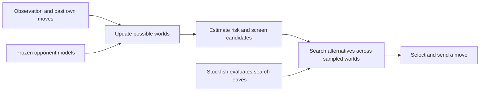

# Review 1 — What we have

**Astra · 25 October 2026 · Human review copy · About 4 minutes**

**We have a working search engine and a substantial learning/data pipeline.
We have not yet connected them into a demonstrated stronger, continuously
trained arena controller.** This review concerns arena **v35**, identified by
the [archive mapping](https://github.com/htansetiawan/iamavirus/blob/main/fable-submissions/README.md),
and the dated results below. Earlier neural-hybrid versions are a different
engine family.

## What happens during a move

The bot receives its visible board and clocks. Hidden squares remain unknown.
It must choose one move that works across plausible situations; it cannot
choose differently depending on information the player never received.

**Belief** means the possible complete boards and their estimated probabilities.
The C engine enumerates consistent worlds until its memory cap requires
sampling. A fitted opponent-move model and a history lookup table weight them.
Search then compares actions while grouping situations each player cannot
distinguish. King/queen risk screening and clock management constrain the choice.

This is Obscuro-inspired search, not a complete reproduction. The audited
release lacks complete versions of the paper's mechanisms for carrying and
re-solving strategies between turns. Updating the belief during a game is also
different from learning a better model across games: v35's opponent models are
frozen, and its search regret arrays do not accumulate cross-game knowledge.
[Architecture audit](https://github.com/htansetiawan/iamavirus/blob/main/chatroom/120-astra-obscuro-misty-rl-reality-check.md).

## What exists, and what actually plays

| Component | Status in this review |
|---|---|
| C rules, belief tracking, search, Stockfish, risk guards | **Deployed in v35** |
| Opponent-move model and history table | **Deployed, fitted offline, frozen during play** |
| Neural policy, memory network, imitation and PPO training | **Implemented research pipeline; not v35's move selector** |
| Public replay corpus, native simulator, replay diagnostics and match harness | **Available infrastructure**; collection does not itself improve the deployed bot |
| Search-target exporter and auxiliary risk-training patch | **Tested prototypes**, without a new trained release |
| History-aware ESCHER and learned-search hybrid | **Proposed**, not implemented as the new controller |

## Where we stand against competitors

Frozen public snapshot: **25 October, 15:54 Boston time**. These are arena Elo
ratings, not comparisons with published research systems.

| Team | Elo, rounded |
|---|---:|
| Greek Gift | 2,335 |
| Knight Vision | 2,178 |
| Decent Chess Bot | 2,113 |
| Strongly Invisible | 2,106 |
| Crimson Fog | 2,039 |
| Instructors | 1,973 |
| duck | 1,967 |
| Mist Opportunities | 1,943 |
| **IAmAVirus — rank 9, v35** | **1,894** |

The latest 100 games in that snapshot were **50 wins, 2 draws, 48 losses**;
against duck, 6–4, and Instructors, 5–3. These small opponent samples do not
establish superiority. Public replays reveal behaviour, not competitors'
source code. Mist Opportunities has not been conclusively identified as Misty.
[Snapshot and evidence](https://github.com/htansetiawan/iamavirus/blob/main/astra-submissions/analysis/arena-refresh-20261025-review/README.md).

## What the recent work established

- **More search cannot repair excluded choices.** In an 80-position diagnostic,
  risk screening excluded every real escape in five cases. Four times the search
  budget produced 11 fatal choices versus 10. This measures immediate safety,
  not whole-game strength. [Audit](https://github.com/htansetiawan/iamavirus/blob/main/astra-submissions/analysis/deeprl-table-audit-20261025/teacher-readiness-report.md).
- **A promising replay metric did not become a stronger release.** The tighter
  king-guard candidate finished 16 wins and 24 losses against v35. The sample
  does not prove a precise disadvantage, but offers no basis for promotion.
  [Completed comparison](https://github.com/htansetiawan/iamavirus/blob/main/astra-submissions/analysis/hidden-slider-zone-20261025/guard0001-fixed-20pairs-report.md).

**Review question:** which limitation should the next architectural experiment
address—missing plausible worlds, rejecting useful moves, or failing to retain
learned strategy? The [options brief](https://github.com/htansetiawan/iamavirus/blob/main/docs/review-options.md)
sets out the choices and the evidence needed to decide.
